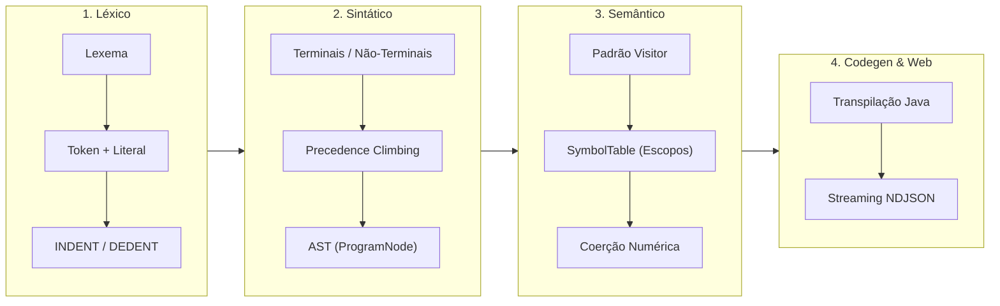

# Glossário Visual e Técnico de Compiladores

  Referência Conceitual · Terminologia do PyToJava
  Léxico · Sintático · Semântico · Geração de Código · Driver

Esta página centraliza os conceitos teóricos e os termos de implementação adotados ao longo do desenvolvimento do **PyToJava**. Utilize as seções abaixo para consultar rapidamente o significado, a categoria e exemplos práticos de cada termo.

---

## Como os Termos se Conectam na Prática?

---

## 1. Termos da Análise Léxica (`src/lexer/`)

| Termo | Categoria | Descrição Didática | Exemplo no PyToJava | Observação Técnica |
| :--- | :--- | :--- | :--- | :--- |
| **Lexema** | Estrutura Léxica | Trecho exato de texto extraído do código-fonte que casa com o padrão de um token. | Em `taxa = 2.5`, os lexemas são `"taxa"`, `"="` e `"2.5"`. | Guardado no atributo `token.lexeme` sempre como `str`. |
| **Literal** | Estrutura Léxica | Valor nativo convertido a partir do lexema, livre de pontuação sintática (sem aspas em strings, já convertido para `int` ou `float` em números). | Em `x = "Olá"`, `lexeme` é `"Olá"` e `literal` é a string `'Olá'`; em `y = 42`, `literal` é `42` (`int`). | Fica `None` para tokens que não carregam valor próprio (palavras reservadas, operadores e delimitadores). |
| **Token** | Estrutura Léxica | Unidade léxica imutável emitida pelo `Scanner`, combinando categoria (`TokenType`), lexema, literal e coordenadas (`line`, `column`). | `Token(type=TokenType.KW_IF, lexeme="if", literal=None, line=2, column=1)` | Linha e coluna são baseadas em `1` (1-based) para exibição direta em mensagens de erro. |
| **INDENT** | Controle de Bloco | Token sintético emitido pelo `IndentManager` quando o recuo à esquerda aumenta em relação à linha lógica anterior. | `if True:` `␣␣␣␣x = 1` Emite `INDENT` antes de `x = 1`. | Substitui a chave de abertura `{` durante a análise do Python. |
| **DEDENT** | Controle de Bloco | Token sintético emitido pelo `IndentManager` quando o recuo diminui, sinalizando o fechamento de um ou mais blocos. | `if True:` `␣␣␣␣x = 1` `y = 2` Emite `DEDENT` antes de `y = 2`. | Sempre pareado com um `INDENT` anterior; no `EOF`, fecha todos os blocos ainda abertos. |
| **Lookahead** | Reconhecimento | Inspecionar o próximo caractere (`CharStream.peek()`) ou o próximo token (`Parser.peek(1)`) sem avançar o cursor de leitura. | Ao ler `=`, o lexer verifica se o próximo caractere também é `=` para decidir entre `OP_ASSIGN` (`=`) e `OP_EQ` (`==`). | Garante a regra do **maior casamento** (*maximal munch*) sem consumir caracteres indevidamente. |

---

## 2. Termos da Análise Sintática e Gramáticas (`src/parser/`)

| Termo | Categoria | Descrição Didática | Exemplo no PyToJava | Observação Técnica |
| :--- | :--- | :--- | :--- | :--- |
| **Símbolo Terminal** | Gramática Formal | Elemento atômico da gramática que corresponde diretamente a um `TokenType` produzido pelo lexer. | Em `1 + 2`, os terminais são `INT_LITERAL` (`1`), `OP_PLUS` (`+`) e `INT_LITERAL` (`2`). | Não pode ser expandido por outras regras; forma as folhas da árvore sintática. |
| **Símbolo Não-Terminal** | Gramática Formal | Variável gramatical abstrata que representa uma construção composta e pode ser expandida em outras produções. | `statement`, `expression`, `comparison`, `block`, `if_stmt`. | Na descida recursiva, cada não-terminal vira um método do `Parser` (ex.: `parse_statement()`). |
| **Regra Gramatical (Produção)** | Gramática Formal | Definição formal (em EBNF ou Bison/Yacc) de como símbolos não-terminais se decompõem em sequências de terminais e não-terminais. | `assignment ::= IDENTIFIER ( "=" \| "+=" \| "-=" ) expression ;` | Uma mesma regra pode possuir várias alternativas separadas por `\|` ("ou"). |
| **Associatividade** | Expressões | Define a ordem de agrupamento quando dois operadores de **mesma precedência** aparecem em sequência. | `10 - 3 - 2` é agrupado à esquerda como `(10 - 3) - 2 = 5`, e não `10 - (3 - 2) = 9`. | No Bison é declarada com `%left`, `%right` ou `%nonassoc`; no `Parser`, é garantida pela condição `op_precedence <= precedence`. |
| **Precedence Climbing** | Algoritmo Sintático | Técnica recursiva que constrói árvores de expressões binárias guiada por uma tabela numérica de pesos (`PRECEDENCE`). | Em `2 + 3 * 4`, como `*` tem peso `30` e `+` tem peso `20`, `3 * 4` é agrupado primeiro na sub-árvore direita. | Evita criar dezenas de chamadas recursivas intermediárias para expressões simples. |
| **AST (Árvore Sintática Abstrata)** | Estrutura de Dados | Representação hierárquica em árvore do programa, mantendo apenas a estrutura semântica e descartando pontuação (`:`, parênteses, `INDENT`/`DEDENT`). | `AssignNode(target="x", op="=", value=IntLiteralNode(value=10))` | Todos os nós herdam `line` e `column` da superclasse `Node`, tendo `ProgramNode` como raiz. |
| **`$$`, `$1`, `$2`...** | Modelo Bison/Yacc | Notação usada em ações semânticas de geradores LR (Bison): `$$` é o valor resultante da regra e `$1`, `$2`... são os valores dos símbolos à direita. | `expr : expr PLUS expr { $$ = $1 + $3; }` | A contagem inclui todos os símbolos do lado direito da produção, inclusive delimitadores. |
| **`yyparse()`** | Modelo Bison/Yacc | Função principal gerada pelo Bison que executa o autômato sintático invocando o lexer (`yylex()`) sob demanda. | `int main(void) { return yyparse(); }` | No PyToJava (implementado em Python puro), o papel equivalente é desempenhado por `Parser.parse()`. |

---

## 3. Termos da Análise Semântica, Geração de Código e Driver (`src/semantic/`, `src/codegen/`, `src/web.py`)

| Termo | Categoria | Descrição Didática | Exemplo no PyToJava | Observação Técnica |
| :--- | :--- | :--- | :--- | :--- |
| **Tabela de Símbolos (`SymbolTable`)** | Análise Semântica | Dicionário encadeado por escopos (`parent`) que registra cada variável declarada (`Symbol`), seu tipo inferido e a posição da 1ª definição. | `scope.define(Symbol(name="x", type="int", line=1))` | Permite busca hierárquica de dentro para fora (`lookup`) e impede que variáveis locais de um bloco vazem para fora dele. |
| **Padrão Visitor** | Arquitetura AST | Padrão de projeto que separa a estrutura dos nós da AST dos algoritmos que operam sobre eles, despachando cada nó para `visit_<TipoDoNo>(node)`. | `SemanticAnalyzer.visit_AssignNode(node)` e `CodeGenerator.visit_IfNode(node)` | Otimizado no PyToJava com a tabela de classe `_VISITOR_DISPATCH` para despacho em $O(1)$. |
| **Coerção / Promoção Numérica** | Sistema de Tipos | Conversão implícita segura de um tipo numérico mais restrito (`int`) para um tipo mais amplo (`float`, emitido como `double` em Java). | `taxa = 2.5` (`float`) seguido de `taxa = 10` (`int`) é válido; `taxa` permanece `float`. | O sentido inverso (`float -> int`) é bloqueado com `SemanticError` para impedir truncamento silencioso. |
| **Transpilação (`CodeGenerator`)** | Geração de Código | Tradução *source-to-source* da AST validada para código-fonte estruturado em outra linguagem de alto nível (Java 17+). | `x = 10` (1ª vez) -> `int x = 10;` `x += 5` (2ª vez) -> `x += 5;` | Controla variáveis já declaradas por escopo (`_scope_stack`) para emitir o tipo Java apenas na primeira atribuição. |
| **NDJSON** | Interface Web | Formato *Newline Delimited JSON* (`application/x-ndjson`) em que cada linha do streaming HTTP representa um evento JSON completo. | `{"stage": "lexer", "status": "done"}` | Permite que a interface web (`src/web.py`) atualize a barra de progresso etapa por etapa em tempo real. |
