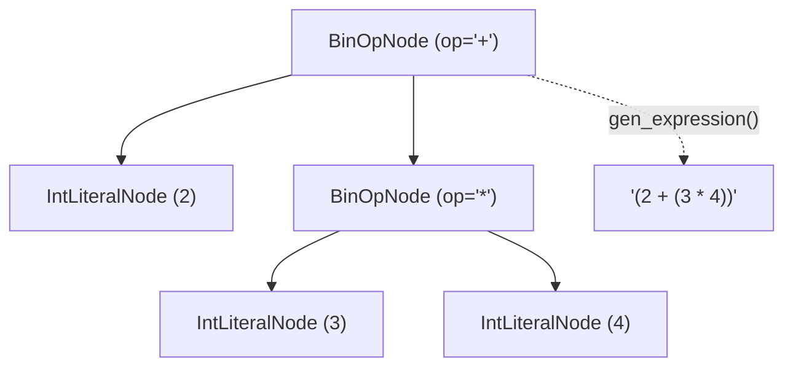

# Geração de Código para Expressões

O método `CodeGenerator.gen_expression(node: Node) -> str`, implementado em `src/codegen/code_generator.py`, é responsável por traduzir os nós de expressão da **Árvore Sintática Abstrata (AST)** para a sintaxe estrita equivalente na linguagem **Java**.

Essa etapa abrange todos os nós folhas de valores primitivos (`IntLiteralNode`, `FloatLiteralNode`, `StringLiteralNode`, `BoolLiteralNode` e `NoneLiteralNode`), referências a variáveis (`IdentifierNode`) e expressões operacionais (`BinOpNode`), preservando de forma determinística a árvore de precedência construída pelo `Parser`.

---

## Tabela de Equivalência de Expressões (Python -> AST -> Java)

A tabela a seguir detalha o mapeamento direto realizado por `gen_expression()`:

| Construção em Python | Nó da AST | Regra de Tradução | Código Java Gerado |
| :--- | :--- | :--- | :--- |
| `42` | `IntLiteralNode(value=42)` | `str(node.value)` | `42` |
| `3.14` | `FloatLiteralNode(value=3.14)` | `str(node.value)` | `3.14` |
| `'PyToJava'` ou `"PyToJava"` | `StringLiteralNode(value="PyToJava")` | Aspas duplas com caracteres de controle escapados | `"PyToJava"` |
| `True` | `BoolLiteralNode(value=True)` | `"true"` (minúsculo em Java) | `true` |
| `False` | `BoolLiteralNode(value=False)` | `"false"` (minúsculo em Java) | `false` |
| `None` | `NoneLiteralNode()` | `"null"` | `null` |
| `contador` | `IdentifierNode(name="contador")` | `node.name` | `contador` |
| `a + b` | `BinOpNode(left=a, op="+", right=b)` | `f"({left} {op} {right})"` | `(a + b)` |
| `-x` *(unário)* | `BinOpNode(left=0, op="-", right=x)` | `f"({left} {op} {right})"` | `(0 - x)` |

---

## Preservação de Precedência e Parênteses em `BinOpNode`

Na AST do **PyToJava**, a precedência e a associatividade dos operadores já foram resolvidas pelo algoritmo de *Precedence Climbing* do `Parser`. Ao emitir cada `BinOpNode` envolto por parênteses `(<left> <op> <right>)`, o gerador garante que o compilador Java avalie as sub-expressões exatamente na mesma ordem semântica da árvore original, independentemente de quão profundamente aninhada seja a expressão.



### Exemplos de Expressões Compostas

| Expressão Original (Python) | Expressão Gerada (Java) |
| :--- | :--- |
| `2 + 3 * 4` | `(2 + (3 * 4))` |
| `(2 + 3) * 4` | `((2 + 3) * 4)` |
| `-x + 5` | `((0 - x) + 5)` |
| `ativo == True` | `(ativo == true)` |
| `(nota1 + nota2) / 2.0 >= 7.0` | `(((nota1 + nota2) / 2.0) >= 7.0)` |

---

## Exemplo de Uso

```python
from src.codegen import CodeGenerator
from src.parser import Parser

gen = CodeGenerator()

# 1. Tradução de expressão aritmética e relacional combinada
ast_expr = Parser("(x + 10) * 2 >= 50").parse_expression()
print(gen.gen_expression(ast_expr))
# Saída: (((x + 10) * 2) >= 50)

# 2. Tradução de literais booleanos e nulo
print(gen.gen_expression(Parser("True").parse_expression()))   # true
print(gen.gen_expression(Parser("False").parse_expression()))  # false
print(gen.gen_expression(Parser("None").parse_expression()))   # null
```

---

## Validação e Testes

```bash
pytest tests/test_codegen_expressions.py -v
mkdocs build --strict
```
