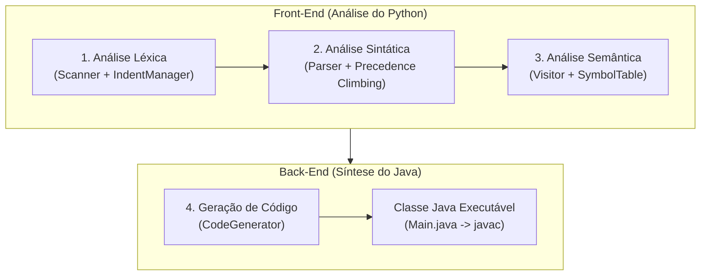

# Conceitos e Arquitetura de Compiladores

<div class="phase-banner">
  <span class="phase-banner-title">Fundamentos Teóricos · Do Código-Fonte ao Código Alvo</span>
  <span class="phase-banner-meta">Python Procedural -> AST -> Java 17+</span>
</div>

## O que é um Compilador?

Um **compilador** é um programa tradutor que lê um código-fonte escrito em uma **linguagem de origem** (como Python) e o converte para uma **linguagem alvo** (como código de máquina, bytecode ou outra linguagem de alto nível estaticamente tipada, processo também conhecido como **transpilação** ou compilação *source-to-source*).

Mais do que traduzir texto, um compilador precisa **compreender a estrutura e o significado** do programa:

1. **Garantir a correção formal**: detectar caracteres ilegais, construções gramaticais malformadas e operações entre tipos incompatíveis antes que o programa seja executado.
2. **Preservar a semântica**: assegurar que o programa gerado na linguagem alvo produza exatamente o mesmo comportamento lógico e matemático do programa original.

No **PyToJava**, traduzimos um subconjunto procedural de **Python** (tipagem dinâmica e blocos delimitados por indentação) para **Java 17+** (tipagem estática explícita e blocos delimitados por chaves `{}`).

---

## Visão Comparativa: Compilador Clássico vs. PyToJava

Todo compilador moderno é dividido em **Front-End** (análise e validação do código de origem) e **Back-End** (síntese e emissão do código alvo):



| Etapa Teórica Clássica | Módulo no PyToJava | Entrada | Saída | Papel Didático no Projeto |
| :--- | :--- | :--- | :--- | :--- |
| **1. Análise Léxica** | `src/lexer/` | Texto bruto (`str`) | Lista de `Token` | Agrupa caracteres em palavras-chave, identificadores, literais e operadores; transforma recuos em tokens sintéticos `INDENT` e `DEDENT`. |
| **2. Análise Sintática** | `src/parser/` | `list[Token]` | `ProgramNode` (AST) | Valida a gramática livre de contexto e organiza a precedência de operadores em uma árvore hierárquica (AST). |
| **3. Análise Semântica** | `src/semantic/` | `ProgramNode` (AST) | `SymbolTable` + AST validada | Registra variáveis por escopo, infere tipos estáticos (`int`, `float`, `String`, `boolean`, `None`) e barra operações ilegais. |
| **4. Geração de Código** | `src/codegen/` | `ProgramNode` (AST) | Código Java (`str`) | Emite `public class Main`, converte tipos (`float -> double`, `None -> Object`) e declara variáveis automaticamente na 1ª atribuição. |
| **5. Orquestração (Driver)** | `src/cli.py` / `src/web.py` | Arquivo `.py` | Arquivo `Main.java` | Conecta as 4 fases na CLI e transmite eventos NDJSON em tempo real na Interface Web Local. |

---

## Como Cada Fase Resolve um Problema Diferente?

Para entender por que um compilador é dividido em fases independentes, observe como cada etapa trata um tipo específico de regra sobre a instrução `media = (nota1 + nota2) / 2.0`:

=== "Fase 1 · O Olhar Léxico (Palavras)"

    O **Analisador Léxico** (`Scanner`) não sabe o que é uma atribuição nem se `nota1` existe. Ele apenas responde: *"Todas as palavras e símbolos deste texto existem no vocabulário da linguagem?"*

    - Reconhece `media`, `nota1` e `nota2` como `IDENTIFIER`.
    - Reconhece `=` como `OP_ASSIGN`, `+` como `OP_PLUS`, `/` como `OP_DIV` e `(` `)` como delimitadores.
    - Reconhece `2.0` como `FLOAT_LITERAL` com valor numérico `2.0`.
    - **Se encontrar `@` ou `$`**: interrompe imediatamente com `LexicalError`.

=== "Fase 2 · O Olhar Sintático (Gramática)"

    O **Analisador Sintático** (`Parser`) recebe a fila de tokens e responde: *"A ordem desses tokens forma uma frase gramaticalmente válida?"*

    - Verifica que à esquerda do `=` há um identificador válido (`media`).
    - Verifica que os parênteses `(` e `)` estão balanceados.
    - Aplica *Precedence Climbing* para garantir que `nota1 + nota2` seja somado **antes** da divisão por `2.0`.
    - **Se faltar um `)` ou houver `10 + * 2`**: interrompe imediatamente com `ParserError`.

=== "Fase 3 · O Olhar Semântico (Significado e Tipos)"

    O **Analisador Semântico** (`SemanticAnalyzer`) percorre a árvore gerada pelo Parser e responde: *"Essa instrução faz sentido lógico e respeita as regras de tipos e escopos?"*

    - Consulta a `SymbolTable` para confirmar se `nota1` e `nota2` já foram declaradas em algum escopo visível.
    - Verifica se os tipos de `nota1` e `nota2` podem ser somados e divididos por `2.0` (inferindo o resultado como `float`).
    - Registra `media` na tabela de símbolos com o tipo `float` (ou valida compatibilidade caso `media` já exista).
    - **Se `nota1` não existir ou for um texto somado com número (`10 + "abc"`)**: interrompe com `SemanticError`.

=== "Fase 4 · O Olhar do Gerador (Tradução para Java)"

    O **Gerador de Código** (`CodeGenerator`) recebe a árvore já aprovada e responde: *"Como expressar essa mesma lógica nas regras estritas do Java?"*

    - Como é a primeira atribuição a `media` no escopo, traduz o tipo semântico `float` para o tipo Java `double`.
    - Emite a declaração completa e parentizada com ponto e vírgula final:
      ```java
      double media = ((nota1 + nota2) / 2.0);
      ```

---

## Principais Desafios da Tradução Python -> Java

!!! tip "Por que transpilar Python para Java é um excelente estudo de compiladores?"
    Embora ambas sejam linguagens imperativas nos trechos procedurais, Python e Java adotam decisões opostas em três aspectos críticos que o **PyToJava** resolve automaticamente:

1. **Delimitadores de Bloco (`INDENT`/`DEDENT` vs. `{}`)**:
   - Em Python, o agrupamento de instruções dentro de um `if` ou `while` é determinado visualmente pelo número de espaços à esquerda.
   - O `IndentManager` do léxico converte variações de recuo em tokens sintéticos `INDENT` e `DEDENT`, que o `Parser` transforma em listas de nós na AST e o `CodeGenerator` emite como blocos `{ ... }` recuados em 4 espaços.
2. **Tipagem Dinâmica Implícita vs. Declaração Estática Explícita**:
   - Em Python, `x = 10` cria a variável sem declarar tipo, e `x = 20` usa a mesma sintaxe.
   - Em Java, a primeira ocorrência exige o tipo (`int x = 10;`), mas as seguintes não podem repeti-lo (`x = 20;`). O `CodeGenerator` mantém uma pilha de conjuntos de variáveis declaradas por escopo (`_scope_stack`) em sincronia com o `SemanticAnalyzer`.
3. **Condições Booleanas Estritas**:
   - Em Python, `if 10:` é aceito por *truthiness* implícita.
   - Em Java, `if (10)` é um erro de compilação no `javac`. O `SemanticAnalyzer` exige que toda condição de `if`, `elif` e `while` tenha tipo estritamente `boolean`.
