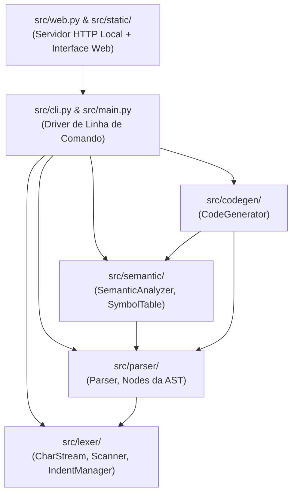

# Estrutura e Arquitetura do Projeto

<div class="phase-banner">
  <span class="phase-banner-title">Organização Modular · Código, Documentação e Testes</span>
  <span class="phase-banner-meta">Arquitetura desacoplada em 4 fases + 2 interfaces (CLI e Web)</span>
</div>

Esta página apresenta a organização física e arquitetural do repositório **PyToJava**. O projeto foi desenhado para manter cada fase do compilador **isolada em seu próprio pacote Python**, comunicando-se exclusivamente por estruturas de dados bem definidas (`Token`, `Node`/AST e `SymbolTable`).

---

## Diagrama de Dependências entre Pacotes



---

## Visão Rápida dos Diretórios Principais

<div class="grid-cards">

  <div class="card-fases">
    <div>
      <div class="card-header">
        <div class="card-icon">SRC</div>
        <span class="badge badge-green">Núcleo</span>
      </div>
      <h3>Código-Fonte (<code>src/</code>)</h3>
      <p>
        Implementação das 4 fases do compilador (<code>lexer</code>, <code>parser</code>, <code>semantic</code>, <code>codegen</code>), driver CLI (<code>cli.py</code>) e servidor web local (<code>web.py</code> + <code>static/</code>).
      </p>
    </div>
  </div>

  <div class="card-fases">
    <div>
      <div class="card-header">
        <div class="card-icon">TST</div>
        <span class="badge badge-purple">Qualidade</span>
      </div>
      <h3>Suíte de Testes (<code>tests/</code>)</h3>
      <p>
        23 suítes automatizadas com mais de 690 casos de teste cobrindo caminhos felizes, casos de borda, integração HTTP e validação real com <code>javac</code>.
      </p>
    </div>
  </div>

  <div class="card-fases">
    <div>
      <div class="card-header">
        <div class="card-icon">DOC</div>
        <span class="badge badge-purple">MkDocs</span>
      </div>
      <h3>Documentação (<code>docs/</code>)</h3>
      <p>
        Especificações léxicas, gramática EBNF, diagramas da AST, regras semânticas, tabelas de tradução Java, glossário e manuais de uso.
      </p>
    </div>
  </div>

  <div class="card-fases">
    <div>
      <div class="card-header">
        <div class="card-icon">EXM</div>
        <span class="badge badge-green">Homologação</span>
      </div>
      <h3>Exemplos (<code>examples/</code>)</h3>
      <p>
        Scripts Python procedurais prontos para testar na CLI ou carregar com um clique na Interface Web Local.
      </p>
    </div>
  </div>

</div>

---

## Árvore Completa do Repositório

```text
pytojava/
├── docs/                                # Documentação formal e especificações (MkDocs)
│   ├── arch/
│   │   └── scanner.md                   # Arquitetura do Scanner léxico
│   ├── codegen/
│   │   ├── architecture.md              # Arquitetura do Gerador de Código
│   │   ├── control_flow.md              # Tradução de if/elif/else e while
│   │   └── expressions.md               # Tradução de literais e expressões
│   ├── parser/
│   │   ├── ast.md                       # Nós da Árvore Sintática Abstrata (AST)
│   │   ├── errors.md                    # Erros sintáticos e casos de borda
│   │   ├── grammar.md                   # Gramática formal e precedência
│   │   └── index.md                     # Visão geral e API do Parser
│   ├── semantic/
│   │   ├── analyzer.md                  # Analisador Semântico e padrão Visitor
│   │   ├── symbol_table.md              # Tabela de Símbolos e escopos
│   │   └── types.md                     # Regras de tipos e compatibilidade
│   ├── specs/
│   │   └── lexico.md                    # Especificação léxica e tabela de tokens
│   ├── stylesheets/
│   │   └── extra.css                    # Identidade visual customizada do MkDocs
│   ├── compiladores.md                  # Conceitos gerais de compiladores
│   ├── estrutura.md                     # Estrutura de diretórios do projeto
│   ├── GLOSSARY.md                      # Glossário de termos técnicos
│   ├── index.md                         # Página inicial da documentação
│   └── usage.md                         # Guia de uso da CLI, API e Interface Web
├── examples/                            # Scripts Python procedurais de exemplo (.py)
│   ├── basic_math.py                    # Operações aritméticas e atribuições
│   ├── calculator.py                    # Calculadora procedural com controle de fluxo
│   ├── control_flow.py                  # Laços while e condicionais aninhadas
│   ├── factorial.py                     # Cálculo iterativo de fatorial
│   ├── hello.py                         # Manipulação de strings e booleanos
│   └── teste_interface.py               # Script de demonstração para a interface web
├── output/                              # Diretório padrão para arquivos .java gerados
├── src/                                 # Código-fonte do compilador PyToJava
│   ├── __init__.py
│   ├── cli.py                           # Driver e CLI do pipeline completo
│   ├── main.py                          # Ponto de entrada principal (delega para cli.py)
│   ├── web.py                           # Servidor HTTP local da interface web
│   ├── static/                          # Assets estáticos da interface web local
│   │   ├── app.css                      # Estilização responsiva (temas claro e escuro)
│   │   ├── app.js                       # Cliente NDJSON, editor, realce Java e download
│   │   ├── favicon.svg                  # Ícone vetorial da aplicação web
│   │   └── index.html                   # Estrutura semântica da interface web
│   ├── lexer/                           # Fase 1: Analisador Léxico
│   │   ├── __init__.py
│   │   ├── char_stream.py               # Cursor de leitura com linha e coluna
│   │   ├── errors.py                    # Exceção LexicalError
│   │   ├── indent_manager.py            # Pilha de níveis de recuo (INDENT/DEDENT)
│   │   ├── scanner.py                   # Autômato principal de tokenização
│   │   ├── symbol_table.py              # Registro léxico de identificadores
│   │   ├── token.py                     # Dataclass imutável Token
│   │   └── token_type.py                # Enumeração TokenType
│   ├── parser/                          # Fase 2: Analisador Sintático e AST
│   │   ├── __init__.py
│   │   ├── errors.py                    # Exceção ParserError
│   │   ├── nodes.py                     # Hierarquia de nós @dataclass da AST
│   │   └── parser.py                    # Descida recursiva e Precedence Climbing
│   ├── semantic/                        # Fase 3: Analisador Semântico
│   │   ├── __init__.py
│   │   ├── analyzer.py                  # SemanticAnalyzer (padrão Visitor)
│   │   ├── errors.py                    # Exceção SemanticError
│   │   └── symbol_table.py              # SymbolTable encadeada por escopos
│   └── codegen/                         # Fase 4: Gerador de Código Java
│       ├── __init__.py
│       └── code_generator.py            # Emissor da classe Java Main
├── tests/                               # Suíte de testes unitários e E2E (pytest)
│   ├── __init__.py
│   ├── parser_helpers.py
│   ├── test_ast_nodes.py
│   ├── test_codegen.py
│   ├── test_codegen_control_flow.py
│   ├── test_codegen_expressions.py
│   ├── test_codegen_statements.py
│   ├── test_compiler_pipeline.py
│   ├── test_e2e_javac.py
│   ├── test_indent_manager.py
│   ├── test_lexer_edge_cases.py
│   ├── test_lexer_happy_path.py
│   ├── test_parser_control_flow.py
│   ├── test_parser_edge_cases.py
│   ├── test_parser_expressions.py
│   ├── test_parser_integration.py
│   ├── test_parser_statements.py
│   ├── test_scanner.py
│   ├── test_semantic_analyzer_base.py
│   ├── test_semantic_assignment.py
│   ├── test_semantic_binop_inference.py
│   ├── test_semantic_control_flow.py
│   ├── test_symbol_table.py
│   ├── test_symbol_table_and_errors.py
│   └── test_web.py
├── .gitignore
├── CONTRIBUTING.md
├── docker-compose.yml
├── Dockerfile
├── LICENSE
├── mkdocs.yml
├── pyproject.toml
├── README.md
└── requirements.txt
```

---

## Responsabilidades Detalhadas por Pacote

=== "Fase 1 · `src/lexer/`"

    | Arquivo | Classe / Função Principal | Responsabilidade |
    | :--- | :--- | :--- |
    | `char_stream.py` | `CharStream` | Encapsula o texto-fonte e controla `cursor`, `line` e `column` com lookahead (`peek`, `peek_next`). |
    | `token_type.py` | `TokenType` | Enumera as categorias léxicas (keywords, literais, operadores, delimitadores e tokens sintéticos). |
    | `token.py` | `Token` | Estrutura imutável (`@dataclass(frozen=True, slots=True)`) com `type`, `lexeme`, `literal`, `line` e `column`. |
    | `indent_manager.py` | `process_indentation`, `finalize_indentation` | Gerencia a pilha `INDENT_STACK` para emitir `INDENT`, `DEDENT` ou `ERROR` de desalinhamento. |
    | `scanner.py` | `Scanner` | Converte o código-fonte em `list[Token]` via `scan()` e `next_token()`. |
    | `errors.py` | `LexicalError` | Formata diagnósticos `Erro Léxico [Linha X, Coluna Y]: ...`. |

=== "Fase 2 · `src/parser/`"

    | Arquivo | Classe / Função Principal | Responsabilidade |
    | :--- | :--- | :--- |
    | `nodes.py` | `Node`, `ProgramNode`, `BinOpNode`, `AssignNode`, `IfNode`, `WhileNode`... | Define os 15 nós da Árvore Sintática Abstrata (AST) com rastreamento de linha e coluna. |
    | `parser.py` | `Parser` | Constrói a AST a partir da lista de tokens via descida recursiva e *Precedence Climbing*. |
    | `errors.py` | `ParserError` | Formata diagnósticos `Erro Sintático [Linha X, Coluna Y]: ...`. |

=== "Fase 3 · `src/semantic/`"

    | Arquivo | Classe / Função Principal | Responsabilidade |
    | :--- | :--- | :--- |
    | `symbol_table.py` | `Symbol`, `SymbolTable` | Armazena variáveis declaradas por escopo e resolve buscas hierárquicas (`lookup` de dentro para fora). |
    | `analyzer.py` | `SemanticAnalyzer` | Percorre a AST com despacho Visitor (`_VISITOR_DISPATCH`), valida condições booleanas e infere tipos. |
    | `errors.py` | `SemanticError` | Formata diagnósticos `Erro Semântico [Linha X, Coluna Y]: ...`. |

=== "Fase 4 & Drivers · `src/codegen/`, `cli.py`, `web.py`"

    | Arquivo | Classe / Função Principal | Responsabilidade |
    | :--- | :--- | :--- |
    | `code_generator.py` | `CodeGenerator` | Emite o código Java indentado (`public class Main`), mapeando tipos e expressões. |
    | `cli.py` | `compile_source`, `compile_file`, `main` | Orquestra as 4 fases, expõe callback `on_stage` e grava arquivos `.java` via terminal. |
    | `web.py` | `CompilerHandler`, `main` | Servidor HTTP local com streaming NDJSON das etapas, listagem de exemplos e interface visual em `src/static/`. |
