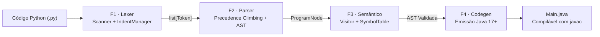

---
hide:
  - navigation
---

# PyToJava — Documentação Técnica

<div class="pj-doc-hero">
  <div class="pj-doc-hero-grid">
    <div>
      <div class="pj-hero-badge">
        <span class="pj-hero-badge-tag">Python -&gt; Java</span>
        <span>Compiladores 1 · UnB · Equipe 03</span>
      </div>
      <h1>
        Do seu Python procedural ao <span class="pj-highlight">Main.java</span> compilável
      </h1>
      <p class="pj-hero-lead">
        O <strong>PyToJava</strong> é um compilador <em>source-to-source</em> desenvolvido na disciplina de Compiladores 1 (UnB). Ele percorre as quatro fases clássicas — Léxico, Sintático, Semântico e Geração de Código — para transformar scripts Python em código <strong>Java 17+</strong> limpo, tipado e validado com <code>javac</code>.
      </p>
      <div class="pj-hero-actions">
        <a href="specs/lexico/" class="pj-btn pj-btn-amber">Especificação do Compilador</a>
        <a href="usage/" class="pj-btn pj-btn-white">▶ Pipeline, CLI e Interface Web</a>
      </div>
      <div class="pj-hero-trust">
        <span>● 4 fases reais sem dependências</span>
        <span>✓ 691 testes automatizados</span>
        <span>✓ Validado com javac 17+</span>
      </div>
    </div>
    <div class="pj-mascot-card">
      
      <span class="pj-mascot-caption">PyToJava · Python + Café</span>
    </div>
  </div>
</div>

---

## Visão Geral da Arquitetura

O código-fonte submetido ao **PyToJava** atravessa quatro estágios independentes, com contratos claros entre cada camada:



<div class="pj-cards-grid">
  <div class="pj-card">
    <div>
      <span class="pj-tag pj-tag-green">F1 · Análise Léxica</span>
      <h3>1. Scanner &amp; Indentação</h3>
      <p>
        Varredura por fatias diretas via <code>CharStream</code>, maior casamento (<em>maximal munch</em>) e pilha de recuo para emissão de <code>INDENT</code> e <code>DEDENT</code>.
      </p>
    </div>
    <a href="arch/scanner/" class="pj-card-link">Ver Lexer →</a>
  </div>

  <div class="pj-card">
    <div>
      <span class="pj-tag pj-tag-amber">F2 · Análise Sintática</span>
      <h3>2. Parser &amp; AST</h3>
      <p>
        Descida recursiva combinada com <em>Precedence Climbing</em>, produzindo uma Árvore Sintática Abstrata (<code>ProgramNode</code>) rastreável por linha e coluna.
      </p>
    </div>
    <a href="parser/" class="pj-card-link">Ver Parser →</a>
  </div>

  <div class="pj-card">
    <div>
      <span class="pj-tag pj-tag-green">F3 · Análise Semântica</span>
      <h3>3. Tipos &amp; Escopos</h3>
      <p>
        Travessia pelo padrão <strong>Visitor</strong> com despacho em tabela de classe, inferência estática, promoção <code>int -&gt; float</code> e isolamento por bloco na <code>SymbolTable</code>.
      </p>
    </div>
    <a href="semantic/analyzer/" class="pj-card-link">Ver Semântico →</a>
  </div>

  <div class="pj-card">
    <div>
      <span class="pj-tag pj-tag-coffee">F4 · Geração de Código</span>
      <h3>4. Emissor Java 17+</h3>
      <p>
        Traduz a AST para <code>public class Main</code> indentada em 4 espaços, declarando tipos Java na 1ª atribuição de cada variável no escopo.
      </p>
    </div>
    <a href="codegen/architecture/" class="pj-card-link">Ver Codegen →</a>
  </div>
</div>

---

## Por Dentro do PyToJava (Interface & Fluxo Visual)

A documentação reflete a identidade visual **neo-brutalista** do projeto — combinando fundo menta suave (`#F3FAF4`), verde cobra (`#1E7F4B`), amarelo destaque (`#FACC15`), café (`#C26D2D`) e bordas em tinta preta (`#111A14`):

<div class="pj-showcase-grid">
  <div class="pj-shot-card">
    <div class="pj-showcase-preview">
      <div class="line-accent">$ python -m src.web</div>
      <div>PyToJava disponível em http://localhost:8000</div>
      <div class="line-green">[POST /api/compile] NDJSON streaming:</div>
      <div>  upload -&gt; lexer -&gt; parser -&gt; semantic -&gt; codegen</div>
      <div class="line-coffee">status: complete · Main.java pronto</div>
    </div>
    <div class="pj-shot-body">
      <strong>Interface Web Local em Tempo Real</strong>
      <span>Upload <em>drag-and-drop</em> de arquivos <code>.py</code>, editor integrado com <code>Ctrl+Enter</code>, exemplos oficiais carregáveis com um clique, realce de sintaxe Java e download direto.</span>
    </div>
  </div>

  <div class="pj-shot-card">
    <div class="pj-showcase-preview">
      <div class="line-accent"># Entrada Python</div>
      <div>media = (n1 + n2) / 2.0</div>
      <div>if media &gt;= 7.0: aprovado = True</div>
      <div class="line-green">// Saída Java (Main.java)</div>
      <div class="line-coffee">double media = ((n1 + n2) / 2.0);</div>
    </div>
    <div class="pj-shot-body">
      <strong>Tradução Fiel Python para Java</strong>
      <span>Mapeamento determinístico de literais, precedência parentizada, estruturas <code>if/elif/else</code> e laços <code>while</code> com chaves balanceadas e escopos isolados.</span>
    </div>
  </div>

  <div class="pj-shot-card">
    <div class="pj-showcase-preview">
      <div class="line-accent">$ python -m pytest -v</div>
      <div class="line-green">23 suítes · 691 testes aprovados · 0 falhas</div>
      <div>E2E: compile_source() -&gt; javac -&gt; java Main</div>
      <div class="line-coffee">Erro [Linha X, Coluna Y] validado em todas as fases</div>
    </div>
    <div class="pj-shot-body">
      <strong>Homologação Completa e Benchmarks</strong>
      <span>Cobertura de caminhos felizes, casos de borda, integração HTTP da interface web, validação real na JVM com <code>javac</code> e otimizações verificadas por benchmark.</span>
    </div>
  </div>
</div>

---

## Exemplo Didático: Evolução do Código nas 4 Fases

=== "1. Entrada Python (.py)"

    ```python
    nota_1 = 8.0
    nota_2 = 6.0
    media = (nota_1 + nota_2) / 2.0

    if media >= 7.0:
        aprovado = True
    else:
        aprovado = False
    ```

=== "2. Tokens (Lexer)"

    ```text
    IDENTIFIER("nota_1")  OP_ASSIGN("=")  FLOAT_LITERAL(8.0)  NEWLINE
    IDENTIFIER("nota_2")  OP_ASSIGN("=")  FLOAT_LITERAL(6.0)  NEWLINE
    IDENTIFIER("media")   OP_ASSIGN("=")  LPAREN  IDENTIFIER("nota_1")  OP_PLUS("+")  IDENTIFIER("nota_2")  RPAREN  OP_DIV("/")  FLOAT_LITERAL(2.0)  NEWLINE
    KW_IF("if")  IDENTIFIER("media")  OP_GTE(">=")  FLOAT_LITERAL(7.0)  COLON(":")  NEWLINE
    INDENT  IDENTIFIER("aprovado")  OP_ASSIGN("=")  KW_TRUE("True")   NEWLINE  DEDENT
    KW_ELSE("else")  COLON(":")  NEWLINE
    INDENT  IDENTIFIER("aprovado")  OP_ASSIGN("=")  KW_FALSE("False")  NEWLINE  DEDENT
    EOF
    ```

=== "3. Árvore Sintática (AST)"

    ```python
    ProgramNode(stmts=[
        AssignNode(target="nota_1", op="=", value=FloatLiteralNode(value=8.0)),
        AssignNode(target="nota_2", op="=", value=FloatLiteralNode(value=6.0)),
        AssignNode(
            target="media",
            op="=",
            value=BinOpNode(
                left=BinOpNode(left=IdentifierNode(name="nota_1"), op="+", right=IdentifierNode(name="nota_2")),
                op="/",
                right=FloatLiteralNode(value=2.0),
            ),
        ),
        IfNode(
            condition=BinOpNode(left=IdentifierNode(name="media"), op=">=", right=FloatLiteralNode(value=7.0)),
            then_body=[AssignNode(target="aprovado", op="=", value=BoolLiteralNode(value=True))],
            elif_clauses=[],
            else_body=[AssignNode(target="aprovado", op="=", value=BoolLiteralNode(value=False))],
        ),
    ])
    ```

=== "4. Saída Java (Main.java)"

    ```java
    public class Main {
        public static void main(String[] args) {
            double nota_1 = 8.0;
            double nota_2 = 6.0;
            double media = ((nota_1 + nota_2) / 2.0);
            if ((media >= 7.0)) {
                boolean aprovado = true;
            } else {
                boolean aprovado = false;
            }
        }
    }
    ```

---

## Princípios Invioláveis do PyToJava

| Princípio | Garantia Arquitetural | Como é Verificado |
| :--- | :--- | :--- |
| **Zero Dependências no Núcleo** | Todo o compilador, a CLI e o servidor web rodam apenas com a biblioteca padrão do **Python 3.10+**. | `pyproject.toml` com `dependencies = []`. |
| **Diagnóstico Exato (*Fail-Fast*)** | Qualquer erro léxico, sintático ou semântico interrompe o pipeline imediatamente informando `[Linha X, Coluna Y]`. | Testes parametrizados em `test_lexer_edge_cases.py`, `test_parser_edge_cases.py` e `test_compiler_pipeline.py`. |
| **Fidelidade Semântica no Java** | Condições estritamente booleanas, isolamento de escopos por bloco e precedência parentizada garantem compilação limpa no `javac`. | Validação End-to-End em `tests/test_e2e_javac.py`. |
| **Segurança e Execução Local** | A interface web processa arquivos apenas em memória no `127.0.0.1`, sem executar o Python enviado nem o Java gerado, com validação de `Origin` e cabeçalhos de segurança. | Testes de integração HTTP em `tests/test_web.py`. |

---

## Documentos Principais

- **[Conceitos de Compiladores](compiladores.md)** — Front-End vs. Back-End e fundamentos teóricos aplicados no projeto.
- **[Estrutura do Projeto](estrutura.md)** — Mapa de pacotes, módulos e organização dos diretórios.
- **[Glossário Técnico](GLOSSARY.md)** — Definições de lexema, token, AST, Visitor, coerção e NDJSON.
- **[Especificação Léxica](specs/lexico.md)** — Tabela completa de tokens, regras de indentação e erros léxicos.
- **[Gramática e Precedência](parser/grammar.md)** — Regras EBNF, *Precedence Climbing* e controle de fluxo.
- **[Tipos e Compatibilidade](semantic/types.md)** — Matriz de inferência, promoção numérica e escopos.
- **[Geração de Código Java](codegen/control_flow.md)** — Tradução de expressões, declarações, `if/elif/else` e `while`.
- **[Guia de Uso (CLI & Web)](usage.md)** — Como rodar no terminal, via API Python ou no navegador.
