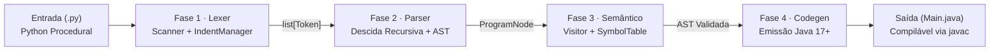

# Documentação Oficial — PyToJava


<div class="banner-hero">
  
  <div class="banner-overlay">
    <div class="banner-content">
      <span class="banner-subtitle">UnB · Engenharia de Software · Compiladores 1</span>
      <h2 class="banner-title">PyToJava Compiler</h2>
    </div>
    <span class="banner-badge">Python 3.10+ -> Java 17+</span>
  </div>
</div>

## Sobre o Projeto

O **PyToJava** é um compilador/transpilador *source-to-source* desenvolvido na disciplina **Compiladores 1** (ministrada pelo professor **Sergio Freitas** na Universidade de Brasília — UnB). Seu objetivo é traduzir programas escritos em um **subconjunto procedural da linguagem Python** para código-fonte **Java 17+** (`public class Main`) estruturado, estaticamente tipado e diretamente compilável com `javac`.

Para compreender a base teórica de compiladores aplicada neste projeto, acesse a seção [Conceitos de Compiladores](compiladores.md).

---

## Mapa Visual da Pipeline de Compilação

O código-fonte submetido ao **PyToJava** atravessa quatro fases sequenciais determinísticas, orquestradas pelo driver da **CLI** (`src/cli.py`) ou pela **Interface Web Local** (`src/web.py`):



<div class="grid-cards">

  <div class="card-fases">
    <div>
      <div class="card-header">
        <div class="card-icon">F1</div>
        <span class="badge badge-green">Fase 1 · Léxico</span>
      </div>
      <h3>Analisador Léxico</h3>
      <p>
        Varredura de caracteres via <code>CharStream</code>, agrupamento em <strong>Tokens</strong> pelo princípio do maior casamento (<em>maximal munch</em>) e controle da pilha de indentação (<code>INDENT</code>/<code>DEDENT</code>).
      </p>
    </div>
    <div class="card-footer-action">
      <div class="progress-bar"><div class="progress-fill green" style="width: 100%;"></div></div>
      <span class="progress-text">src/lexer/ · Concluído (100%)</span>
      <a href="specs/lexico/" class="btn-card-doc">Explorar Fase 1 -></a>
    </div>
  </div>

  <div class="card-fases">
    <div>
      <div class="card-header">
        <div class="card-icon">F2</div>
        <span class="badge badge-purple">Fase 2 · Sintático</span>
      </div>
      <h3>Analisador Sintático</h3>
      <p>
        Validação gramatical por descida recursiva e <em>Precedence Climbing</em>, convertendo a fila linear de tokens na <strong>Árvore Sintática Abstrata (AST)</strong>.
      </p>
    </div>
    <div class="card-footer-action">
      <div class="progress-bar"><div class="progress-fill green" style="width: 100%;"></div></div>
      <span class="progress-text">src/parser/ · Concluído (100%)</span>
      <a href="parser/" class="btn-card-doc">Explorar Fase 2 -></a>
    </div>
  </div>

  <div class="card-fases">
    <div>
      <div class="card-header">
        <div class="card-icon">F3</div>
        <span class="badge badge-purple">Fase 3 · Semântico</span>
      </div>
      <h3>Analisador Semântico</h3>
      <p>
        Travessia da AST com o padrão <strong>Visitor</strong>, inferência estática de tipos, promoção numérica (<code>int -> float</code>) e isolamento de escopos na <code>SymbolTable</code>.
      </p>
    </div>
    <div class="card-footer-action">
      <div class="progress-bar"><div class="progress-fill green" style="width: 100%;"></div></div>
      <span class="progress-text">src/semantic/ · Concluído (100%)</span>
      <a href="semantic/analyzer/" class="btn-card-doc">Explorar Fase 3 -></a>
    </div>
  </div>

  <div class="card-fases">
    <div>
      <div class="card-header">
        <div class="card-icon">F4</div>
        <span class="badge badge-purple">Fase 4 · Codegen</span>
      </div>
      <h3>Gerador de Código</h3>
      <p>
        Tradução da AST validada para código-fonte <strong>Java</strong> indentado (<code>public class Main</code>), com declaração tipada automática na primeira atribuição.
      </p>
    </div>
    <div class="card-footer-action">
      <div class="progress-bar"><div class="progress-fill green" style="width: 100%;"></div></div>
      <span class="progress-text">src/codegen/ · Concluído (100%)</span>
      <a href="codegen/architecture/" class="btn-card-doc">Explorar Fase 4 -></a>
    </div>
  </div>

</div>

---

## Exemplo Didático: Transformação de Ponta a Ponta

Veja nas abas abaixo como um mesmo trecho de código Python é enxergado e transformado por cada fase do compilador **PyToJava**:

=== "1. Entrada Python (.py)"

    ```python
    nota_1 = 8.0
    nota_2 = 6.0
    media = (nota_1 + nota_2) / 2.0

    if media >= 7.0:
        aprovado = True
    else:
        aprovado = False
    ```

=== "2. Fluxo de Tokens (Lexer)"

    ```text
    IDENTIFIER("nota_1")  OP_ASSIGN("=")  FLOAT_LITERAL(8.0)  NEWLINE
    IDENTIFIER("nota_2")  OP_ASSIGN("=")  FLOAT_LITERAL(6.0)  NEWLINE
    IDENTIFIER("media")   OP_ASSIGN("=")  LPAREN  IDENTIFIER("nota_1")  OP_PLUS("+")  IDENTIFIER("nota_2")  RPAREN  OP_DIV("/")  FLOAT_LITERAL(2.0)  NEWLINE
    KW_IF("if")  IDENTIFIER("media")  OP_GTE(">=")  FLOAT_LITERAL(7.0)  COLON(":")  NEWLINE
    INDENT  IDENTIFIER("aprovado")  OP_ASSIGN("=")  KW_TRUE("True")   NEWLINE  DEDENT
    KW_ELSE("else")  COLON(":")  NEWLINE
    INDENT  IDENTIFIER("aprovado")  OP_ASSIGN("=")  KW_FALSE("False")  NEWLINE  DEDENT
    EOF
    ```

=== "3. Árvore Sintática (AST)"

    ```python
    ProgramNode(stmts=[
        AssignNode(target="nota_1", op="=", value=FloatLiteralNode(value=8.0)),
        AssignNode(target="nota_2", op="=", value=FloatLiteralNode(value=6.0)),
        AssignNode(
            target="media",
            op="=",
            value=BinOpNode(
                left=BinOpNode(left=IdentifierNode(name="nota_1"), op="+", right=IdentifierNode(name="nota_2")),
                op="/",
                right=FloatLiteralNode(value=2.0),
            ),
        ),
        IfNode(
            condition=BinOpNode(left=IdentifierNode(name="media"), op=">=", right=FloatLiteralNode(value=7.0)),
            then_body=[AssignNode(target="aprovado", op="=", value=BoolLiteralNode(value=True))],
            elif_clauses=[],
            else_body=[AssignNode(target="aprovado", op="=", value=BoolLiteralNode(value=False))],
        ),
    ])
    ```

=== "4. Saída Java (Main.java)"

    ```java
    public class Main {
        public static void main(String[] args) {
            double nota_1 = 8.0;
            double nota_2 = 6.0;
            double media = ((nota_1 + nota_2) / 2.0);
            if ((media >= 7.0)) {
                boolean aprovado = true;
            } else {
                boolean aprovado = false;
            }
        }
    }
    ```

!!! info "Contexto Acadêmico e Referência Teórica — [Consultar Repositório da Disciplina (COMP1)](https://github.com/sergioaafreitas/COMP1)"
    Desenvolvido na disciplina de **Compiladores 1** do curso de Engenharia de Software (UnB). O projeto aplica na prática análise léxica determinística com pilha de recuo, gramáticas livres de contexto com subida de precedência (*Precedence Climbing*), verificação estática de tipos e escopos via padrão *Visitor* e geração de código Java validado com `javac`.

---

## Como Executar Rapidamente

=== "Interface Web Local (Visual)"

    Inicie o servidor HTTP local (sem dependências externas) para acompanhar as 5 etapas da compilação em tempo real no navegador:

    ```bash
    python -m src.web
    ```

    Acesse `http://localhost:8000`, envie um arquivo `.py` (ou escolha um exemplo integrado) e baixe o `Main.java` gerado.

=== "Linha de Comando (CLI)"

    Compile qualquer script Python procedural diretamente pelo terminal:

    ```bash
    python -m src.cli examples/calculator.py -o output/Main.java
    javac output/Main.java
    java -cp output Main
    ```

=== "Suíte de Testes (Pytest)"

    Execute as 23 suítes de testes unitários, de integração HTTP e E2E:

    ```bash
    python -m pytest -v
    ```

---

## Objetivos e Tecnologias

| Pilar do Projeto | Descrição Técnica |
| :--- | :--- |
| **Implementação das 4 Fases** | Construção modular de Lexer (`src/lexer`), Parser (`src/parser`), Semântico (`src/semantic`) e Codegen (`src/codegen`) em **Python 3.10+** puro. |
| **Validação Real na JVM** | Emissão de código compatível com **Java 17+ (`javac`)**, garantindo chaves balanceadas, tipagem estática e precedência preservada. |
| **Diagnósticos Precisos** | Erros léxicos, sintáticos e semânticos padronizados com **linha e coluna exatas** (`[Linha X, Coluna Y]`). |
| **Dupla Interface de Uso** | Driver de linha de comando (`src/cli.py`) e Interface Web Local com streaming **NDJSON** (`src/web.py`). |
| **Qualidade e Documentação** | Mais de 690 testes automatizados via **Pytest**, modelos teóricos baseados em **Flex & Bison** e documentação viva em **MkDocs Material**. |
