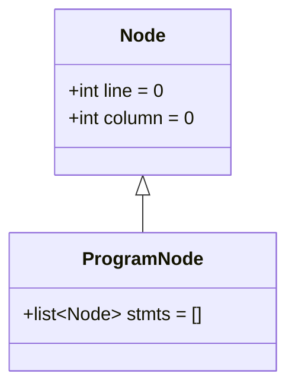
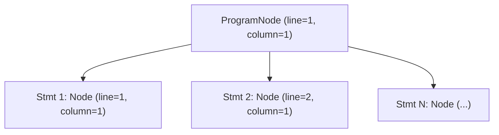

# Árvore Sintática Abstrata (AST)

A **Árvore Sintática Abstrata** (*Abstract Syntax Tree* — **AST**) é a estrutura de dados central produzida pelo **Analisador Sintático (Parser)** do compilador **PyToJava**. Enquanto a análise léxica converte o código-fonte Python em uma sequência linear de tokens, a AST organiza essas construções em uma hierarquia em árvore que reflete a estrutura gramatical e semântica do programa, abstraindo detalhes puramente sintáticos (como delimitadores, quebras de linha e recuos `INDENT`/`DEDENT`).

Cada nó da árvore é modelado com `@dataclass` no módulo `src/parser/nodes.py` e carrega metadados de rastreabilidade (`line` e `column`) herdados da classe base `Node`, permitindo que as fases seguintes (análise semântica e geração de código Java) reportem diagnósticos precisos no código-fonte original.

---

## Hierarquia Inicial da AST

A infraestrutura base da AST é composta pela superclasse `Node` e pelo nó raiz `ProgramNode`, que agrupa todas as instruções (*statements*) de nível superior do programa:



Também podemos visualizar como um `ProgramNode` organiza as instruções em tempo de execução na forma de árvore:



---

## Especificação dos Nós Base

### `Node`

Classe base para todos os nós da Árvore Sintática Abstrata.

```python
@dataclass(kw_only=True)
class Node:
    line: int = 0
    column: int = 0
```

| Atributo | Tipo | Padrão | Descrição |
| :--- | :--- | :--- | :--- |
| `line` | `int` | `0` | Linha no código-fonte onde a construção sintática se inicia (1-based quando preenchida pelo parser, `0` quando não especificada). |
| `column` | `int` | `0` | Coluna no código-fonte onde a construção sintática se inicia (1-based quando preenchida pelo parser, `0` quando não especificada). |

!!! info "Por que `kw_only=True` na classe base?"
    Em Python, `dataclasses` padrão não permitem que subclasses declarem atributos obrigatórios (sem valor padrão) após atributos herdados que já possuem valor padrão (`line: int = 0` e `column: int = 0`).
    Ao declarar `@dataclass(kw_only=True)` em `Node`, `line` e `column` tornam-se parâmetros exclusivamente nomeados (*keyword-only*), permitindo que qualquer subclasse (como `ProgramNode` ou nós de expressões e instruções) defina livremente atributos posicionais ou com valor padrão sem conflito na ordem de argumentos do `__init__`.

---

### `ProgramNode`

Nó raiz da AST que representa o programa Python completo como uma sequência ordenada de instruções (*statements*).

```python
@dataclass
class ProgramNode(Node):
    stmts: list[Node] = field(default_factory=list)
```

| Atributo | Tipo | Padrão | Descrição |
| :--- | :--- | :--- | :--- |
| `stmts` | `list[Node]` | `[]` | Lista ordenada de instruções de nível superior que compõem o programa. Inicializada com `field(default_factory=list)` para evitar compartilhamento de estado mutável entre instâncias. |
| `line` | `int` | `0` | Herdado de `Node`. Indica a linha do primeiro elemento do programa. |
| `column` | `int` | `0` | Herdado de `Node`. Indica a coluna do primeiro elemento do programa. |

---

## Exemplo de Uso

```python
from src.parser import Node, ProgramNode

# Instanciação padrão (programa vazio)
empty_program = ProgramNode()
assert empty_program.stmts == []
assert (empty_program.line, empty_program.column) == (0, 0)

# Instanciação com instruções e coordenadas do código-fonte
stmt_1 = Node(line=1, column=1)
stmt_2 = Node(line=2, column=1)
program = ProgramNode(stmts=[stmt_1, stmt_2], line=1, column=1)
```

## Validação e Testes

Para executar a suíte de testes unitários da estrutura base da AST:

```bash
pytest tests/test_ast_nodes.py -v
```
