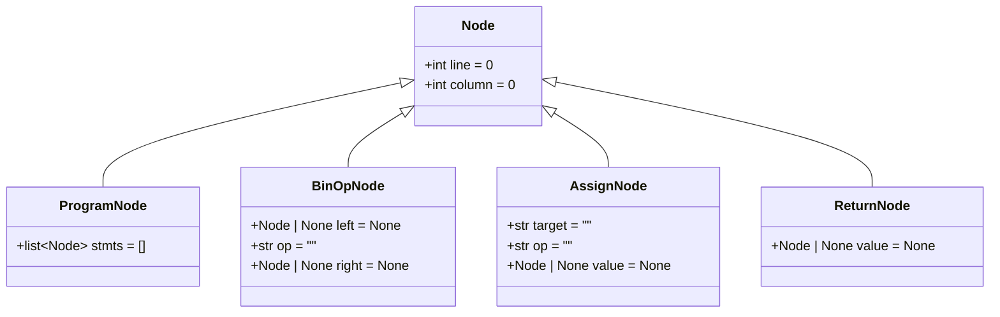
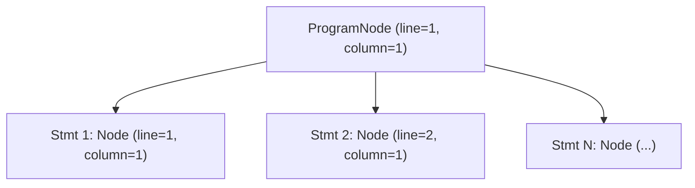
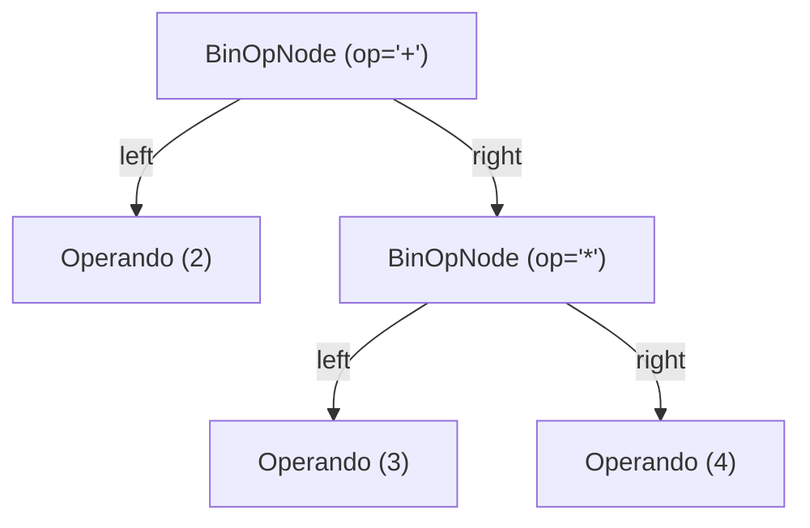
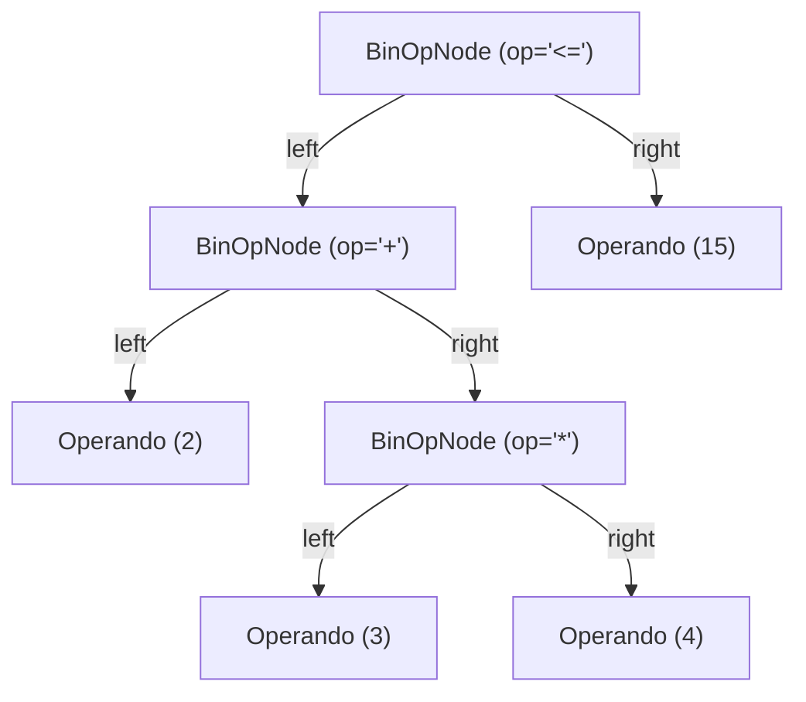
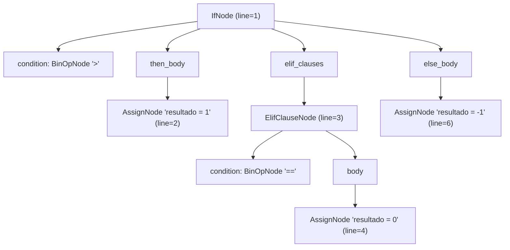
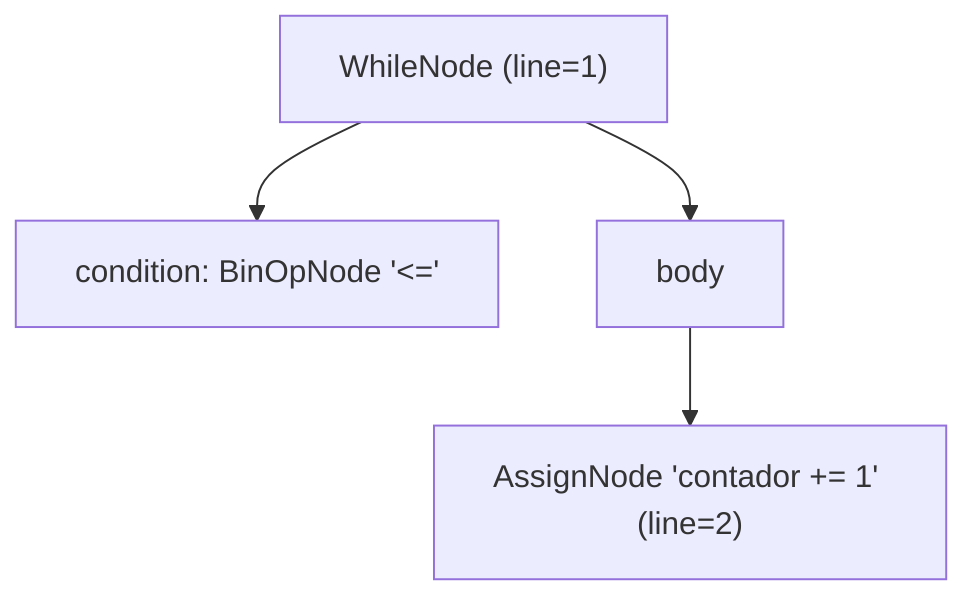
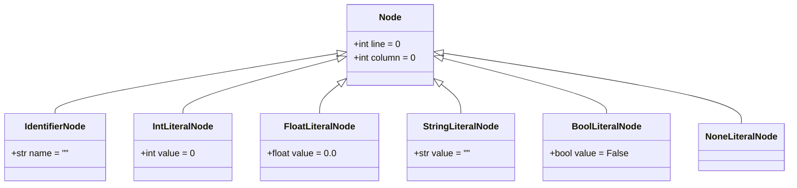

# Árvore Sintática Abstrata (AST)

A **Árvore Sintática Abstrata** (*Abstract Syntax Tree* — **AST**) é a estrutura de dados central produzida pelo **Analisador Sintático (Parser)** do compilador **PyToJava**. Enquanto a análise léxica converte o código-fonte Python em uma sequência linear de tokens, a AST organiza essas construções em uma hierarquia em árvore que reflete a estrutura gramatical e semântica do programa, abstraindo detalhes puramente sintáticos (como delimitadores, quebras de linha e recuos `INDENT`/`DEDENT`).

Cada nó da árvore é modelado com `@dataclass` no módulo `src/parser/nodes.py` e carrega metadados de rastreabilidade (`line` e `column`) herdados da classe base `Node`, permitindo que as fases seguintes (análise semântica e geração de código Java) reportem diagnósticos precisos no código-fonte original.

---

## Hierarquia da AST

A infraestrutura da AST é composta pela superclasse `Node`, pelo nó raiz `ProgramNode` (que agrupa todas as instruções de nível superior do programa) pelos nós de expressões, como `BinOpNode`, e pelos nós de instruções imperativas (`AssignNode` e `ReturnNode`):



Também podemos visualizar como um `ProgramNode` organiza as instruções em tempo de execução na forma de árvore:



---

## Especificação dos Nós

### `Node`

Classe base para todos os nós da Árvore Sintática Abstrata.

```python
@dataclass(kw_only=True)
class Node:
    line: int = 0
    column: int = 0
```

| Atributo | Tipo | Padrão | Descrição |
| :--- | :--- | :--- | :--- |
| `line` | `int` | `0` | Linha no código-fonte onde a construção sintática se inicia (1-based quando preenchida pelo parser, `0` quando não especificada). |
| `column` | `int` | `0` | Coluna no código-fonte onde a construção sintática se inicia (1-based quando preenchida pelo parser, `0` quando não especificada). |

!!! info "Por que `kw_only=True` na classe base?"
    Em Python, `dataclasses` padrão não permitem que subclasses declarem atributos obrigatórios (sem valor padrão) após atributos herdados que já possuem valor padrão (`line: int = 0` e `column: int = 0`).
    Ao declarar `@dataclass(kw_only=True)` em `Node`, `line` e `column` tornam-se parâmetros exclusivamente nomeados (*keyword-only*), permitindo que qualquer subclasse (como `ProgramNode` ou `BinOpNode`) defina livremente atributos posicionais ou com valor padrão sem conflito na ordem de argumentos do `__init__`.

---

### `ProgramNode`

Nó raiz da AST que representa o programa Python completo como uma sequência ordenada de instruções (*statements*).

```python
@dataclass
class ProgramNode(Node):
    stmts: list[Node] = field(default_factory=list)
```

| Atributo | Tipo | Padrão | Descrição |
| :--- | :--- | :--- | :--- |
| `stmts` | `list[Node]` | `[]` | Lista ordenada de instruções de nível superior que compõem o programa. Inicializada com `field(default_factory=list)` para evitar compartilhamento de estado mutável entre instâncias. |
| `line` | `int` | `0` | Herdado de `Node`. Indica a linha do primeiro elemento do programa. |
| `column` | `int` | `0` | Herdado de `Node`. Indica a coluna do primeiro elemento do programa. |

---

### `BinOpNode` (Expressões Binárias)

Nó responsável por representar operações binárias **aritméticas** (`+`, `-`, `*`, `/`) e **relacionais** (`==`, `!=`, `<`, `<=`, `>`, `>=`) entre dois operandos (`left` e `right`).

```python
@dataclass
class BinOpNode(Node):
    left: Node | None = None
    op: str = ""
    right: Node | None = None
```

| Atributo | Tipo | Padrão | Descrição |
| :--- | :--- | :--- | :--- |
| `left` | `Node \| None` | `None` | Sub-árvore ou nó folha correspondente ao operando esquerdo. |
| `op` | `str` | `""` | Símbolo textual do operador binário (ex.: `"+"`, `"-"`, `"*"`, `"/"`, `"=="`, `"!="`, `"<"`, `"<="`, `">"`, `">="`). |
| `right` | `Node \| None` | `None` | Sub-árvore ou nó folha correspondente ao operando direito. |
| `line` | `int` | `0` | Herdado de `Node`. Linha no código-fonte onde a operação é avaliada. |
| `column` | `int` | `0` | Herdado de `Node`. Coluna no código-fonte onde a operação é avaliada. |

---

## Instruções Imperativas

Os nós de instruções imperativas modelam operações de atribuição de variáveis e instruções de fluxo de controle básicas (retorno de valores).

### `AssignNode`

Representa operações de atribuição (`=`, `+=`, `-=`) a variáveis ou alvos no código-fonte.

```python
@dataclass
class AssignNode(Node):
    target: str = ""
    op: str = ""
    value: Node | None = None
```

| Atributo | Tipo | Padrão | Descrição |
| :--- | :--- | :--- | :--- |
| `target` | `str` | `""` | Identificador da variável ou alvo da atribuição. |
| `op` | `str` | `""` | Operador de atribuição utilizado (`=`, `+=`, `-=`). |
| `value` | `Node \| None` | `None` | Expressão da AST atribuída ao alvo. |
| `line` | `int` | `0` | Herdado de `Node`. Linha onde a atribuição ocorre. |
| `column` | `int` | `0` | Herdado de `Node`. Coluna onde a atribuição ocorre. |

---

### `ReturnNode`

Representa instruções de retorno de valores (`return expr` ou `return` vazio).

```python
@dataclass
class ReturnNode(Node):
    value: Node | None = None
```

| Atributo | Tipo | Padrão | Descrição |
| :--- | :--- | :--- | :--- |
| `value` | `Node \| None` | `None` | Expressão opcional retornada pela instrução (`None` quando não há valor). |
| `line` | `int` | `0` | Herdado de `Node`. Linha onde a instrução `return` ocorre. |
| `column` | `int` | `0` | Herdado de `Node`. Coluna onde a instrução `return` ocorre. |

---

## Exemplos Práticos: Código Python vs. Estrutura AST

Abaixo estão exemplos práticos demonstrando como o código Python para instruções imperativas é mapeado para a estrutura da AST:

### 1. Atribuição Simples (`x = 10`)
* **Código Python:**
  ```python
  x = 10
  ```
* **Representação na AST:**
  ```python
  AssignNode(
      target="x",
      op="=",
      value=LiteralNode(value=10),
      line=1,
      column=1
  )
  ```

### 2. Atribuições Acumulativas (`x += 1` e `x -= 5`)
* **Código Python:**
  ```python
  x += 1
  x -= 5
  ```
* **Representação na AST:**
  ```python
  # x += 1
  AssignNode(
      target="x",
      op="+=",
      value=LiteralNode(value=1),
      line=1,
      column=1
  )

  # x -= 5
  AssignNode(
      target="x",
      op="-=",
      value=LiteralNode(value=5),
      line=2,
      column=1
  )
  ```

### 3. Retorno com Valor (`return x`)
* **Código Python:**
  ```python
  return x
  ```
* **Representação na AST:**
  ```python
  ReturnNode(
      value=IdentifierNode(name="x"),
      line=1,
      column=1
  )
  ```

### 4. Retorno Vazio (`return`)
* **Código Python:**
  ```python
  return
  ```
* **Representação na AST:**
  ```python
  ReturnNode(
      value=None,
      line=1,
      column=1
  )
  ```

---

## Exemplo de Uso: Instruções Imperativas

```python
from src.parser import AssignNode, Node, ProgramNode, ReturnNode

# Instanciação padrão (programa vazio)
empty_program = ProgramNode()
assert empty_program.stmts == []
assert (empty_program.line, empty_program.column) == (0, 0)

# Instanciação de nós de atribuição e retorno
assign_stmt = AssignNode(target="x", op="=", line=1, column=1)
return_stmt = ReturnNode(line=2, column=1)

# Composição do programa no ProgramNode
program = ProgramNode(stmts=[assign_stmt, return_stmt], line=1, column=1)
assert len(program.stmts) == 2
```

---

## Representação de Expressões Binárias e Árvore de Precedência

Na AST, a **precedência de operadores** e a **associatividade** são codificadas diretamente pela profundidade dos nós `BinOpNode`:

- Operações de **maior precedência** (como multiplicação `*` e divisão `/`) ficam **mais profundas** na árvore (mais próximas das folhas), sendo avaliadas primeiro.
- Operações de **menor precedência** (como adição `+`, subtração `-` e comparações relacionais `<=`, `==`) ficam **mais próximas da raiz** da expressão, consumindo o resultado das sub-árvores filhas.

### Exemplo Visual 1 — Precedência Aritmética (`2 + 3 * 4`)

Na expressão `2 + 3 * 4`, a multiplicação tem precedência sobre a soma. Portanto, o nó `BinOpNode(op="+")` ocupa a raiz da expressão e seu campo `right` aponta para outro `BinOpNode(op="*")`:



### Exemplo Visual 2 — Expressão Aritmética e Relacional Combinada (`2 + 3 * 4 <= 15`)

Quando combinamos operadores aritméticos com um operador relacional (`<=`), o operador relacional possui a menor precedência e torna-se o nó superior da expressão:



---

## Exemplos de Uso

```python
from src.parser import BinOpNode, Node, ProgramNode

# 1. Instanciação padrão (programa vazio)
empty_program = ProgramNode()
assert empty_program.stmts == []
assert (empty_program.line, empty_program.column) == (0, 0)

# 2. Construção de sub-árvore aninhada para "2 + 3 * 4"
mult_expr = BinOpNode(
    left=Node(line=1, column=5),
    op="*",
    right=Node(line=1, column=9),
    line=1,
    column=7,
)
add_expr = BinOpNode(
    left=Node(line=1, column=1),
    op="+",
    right=mult_expr,
    line=1,
    column=3,
)

assert add_expr.op == "+"
assert add_expr.right.op == "*"
```

---

## 🪢Nós de Controle de Fluxo

Esta seção documenta os nós que representam as estruturas condicionais e de repetição do subconjunto Python suportado pelo PyToJava.

---🔨

### `IfNode`

Representa uma estrutura condicional completa, podendo conter cláusulas `elif` e `else`.

| Atributo | Tipo | Padrão | Descrição |
| :--- | :--- | :--- | :--- |
| `condition` | `Node \| None` | `None` | Expressão avaliada como condição do `if`. |
| `then_body` | `list[Node]` | `[]` | Lista de instruções executadas quando a condição é verdadeira. |
| `elif_clauses` | `list[ElifClauseNode]` | `[]` | Lista de cláusulas `elif` associadas ao bloco. |
| `else_body` | `list[Node]` | `[]` | Lista de instruções executadas quando nenhuma condição anterior é verdadeira. |
| `line` | `int` | `0` | Herdado de `Node`. |
| `column` | `int` | `0` | Herdado de `Node`. |

---

### `ElifClauseNode`

Representa uma cláusula `elif` dentro de uma estrutura condicional.

| Atributo | Tipo | Padrão | Descrição |
| :--- | :--- | :--- | :--- |
| `condition` | `Node \| None` | `None` | Expressão avaliada como condição do `elif`. |
| `body` | `list[Node]` | `[]` | Lista de instruções executadas quando a condição é verdadeira. |
| `line` | `int` | `0` | Herdado de `Node`. |
| `column` | `int` | `0` | Herdado de `Node`. |

---

### `ElseClauseNode`

Representa a cláusula `else` dentro de uma estrutura condicional.

| Atributo | Tipo | Padrão | Descrição |
| :--- | :--- | :--- | :--- |
| `body` | `list[Node]` | `[]` | Lista de instruções executadas quando nenhuma condição anterior é verdadeira. |
| `line` | `int` | `0` | Herdado de `Node`. |
| `column` | `int` | `0` | Herdado de `Node`. |

---

### `WhileNode`

Representa um laço de repetição `while`.

| Atributo | Tipo | Padrão | Descrição |
| :--- | :--- | :--- | :--- |
| `condition` | `Node \| None` | `None` | Expressão avaliada a cada iteração do laço. |
| `body` | `list[Node]` | `[]` | Lista de instruções executadas enquanto a condição for verdadeira. |
| `line` | `int` | `0` | Herdado de `Node`. |
| `column` | `int` | `0` | Herdado de `Node`. |

### 👀Exemplo Visual

Dado o seguinte trecho de código Python:

```python
if x > 0:
    resultado = 1
elif x == 0:
    resultado = 0
else:
    resultado = -1
```

A AST correspondente gerada pelos nós seria:



E para um laço `while`:

```python
while contador <= 10:
    contador += 1
```



---

## 🍃 Nós Folha (Tipos Primitivos)

Os nós folha são os elementos terminais da AST, ou seja, não têm filhos, apenas armazenam um valor literal ou um nome. São o ponto final de qualquer expressão. Cada tipo de literal tem seu próprio nó para que o analisador semântico consiga inferir o tipo da expressão diretamente, sem precisar inspecionar o lexeme.

Todos usam `@dataclass(kw_only=True)`, o que significa que **todos os campos, incluindo `value`, só aceitam argumento por nome**.

---

### `IdentifierNode`

Representa o uso de uma variável ou nome no código-fonte.

| Atributo | Tipo | Padrão | Descrição |
| :--- | :--- | :--- | :--- |
| `name` | `str` | `""` | Nome textual do identificador. |
| `line` | `int` | `0` | Herdado de `Node`. |
| `column` | `int` | `0` | Herdado de `Node`. |

Exemplo: `total`, `x`, `resultado` → `IdentifierNode(name="total", line=1, column=1)`

---

### `IntLiteralNode`

Representa um literal numérico inteiro.

| Atributo | Tipo | Padrão | Descrição |
| :--- | :--- | :--- | :--- |
| `value` | `int` | `0` | Valor inteiro do literal. |
| `line` | `int` | `0` | Herdado de `Node`. |
| `column` | `int` | `0` | Herdado de `Node`. |

Exemplo: `42` → `IntLiteralNode(value=42, line=1, column=5)`

---

### `FloatLiteralNode`

Representa um literal numérico de ponto flutuante.

| Atributo | Tipo | Padrão | Descrição |
| :--- | :--- | :--- | :--- |
| `value` | `float` | `0.0` | Valor float do literal. |
| `line` | `int` | `0` | Herdado de `Node`. |
| `column` | `int` | `0` | Herdado de `Node`. |

Exemplo: `3.14` → `FloatLiteralNode(value=3.14, line=2, column=7)`

---

### `StringLiteralNode`

Representa um literal de texto, sem as aspas delimitadoras.

| Atributo | Tipo | Padrão | Descrição |
| :--- | :--- | :--- | :--- |
| `value` | `str` | `""` | Conteúdo textual da string. |
| `line` | `int` | `0` | Herdado de `Node`. |
| `column` | `int` | `0` | Herdado de `Node`. |

Exemplo: `"olá"` → `StringLiteralNode(value="olá", line=3, column=9)`

---

### `BoolLiteralNode`

Representa um literal booleano (`True` ou `False`).

| Atributo | Tipo | Padrão | Descrição |
| :--- | :--- | :--- | :--- |
| `value` | `bool` | `False` | Valor booleano do literal. |
| `line` | `int` | `0` | Herdado de `Node`. |
| `column` | `int` | `0` | Herdado de `Node`. |

Exemplos:
- `True` → `BoolLiteralNode(value=True, line=1, column=4)`
- `False` → `BoolLiteralNode(value=False, line=2, column=4)`

---

### `NoneLiteralNode`

Representa o literal nulo `None`. Não carrega valor — apenas registra a posição no código-fonte.

| Atributo | Tipo | Padrão | Descrição |
| :--- | :--- | :--- | :--- |
| `line` | `int` | `0` | Herdado de `Node`. |
| `column` | `int` | `0` | Herdado de `Node`. |

Exemplo: `None` → `NoneLiteralNode(line=4, column=1)`

---

### Diagrama dos nós folha



---

## 🚀Validação e Testes

Para executar a suíte de testes unitários da AST:

```bash
pytest tests/test_ast_nodes.py -v
```
