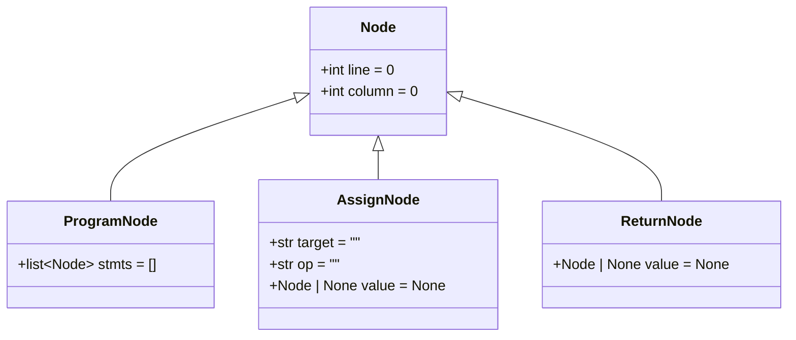
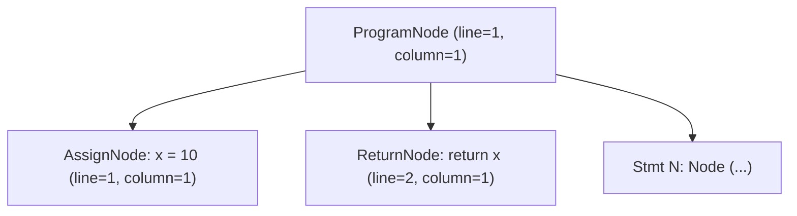

# Árvore Sintática Abstrata (AST)

A **Árvore Sintática Abstrata** (*Abstract Syntax Tree* — **AST**) é a estrutura de dados central produzida pelo **Analisador Sintático (Parser)** do compilador **PyToJava**. Enquanto a análise léxica converte o código-fonte Python em uma sequência linear de tokens, a AST organiza essas construções em uma hierarquia em árvore que reflete a estrutura gramatical e semântica do programa, abstraindo detalhes puramente sintáticos (como delimitadores, quebras de linha e recuos `INDENT`/`DEDENT`).

Cada nó da árvore é modelado com `@dataclass` no módulo `src/parser/nodes.py` e carrega metadados de rastreabilidade (`line` e `column`) herdados da classe base `Node`, permitindo que as fases seguintes (análise semântica e geração de código Java) reportem diagnósticos precisos no código-fonte original.

---

## Hierarquia Inicial da AST

A infraestrutura base da AST é composta pela superclasse `Node`, pelo nó raiz `ProgramNode` e pelos nós de instruções imperativas (`AssignNode` e `ReturnNode`):



Também podemos visualizar como um `ProgramNode` organiza as instruções em tempo de execução na forma de árvore:



---

## Especificação dos Nós Base

### `Node`

Classe base para todos os nós da Árvore Sintática Abstrata.

```python
@dataclass(kw_only=True)
class Node:
    line: int = 0
    column: int = 0
```

| Atributo | Tipo | Padrão | Descrição |
| :--- | :--- | :--- | :--- |
| `line` | `int` | `0` | Linha no código-fonte onde a construção sintática se inicia (1-based quando preenchida pelo parser, `0` quando não especificada). |
| `column` | `int` | `0` | Coluna no código-fonte onde a construção sintática se inicia (1-based quando preenchida pelo parser, `0` quando não especificada). |

!!! info "Por que `kw_only=True` na classe base?"
    Em Python, `dataclasses` padrão não permitem que subclasses declarem atributos obrigatórios (sem valor padrão) após atributos herdados que já possuem valor padrão (`line: int = 0` e `column: int = 0`).
    Ao declarar `@dataclass(kw_only=True)` em `Node`, `line` e `column` tornam-se parâmetros exclusivamente nomeados (*keyword-only*), permitindo que qualquer subclasse (como `ProgramNode`, `AssignNode`, `ReturnNode` ou nós de expressões e instruções) defina livremente atributos posicionais ou com valor padrão sem conflito na ordem de argumentos do `__init__`.

---

### `ProgramNode`

Nó raiz da AST que representa o programa Python completo como uma sequência ordenada de instruções (*statements*).

```python
@dataclass
class ProgramNode(Node):
    stmts: list[Node] = field(default_factory=list)
```

| Atributo | Tipo | Padrão | Descrição |
| :--- | :--- | :--- | :--- |
| `stmts` | `list[Node]` | `[]` | Lista ordenada de instruções de nível superior que compõem o programa. Inicializada com `field(default_factory=list)` para evitar compartilhamento de estado mutável entre instâncias. |
| `line` | `int` | `0` | Herdado de `Node`. Indica a linha do primeiro elemento do programa. |
| `column` | `int` | `0` | Herdado de `Node`. Indica a coluna do primeiro elemento do programa. |

---

## Instruções Imperativas

Os nós de instruções imperativas modelam operações de atribuição de variáveis e instruções de fluxo de controle básicas (retorno de valores).

### `AssignNode`

Representa operações de atribuição (`=`, `+=`, `-=`) a variáveis ou alvos no código-fonte.

```python
@dataclass
class AssignNode(Node):
    target: str = ""
    op: str = ""
    value: Node | None = None
```

| Atributo | Tipo | Padrão | Descrição |
| :--- | :--- | :--- | :--- |
| `target` | `str` | `""` | Identificador da variável ou alvo da atribuição. |
| `op` | `str` | `""` | Operador de atribuição utilizado (`=`, `+=`, `-=`). |
| `value` | `Node \| None` | `None` | Expressão da AST atribuída ao alvo. |
| `line` | `int` | `0` | Herdado de `Node`. Linha onde a atribuição ocorre. |
| `column` | `int` | `0` | Herdado de `Node`. Coluna onde a atribuição ocorre. |

---

### `ReturnNode`

Representa instruções de retorno de valores (`return expr` ou `return` vazio).

```python
@dataclass
class ReturnNode(Node):
    value: Node | None = None
```

| Atributo | Tipo | Padrão | Descrição |
| :--- | :--- | :--- | :--- |
| `value` | `Node \| None` | `None` | Expressão opcional retornada pela instrução (`None` quando não há valor). |
| `line` | `int` | `0` | Herdado de `Node`. Linha onde a instrução `return` ocorre. |
| `column` | `int` | `0` | Herdado de `Node`. Coluna onde a instrução `return` ocorre. |

---

## Exemplos Práticos: Código Python vs. Estrutura AST

Abaixo estão exemplos práticos demonstrando como o código Python para instruções imperativas é mapeado para a estrutura da AST:

### 1. Atribuição Simples (`x = 10`)
* **Código Python:**
  ```python
  x = 10
  ```
* **Representação na AST:**
  ```python
  AssignNode(
      target="x",
      op="=",
      value=LiteralNode(value=10),
      line=1,
      column=1
  )
  ```

### 2. Atribuições Acumulativas (`x += 1` e `x -= 5`)
* **Código Python:**
  ```python
  x += 1
  x -= 5
  ```
* **Representação na AST:**
  ```python
  # x += 1
  AssignNode(
      target="x",
      op="+=",
      value=LiteralNode(value=1),
      line=1,
      column=1
  )

  # x -= 5
  AssignNode(
      target="x",
      op="-=",
      value=LiteralNode(value=5),
      line=2,
      column=1
  )
  ```

### 3. Retorno com Valor (`return x`)
* **Código Python:**
  ```python
  return x
  ```
* **Representação na AST:**
  ```python
  ReturnNode(
      value=IdentifierNode(name="x"),
      line=1,
      column=1
  )
  ```

### 4. Retorno Vazio (`return`)
* **Código Python:**
  ```python
  return
  ```
* **Representação na AST:**
  ```python
  ReturnNode(
      value=None,
      line=1,
      column=1
  )
  ```

---

## Exemplo de Uso

```python
from src.parser import AssignNode, Node, ProgramNode, ReturnNode

# Instanciação padrão (programa vazio)
empty_program = ProgramNode()
assert empty_program.stmts == []
assert (empty_program.line, empty_program.column) == (0, 0)

# Instanciação de nós de atribuição e retorno
assign_stmt = AssignNode(target="x", op="=", line=1, column=1)
return_stmt = ReturnNode(line=2, column=1)

# Composição do programa no ProgramNode
program = ProgramNode(stmts=[assign_stmt, return_stmt], line=1, column=1)
assert len(program.stmts) == 2
```

## Validação e Testes

Para executar a suíte de testes unitários da estrutura base da AST:

```bash
pytest tests/test_ast_nodes.py -v
```
