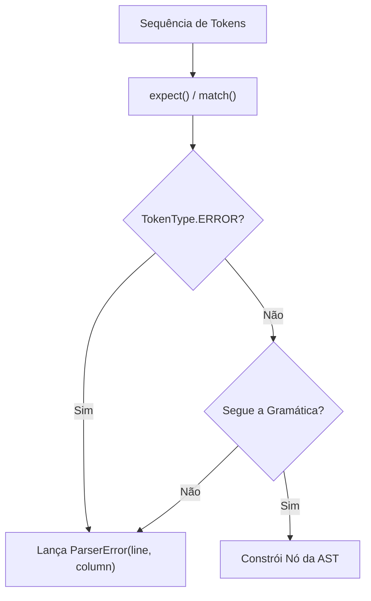

# Erros Sintáticos e Casos de Borda

O analisador sintático do **PyToJava** implementa uma estratégia de diagnóstico rigorosa e determinística no módulo `src/parser/errors.py` e na classe `Parser` (`src/parser/parser.py`). Sempre que a sequência de tokens recebida do `Scanner` viola alguma produção da gramática livre de contexto da linguagem, o parser interrompe imediatamente a construção da AST e lança uma exceção tipada `ParserError` contendo a linha e a coluna exatas do token infrator.

---

## Modelo de Exceção: `ParserError`

Definida em `src/parser/errors.py`, a classe `ParserError` padroniza os diagnósticos da fase sintática seguindo a mesma convenção visual dos erros léxicos e semânticos do compilador:

```python
class ParserError(Exception):
    def __init__(self, message: str, line: int = 0, column: int = 0) -> None:
        super().__init__(message)
        self.message = message
        self.line = line
        self.column = column

    def __str__(self) -> str:
        return (
            f"Erro Sintático [Linha {self.line}, Coluna {self.column}]: "
            f"{self.message}"
        )
```

| Atributo | Tipo | Padrão | Descrição |
| :--- | :--- | :---: | :--- |
| `message` | `str` | — | Explicação clara do símbolo esperado ou da regra gramatical violada. |
| `line` | `int` | `0` | Linha do código-fonte onde a violação foi detectada (1-based). |
| `column` | `int` | `0` | Coluna do código-fonte onde o token inesperado se inicia (1-based). |

---

## Mecanismo de Captura e Validação no `Parser`

A detecção de erros sintáticos ocorre em quatro pontos estruturais do `Parser`:



1. **`expect(token_type, message)` e `match(*token_types)`**:
   - Validam que os tipos consultados são instâncias válidas de `TokenType`.
   - Interceptam tokens sintéticos `TokenType.ERROR` (como desalinhamentos de indentação reportados pelo `IndentManager`) e os convertem em `ParserError` na posição exata do recuo inválido.
   - Caso o token atual divirja do esperado em `expect()`, lançam `ParserError` informando o token esperado e o encontrado.
2. **Expressões e Agrupamentos (`parse_primary`, `parse_unary`, `parse_expression`)**:
   - Rejeitam parênteses abertos sem fechamento `(a + b`, parênteses vazios `()` e operadores binários/unários sem operandos (`* 5`, `10 +`, `1 + * 2`).
3. **Instruções Simples (`parse_statement`, `parse_assignment`, `_end_simple_statement`)**:
   - Rejeitam atribuições sem expressão à direita (`x =`, `x +=`), alvos de atribuição inválidos (`10 = x`) e múltiplas instruções na mesma linha sem quebra (`x = 1 y = 2`).
   - Interceptam cláusulas `elif` e `else` órfãs (sem um bloco `if` correspondente).
4. **Blocos Indentados (`parse_block`, `parse`)**:
   - Exigem obrigatoriamente `:`, `NEWLINE` e `INDENT` na abertura de corpos de `if`, `elif`, `else` e `while`, além do `DEDENT` no fechamento.
   - Rejeitam indentação inesperada no escopo global.

---

## Catálogo de Erros Sintáticos e Exemplos

### 1. Falta de Dois-Pontos (`:`) em Blocos Condicionais ou Laços

```python
if x > 0
    y = 1
```

```text
Erro Sintático [Linha 1, Coluna 9]: Esperado ':' ao iniciar o bloco
```

### 2. Bloco sem Recuo (`INDENT`) após `:`

```python
while x < 10:
x += 1
```

```text
Erro Sintático [Linha 2, Coluna 1]: Esperado bloco indentado após ':'
```

### 3. Parênteses Abertos sem Fechamento

```python
resultado = (2 + 3 * 4
```

```text
Erro Sintático [Linha 1, Coluna 23]: Esperado ')' após a expressão agrupada
```

### 4. Operador sem Operando

```python
x = 10 + * 5
```

```text
Erro Sintático [Linha 1, Coluna 10]: Token inesperado ao analisar expressão primária: '*' (OP_MULT)
```

### 5. Cláusula `else` ou `elif` sem `if` Correspondente

```python
x = 1
else:
    x = 2
```

```text
Erro Sintático [Linha 2, Coluna 1]: Cláusula 'else' sem 'if' correspondente
```

---

## Casos de Borda Não-Erro (Entradas Limítrofes Válidas)

O `Parser` também trata graciosamente casos limite que **não** constituem erro sintático:

- **Arquivos completamente vazios (`""`)**: retornam `ProgramNode(stmts=[], line=1, column=1)`.
- **Arquivos contendo apenas espaços, tabulações ou quebras de linha (`\n`, `\r\n`)**: todos os tokens `NEWLINE` de nível global são ignorados e o parser devolve `ProgramNode(stmts=[])`.
- **Arquivos contendo apenas comentários (`# ...`)**: descartados pelo `Scanner`, resultando apenas em `EOF` e produzindo `ProgramNode(stmts=[])`.
- **Listas de tokens sem `EOF` explícito**: o construtor `Parser(tokens)` normaliza a entrada acrescentando um token `EOF` sintético ao final.

---

## Validação e Testes

Para executar a suíte de testes de casos de borda e erros sintáticos:

```bash
pytest tests/test_parser_edge_cases.py -v
mkdocs build --strict
```
