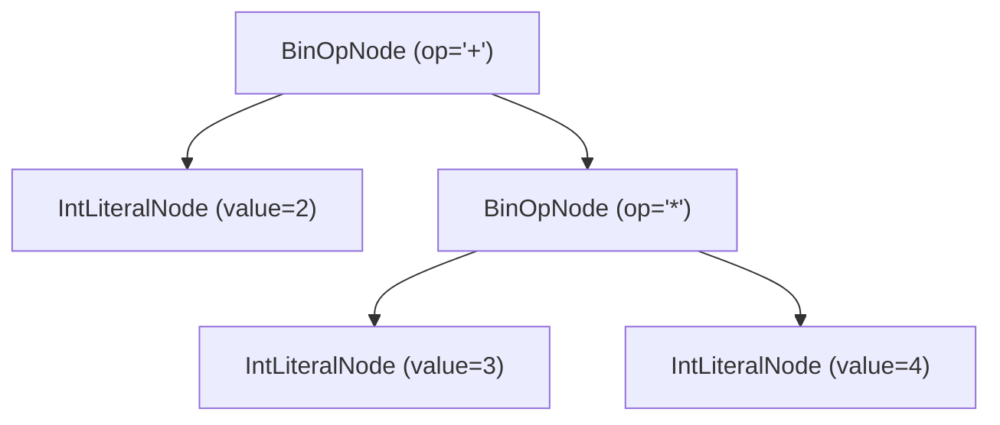
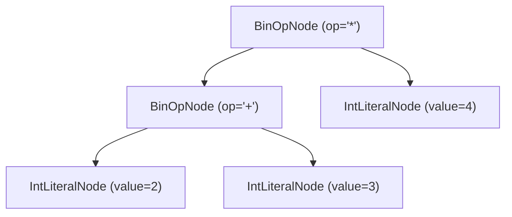
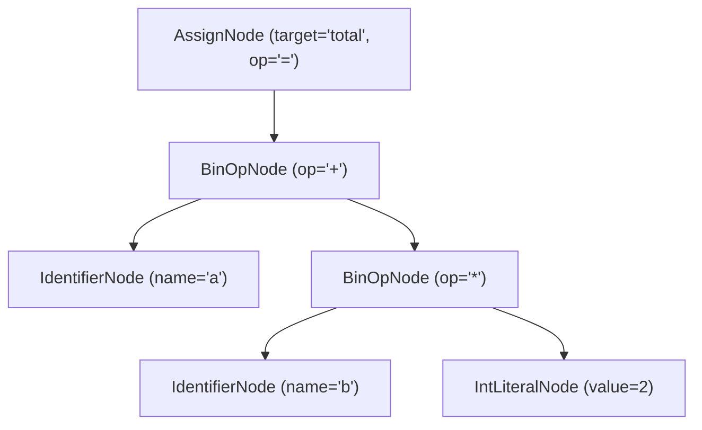
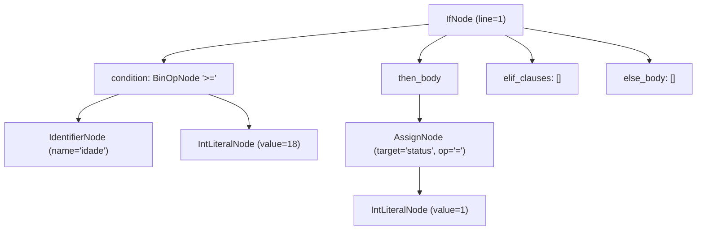
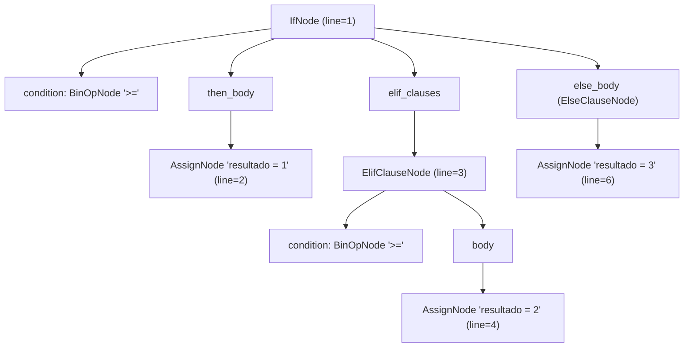
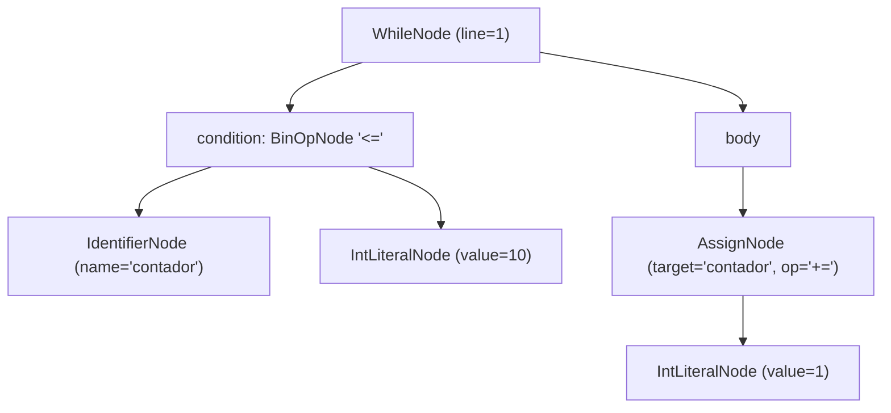
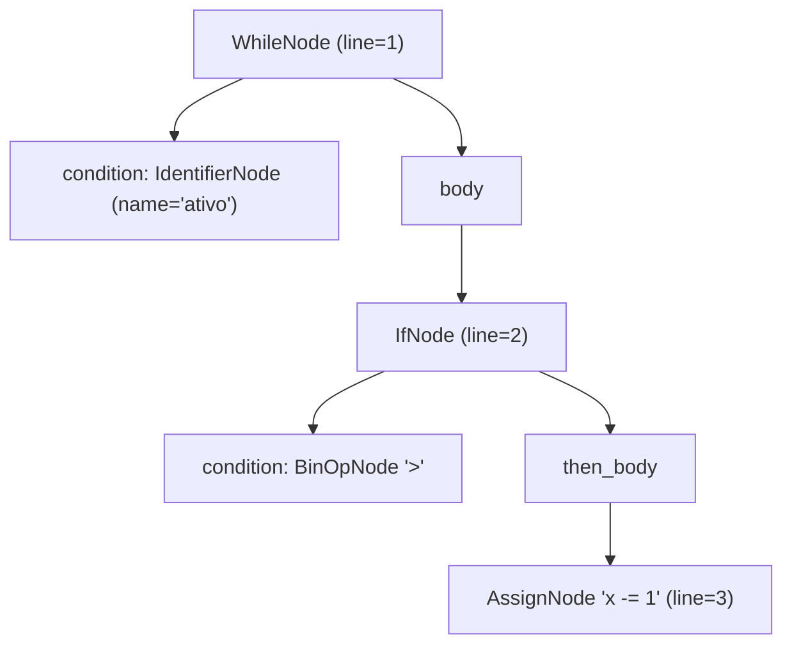

# Gramática de Expressões e Precedência de Operadores

O módulo `src/parser/parser.py` implementa a infraestrutura principal da classe `Parser`, responsável por converter a sequência linear de tokens emitida pelo `Scanner` em sub-árvores da **Árvore Sintática Abstrata (AST)**.

O reconhecimento de expressões utiliza análise sintática recursiva descendente combinada com o algoritmo de **Subida de Precedência (*Precedence Climbing*)**, garantindo que operadores unários, aritméticos, relacionais e agrupamentos por parênteses sejam estruturados respeitando a hierarquia matemática da linguagem.

---

## Gramática Livre de Contexto (EBNF)

As produções gramaticais para as expressões suportadas pelo subconjunto Python do **PyToJava** são definidas formalmente em EBNF como:

```ebnf
expression     ::= comparison ;
comparison     ::= addition ( ( "==" | "!=" | "<" | "<=" | ">" | ">=" ) addition )* ;
addition       ::= multiplication ( ( "+" | "-" ) multiplication )* ;
multiplication ::= unary ( ( "*" | "/" ) unary )* ;
unary          ::= ( "+" | "-" ) unary
                 | primary ;
primary        ::= INT_LITERAL
                 | FLOAT_LITERAL
                 | STRING_LITERAL
                 | "True"
                 | "False"
                 | "None"
                 | IDENTIFIER
                 | "(" expression ")" ;
```

---

## Tabela de Precedência e Associatividade

A tabela a seguir apresenta os níveis de precedência implementados no `Parser`, ordenados da **maior** para a **menor** prioridade de ligação:

| Nível | Categoria | Operadores / Construções | Tokens (`TokenType`) | Associatividade | Peso (`PRECEDENCE`) |
| :---: | :--- | :--- | :--- | :---: | :---: |
| **1 (Maior)** | Agrupamento / Primários | `( expr )`, literais, identificadores | `LPAREN` ... `RPAREN`, `*_LITERAL`, `IDENTIFIER`, `KW_TRUE`, `KW_FALSE`, `KW_NONE` | — | Resolvido em `parse_primary()` |
| **2** | Unários Prefixados | `+x`, `-x` | `OP_PLUS`, `OP_MINUS` | Direita para a Esquerda | Resolvido em `parse_unary()` |
| **3** | Multiplicativos | `*`, `/` | `OP_MULT`, `OP_DIV` | Esquerda para a Direita | `30` |
| **4** | Aditivos | `+`, `-` | `OP_PLUS`, `OP_MINUS` | Esquerda para a Direita | `20` |
| **5 (Menor)** | Relacionais / Comparação | `==`, `!=`, `<`, `<=`, `>`, `>=` | `OP_EQ`, `OP_NEQ`, `OP_LT`, `OP_LTE`, `OP_GT`, `OP_GTE` | Esquerda para a Direita | `10` |

---

## Mapeamento de Expressões Primárias (`parse_primary`)

O método `parse_primary()` consome os elementos atômicos da gramática e instancia os nós folhas correspondentes da AST:

| Token Léxico (`TokenType`) | Exemplo no Fonte | Nó da AST Gerado |
| :--- | :--- | :--- |
| `INT_LITERAL` | `42` | `IntLiteralNode(value=42)` |
| `FLOAT_LITERAL` | `3.14` | `FloatLiteralNode(value=3.14)` |
| `STRING_LITERAL` | `"PyToJava"` | `StringLiteralNode(value="PyToJava")` |
| `KW_TRUE` | `True` | `BoolLiteralNode(value=True)` |
| `KW_FALSE` | `False` | `BoolLiteralNode(value=False)` |
| `KW_NONE` | `None` | `NoneLiteralNode()` |
| `IDENTIFIER` | `contador` | `IdentifierNode(name="contador")` |
| `LPAREN` ... `RPAREN` | `(2 + 3)` | Sub-árvore interna retornada por `parse_expression()` |

---

## Visualização da Precedência na AST

### 1. Precedência Natural (`2 + 3 * 4`)

Sem parênteses, o operador `*` (precedência `30`) possui prioridade superior ao operador `+` (precedência `20`). Por isso, `3 * 4` é agrupado como a sub-árvore direita da adição:



### 2. Alteração de Precedência com Parênteses (`(2 + 3) * 4`)

Quando parênteses são utilizados, `parse_primary()` avalia recursivamente a expressão interna `2 + 3` antes de retornar ao nível multiplicativo:



---

## Validação e Testes

Para executar a suíte de testes unitários do parser de expressões:

```bash
pytest tests/test_parser_expressions.py -v
```

---

## Instruções Simples: Atribuição e `return`

Além de expressões, o `Parser` reconhece instruções imperativas simples. Cada instrução ocupa uma linha e termina em `NEWLINE` (ou imediatamente antes de `DEDENT`/`EOF`, que pertencem a quem fecha o bloco ou o programa).

```ebnf
statement        ::= if_stmt
                   | while_stmt
                   | simple_statement ;
simple_statement ::= return_statement
                   | assignment
                   | expression ;
assignment       ::= IDENTIFIER ( "=" | "+=" | "-=" ) expression ;
return_statement ::= "return" expression? ;
statement_end    ::= NEWLINE | (* antes de *) DEDENT | EOF ;
```

As produções `if_stmt`, `while_stmt` e `block` são detalhadas na seção [Estruturas de Controle de Fluxo](#estruturas-de-controle-de-fluxo).

### Roteamento (`parse_statement`)

O método `parse_statement()` decide qual regra aplicar olhando o token atual e, quando necessário, o próximo (*lookahead* de 1 token):

| Token atual | Próximo token | Método chamado | Nó gerado |
| :--- | :--- | :--- | :--- |
| `KW_RETURN` | qualquer | `parse_return_statement()` | `ReturnNode` |
| `IDENTIFIER` (lexema `print`) | `LPAREN` | `parse_print_statement()` | `PrintNode` |
| `IDENTIFIER` | `OP_ASSIGN`, `OP_ADD_ASSIGN`, `OP_SUB_ASSIGN` | `parse_assignment()` | `AssignNode` |
| outro | — | `parse_expression()` | nó da expressão |

O *lookahead* é necessário porque `x = 1` e `x + 1` começam com o mesmo token `IDENTIFIER`.

### Atribuição (`parse_assignment`)

Consome o identificador de destino, o operador e delega o lado direito a `parse_expression()`. O campo `target` guarda apenas o nome, pois o lado esquerdo sempre é um identificador; `value` guarda a sub-árvore da expressão.

| Código | Nó gerado |
| :--- | :--- |
| `x = 10` | `AssignNode(target="x", op="=", value=IntLiteralNode(value=10))` |
| `contador += 1` | `AssignNode(target="contador", op="+=", value=IntLiteralNode(value=1))` |
| `saldo -= taxa` | `AssignNode(target="saldo", op="-=", value=IdentifierNode(name="taxa"))` |

Para `total = a + b * 2`:



### Retorno (`parse_return_statement`)

Consome `return`. Se o próximo token já encerrar a instrução (`NEWLINE`, `DEDENT` ou `EOF`), o retorno é vazio; caso contrário, a expressão é analisada.

| Código | Nó gerado |
| :--- | :--- |
| `return x + 1` | `ReturnNode(value=BinOpNode(left=IdentifierNode(name="x"), op="+", right=IntLiteralNode(value=1)))` |
| `return` | `ReturnNode(value=None)` |

### Erros em instruções

| Código | Erro |
| :--- | :--- |
| `x =` | expressão ausente após o operador |
| `x = 1 2` | esperado fim de linha após a instrução |
| `return 1 2` | esperado fim de linha após a instrução |

Para executar os testes de instruções simples:

```bash
pytest tests/test_parser_statements.py -v
```

---

## Estruturas de Controle de Fluxo

O `Parser` reconhece blocos condicionais (`if`/`elif`/`else`) e laços de repetição (`while`). Diferentemente das instruções simples, essas construções ocupam múltiplas linhas e dependem dos tokens sintéticos `INDENT` e `DEDENT` para delimitar o escopo do corpo.

### Gramática (EBNF)

```ebnf
block       ::= ":" NEWLINE INDENT statement+ DEDENT ;
if_stmt     ::= "if" expression block elif_clause* else_clause? ;
elif_clause ::= "elif" expression block ;
else_clause ::= "else" block ;
while_stmt  ::= "while" expression block ;
```

As cláusulas `elif_clause` e `else_clause` são fatores separados apenas para fins didáticos. A produção `if_stmt` também pode ser escrita de forma expandida:

```ebnf
if_stmt ::= "if" expression block
            ( "elif" expression block )*
            ( "else" block )? ;
```

| Produção | Método do `Parser` | Nó da AST |
| :--- | :--- | :--- |
| `block` | `parse_block()` | `list[Node]` com as instruções do corpo |
| `if_stmt` | `parse_if_statement()` | `IfNode` |
| `elif_clause` | `parse_if_statement()` | `ElifClauseNode` |
| `else_clause` | `parse_if_statement()` | `ElseClauseNode` (representado em `IfNode.else_body` como lista de nós) |
| `while_stmt` | `parse_while_statement()` | `WhileNode` |

### Tokens sintéticos `INDENT` e `DEDENT`

O Scanner não produz nós nem valores para o recuo: ele traduz a variação de indentação em tokens sintéticos que o Parser consome para abrir e fechar escopos.

- Ao encontrar uma linha mais recuada que a anterior, o Scanner emite `INDENT`.
- Ao encontrar uma linha menos recuada, emite um `DEDENT` para cada nível de escopo encerrado.
- Ao atingir o `EOF`, o Scanner emite os `DEDENT` necessários para fechar todos os blocos ainda abertos.
- Recuos desalinhados geram um token `ERROR`, que o Parser converte em `ParserError`.

O método `parse_block()` implementa o seguinte contrato:

1. consome obrigatoriamente `COLON`;
2. consome obrigatoriamente `NEWLINE`;
3. valida e consome `INDENT` (abertura do escopo);
4. chama `parse_statement()` repetidamente até encontrar `DEDENT`;
5. consome o `DEDENT` correspondente ao escopo aberto.

Como `parse_statement()` delega estruturas compostas novamente a `parse_if_statement()` ou `parse_while_statement()`, blocos aninhados empilham `INDENT`/`DEDENT` de forma equilibrada. Para o trecho abaixo, a sequência relevante de tokens é:

```python
if x > 0:
    y = 1
elif x == 0:
    y = 2
else:
    y = 3
```

```text
KW_IF ... COLON NEWLINE INDENT ... NEWLINE DEDENT
KW_ELIF ... COLON NEWLINE INDENT ... NEWLINE DEDENT
KW_ELSE COLON NEWLINE INDENT ... NEWLINE DEDENT
```

Cada `INDENT` é emparelhado com exatamente um `DEDENT` no mesmo nível. O `DEDENT` que encerra o corpo do `if` não encerra o `if` inteiro: ele apenas devolve o cursor para o nível em que `elif`/`else` podem aparecer.

### Exemplo 1 — `if` simples

```python
if idade >= 18:
    status = 1
```

```python
IfNode(
    condition=BinOpNode(
        left=IdentifierNode(name="idade"),
        op=">=",
        right=IntLiteralNode(value=18),
    ),
    then_body=[
        AssignNode(target="status", op="=", value=IntLiteralNode(value=1)),
    ],
    elif_clauses=[],
    else_body=[],
)
```



### Exemplo 2 — `if` / `elif` / `else`

```python
if nota >= 7:
    resultado = 1
elif nota >= 5:
    resultado = 2
else:
    resultado = 3
```

```python
IfNode(
    condition=BinOpNode(
        left=IdentifierNode(name="nota"),
        op=">=",
        right=IntLiteralNode(value=7),
    ),
    then_body=[
        AssignNode(target="resultado", op="=", value=IntLiteralNode(value=1)),
    ],
    elif_clauses=[
        ElifClauseNode(
            condition=BinOpNode(
                left=IdentifierNode(name="nota"),
                op=">=",
                right=IntLiteralNode(value=5),
            ),
            body=[
                AssignNode(
                    target="resultado", op="=", value=IntLiteralNode(value=2)
                ),
            ],
        ),
    ],
    else_body=[
        AssignNode(target="resultado", op="=", value=IntLiteralNode(value=3)),
    ],
)
```



!!! note "Representação do `else`"
    O nó `ElseClauseNode` está especificado na [AST](ast.md) para representar a cláusula `else`. Na implementação atual do `Parser`, o conteúdo da cláusula é armazenado diretamente em `IfNode.else_body` como uma `list[Node]`, sem encapsular um `ElseClauseNode`.

### Exemplo 3 — `while`

```python
while contador <= 10:
    contador += 1
```

```python
WhileNode(
    condition=BinOpNode(
        left=IdentifierNode(name="contador"),
        op="<=",
        right=IntLiteralNode(value=10),
    ),
    body=[
        AssignNode(
            target="contador",
            op="+=",
            value=IntLiteralNode(value=1),
        ),
    ],
)
```



### Exemplo 4 — Blocos aninhados

```python
while ativo:
    if x > 0:
        x -= 1
```

```python
WhileNode(
    condition=IdentifierNode(name="ativo"),
    body=[
        IfNode(
            condition=BinOpNode(
                left=IdentifierNode(name="x"),
                op=">",
                right=IntLiteralNode(value=0),
            ),
            then_body=[
                AssignNode(
                    target="x", op="-=", value=IntLiteralNode(value=1)
                ),
            ],
            elif_clauses=[],
            else_body=[],
        ),
    ],
)
```



O `INDENT` após `while ativo:` abre o corpo do laço; o `INDENT` após `if x > 0:` abre o corpo condicional interno. Os `DEDENT` são emitidos na ordem inversa, fechando primeiro o `if` e depois o `while`.

### Erros sintáticos comuns

| Código | Erro |
| :--- | :--- |
| `if x` seguido de bloco | esperado `:` ao iniciar o bloco |
| `if x:` sem linha indentada | esperado bloco indentado após `:` |
| `if x: y = 1` | esperado fim de linha após `:` |
| Recuo desalinhado dentro do bloco | `ParserError` (o Scanner emite `ERROR`) |

Para executar os testes de controle de fluxo e validar a documentação:

```bash
pytest tests/test_parser_control_flow.py -v
python -m mkdocs build --strict
```
