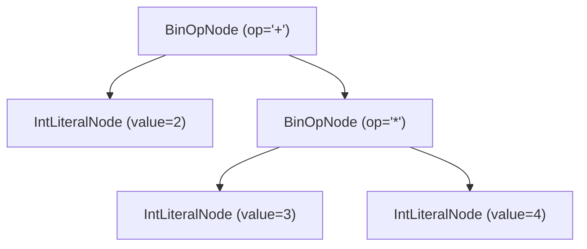
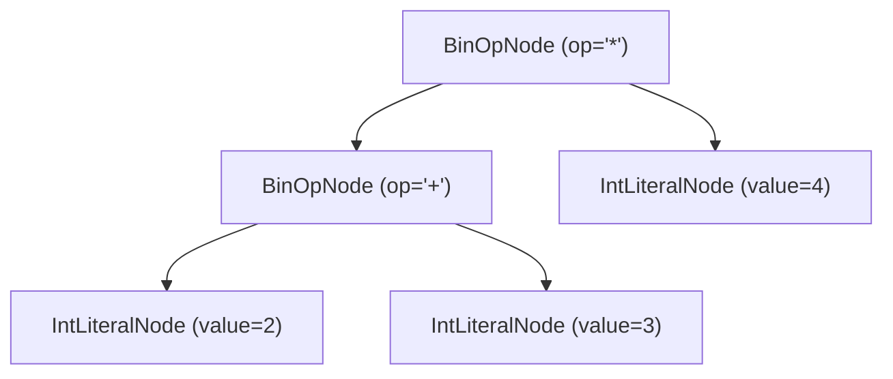

# Gramática de Expressões e Precedência de Operadores

O módulo `src/parser/parser.py` implementa a infraestrutura principal da classe `Parser`, responsável por converter a sequência linear de tokens emitida pelo `Scanner` em sub-árvores da **Árvore Sintática Abstrata (AST)**.

O reconhecimento de expressões utiliza análise sintática recursiva descendente combinada com o algoritmo de **Subida de Precedência (*Precedence Climbing*)**, garantindo que operadores unários, aritméticos, relacionais e agrupamentos por parênteses sejam estruturados respeitando a hierarquia matemática da linguagem.

---

## Gramática Livre de Contexto (EBNF)

As produções gramaticais para as expressões suportadas pelo subconjunto Python do **PyToJava** são definidas formalmente em EBNF como:

```ebnf
expression     ::= comparison ;
comparison     ::= addition ( ( "==" | "!=" | "<" | "<=" | ">" | ">=" ) addition )* ;
addition       ::= multiplication ( ( "+" | "-" ) multiplication )* ;
multiplication ::= unary ( ( "*" | "/" ) unary )* ;
unary          ::= ( "+" | "-" ) unary
                 | primary ;
primary        ::= INT_LITERAL
                 | FLOAT_LITERAL
                 | STRING_LITERAL
                 | "True"
                 | "False"
                 | "None"
                 | IDENTIFIER
                 | "(" expression ")" ;
```

---

## Tabela de Precedência e Associatividade

A tabela a seguir apresenta os níveis de precedência implementados no `Parser`, ordenados da **maior** para a **menor** prioridade de ligação:

| Nível | Categoria | Operadores / Construções | Tokens (`TokenType`) | Associatividade | Peso (`PRECEDENCE`) |
| :---: | :--- | :--- | :--- | :---: | :---: |
| **1 (Maior)** | Agrupamento / Primários | `( expr )`, literais, identificadores | `LPAREN` ... `RPAREN`, `*_LITERAL`, `IDENTIFIER`, `KW_TRUE`, `KW_FALSE`, `KW_NONE` | — | Resolvido em `parse_primary()` |
| **2** | Unários Prefixados | `+x`, `-x` | `OP_PLUS`, `OP_MINUS` | Direita para a Esquerda | Resolvido em `parse_unary()` |
| **3** | Multiplicativos | `*`, `/` | `OP_MULT`, `OP_DIV` | Esquerda para a Direita | `30` |
| **4** | Aditivos | `+`, `-` | `OP_PLUS`, `OP_MINUS` | Esquerda para a Direita | `20` |
| **5 (Menor)** | Relacionais / Comparação | `==`, `!=`, `<`, `<=`, `>`, `>=` | `OP_EQ`, `OP_NEQ`, `OP_LT`, `OP_LTE`, `OP_GT`, `OP_GTE` | Esquerda para a Direita | `10` |

---

## Mapeamento de Expressões Primárias (`parse_primary`)

O método `parse_primary()` consome os elementos atômicos da gramática e instancia os nós folhas correspondentes da AST:

| Token Léxico (`TokenType`) | Exemplo no Fonte | Nó da AST Gerado |
| :--- | :--- | :--- |
| `INT_LITERAL` | `42` | `IntLiteralNode(value=42)` |
| `FLOAT_LITERAL` | `3.14` | `FloatLiteralNode(value=3.14)` |
| `STRING_LITERAL` | `"PyToJava"` | `StringLiteralNode(value="PyToJava")` |
| `KW_TRUE` | `True` | `BoolLiteralNode(value=True)` |
| `KW_FALSE` | `False` | `BoolLiteralNode(value=False)` |
| `KW_NONE` | `None` | `NoneLiteralNode()` |
| `IDENTIFIER` | `contador` | `IdentifierNode(name="contador")` |
| `LPAREN` ... `RPAREN` | `(2 + 3)` | Sub-árvore interna retornada por `parse_expression()` |

---

## Visualização da Precedência na AST

### 1. Precedência Natural (`2 + 3 * 4`)

Sem parênteses, o operador `*` (precedência `30`) possui prioridade superior ao operador `+` (precedência `20`). Por isso, `3 * 4` é agrupado como a sub-árvore direita da adição:



### 2. Alteração de Precedência com Parênteses (`(2 + 3) * 4`)

Quando parênteses são utilizados, `parse_primary()` avalia recursivamente a expressão interna `2 + 3` antes de retornar ao nível multiplicativo:



---

## Validação e Testes

Para executar a suíte de testes unitários do parser de expressões:

```bash
pytest tests/test_parser_expressions.py -v
```
