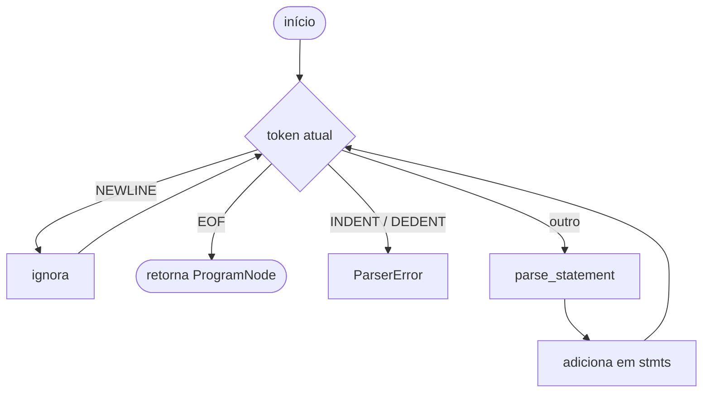
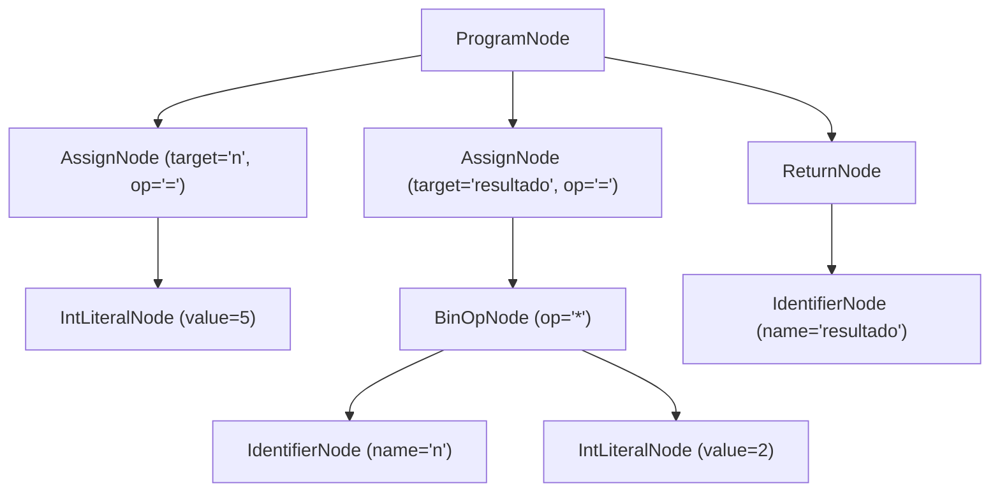

# Analisador Sintático

O analisador sintático (`src/parser/`) recebe a sequência de tokens gerada pelo **Scanner** e constrói a **Árvore Sintática Abstrata (AST)** do programa, cujo nó raiz é o `ProgramNode`.

A técnica é a **análise recursiva descendente**: cada regra da [gramática](grammar.md) corresponde a um método da classe `Parser`, e as expressões usam *Precedence Climbing*. Os nós produzidos estão descritos em [AST](ast.md).

---

## Uso da API

```python
from src.lexer.scanner import Scanner
from src.lexer.token_type import TokenType
from src.parser import Parser

codigo = """
n = 5
resultado = n * 2
return resultado
"""

# 1. Análise léxica: gera a lista de tokens até o EOF
scanner = Scanner(codigo)
tokens = []
while True:
    token = scanner.next_token()
    tokens.append(token)
    if token.type == TokenType.EOF:
        break

# 2. Análise sintática: gera a AST
parser = Parser(tokens)
ast = parser.parse()          # -> ProgramNode

print(len(ast.stmts))         # 3
```

O construtor também aceita o código-fonte diretamente (`Parser(codigo).parse()`), executando o Scanner internamente.

---

## API Pública

| Membro | Descrição |
| :--- | :--- |
| `Parser(tokens)` | Cria o parser a partir da lista de tokens (ou do código-fonte). |
| `parse() -> ProgramNode` | Ponto de entrada: analisa o programa inteiro até o `EOF`. |
| `parse_statement()` | Identifica o tipo da instrução atual e delega ao método adequado. |
| `parse_assignment()` | Atribuição `=`, `+=` ou `-=` → `AssignNode`. |
| `parse_return_statement()` | `return` com expressão opcional → `ReturnNode`. |
| `parse_expression(precedence=0)` | Expressões com precedência de operadores. |
| `peek()`, `advance()`, `match()`, `expect()` | Navegação na lista de tokens. |
| `ParserError` | Exceção de erro sintático com `message`, `line` e `column`. |

---

## Fluxo do método `parse()`



- Linhas em branco e comentários não geram nós: o Scanner não emite tokens para comentários e o `parse()` descarta os `NEWLINE` extras no escopo global.
- Um arquivo vazio gera `ProgramNode(stmts=[])`.
- Indentação no escopo global (ex.: primeira linha recuada) gera `ParserError("Indentação inesperada no escopo global")`.
- O primeiro erro sintático interrompe a análise e informa linha e coluna.

---

## Exemplo de Árvore Gerada

Para o programa acima, `parse()` devolve (posições omitidas):

```python
ProgramNode(stmts=[
    AssignNode(target="n", op="=", value=IntLiteralNode(value=5)),
    AssignNode(
        target="resultado",
        op="=",
        value=BinOpNode(left=IdentifierNode(name="n"), op="*",
                        right=IntLiteralNode(value=2)),
    ),
    ReturnNode(value=IdentifierNode(name="resultado")),
])
```



---

## Validação

```bash
pytest tests/test_parser_integration.py -v
mkdocs build --strict
```
