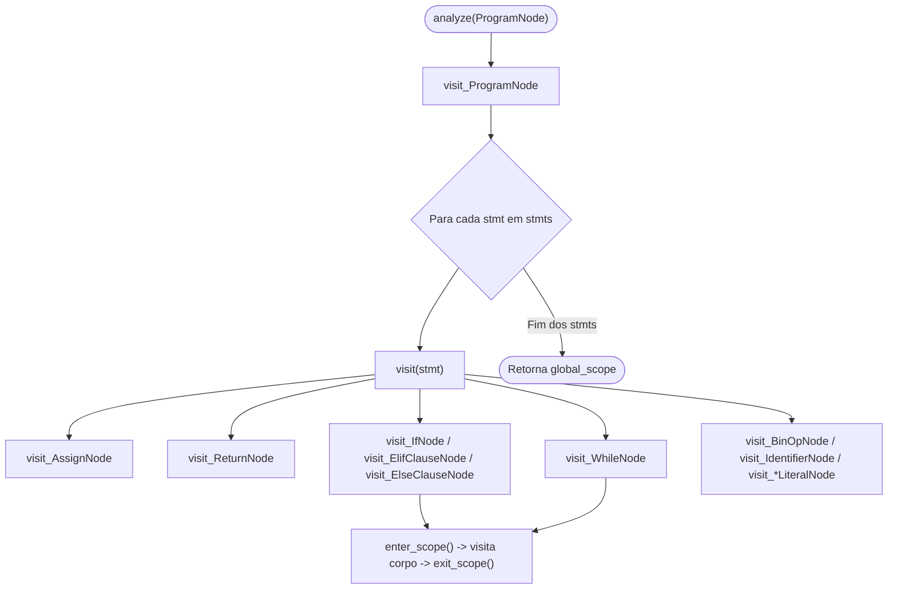
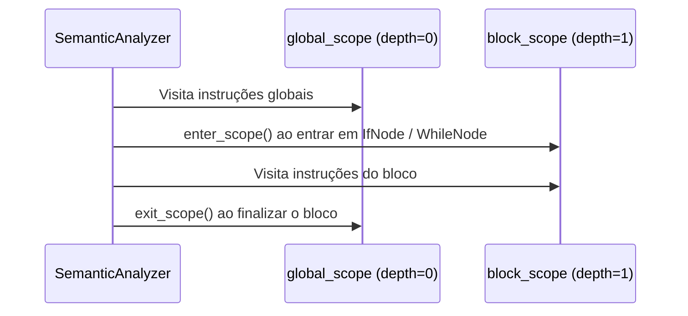

# Analisador Semântico e Navegação na AST (Visitor)

O módulo `src/semantic/analyzer.py` implementa a infraestrutura base do **Analisador Semântico** (`SemanticAnalyzer`) do compilador **PyToJava**, juntamente com a exceção tipada `SemanticError` definida em `src/semantic/errors.py`.

Após o `Parser` construir a **Árvore Sintática Abstrata (AST)** a partir do fluxo de tokens, o `SemanticAnalyzer` percorre recursivamente todos os nós da árvore utilizando o padrão de projeto **Visitor**, gerenciando a abertura e o fechamento de escopos léxicos através da `SymbolTable`.

---

## Fluxo de Navegação (Padrão Visitor)

O despacho de nós no `SemanticAnalyzer` baseia-se no nome da classe de cada nó da AST:

1. O método `analyze(program)` (ou `visit(node)`) recebe a raiz `ProgramNode`.
2. Para cada nó visitado, `visit(node)` resolve dinamicamente o método `visit_<NomeDaClasse>(node)` (ex.: `visit_ProgramNode`, `visit_AssignNode`, `visit_IfNode`).
3. Caso um nó não possua método de visita registrado, o fallback `generic_visit(node)` lança um `SemanticError` com a linha e a coluna exatas do nó.



---

## Gerenciamento de Escopos durante a Travessia

O `SemanticAnalyzer` mantém duas referências principais para a tabela de símbolos:

- **`global_scope`**: instância raiz da `SymbolTable` (`parent=None`, `depth=0`), criada na inicialização do analisador.
- **`current_scope`**: aponta para o escopo ativo no momento exato da visita.

Sempre que o analisador entra no corpo de uma estrutura de controle (`if`, `elif`, `else` ou `while`), o método interno `_visit_block()` executa:

1. `enter_scope()`: cria uma nova `SymbolTable(parent=self.current_scope)` e atualiza `current_scope`.
2. Visita sequencialmente todas as instruções do bloco no novo escopo.
3. `exit_scope()` (em bloco `try/finally`): restaura `current_scope` para o escopo pai, garantindo que variáveis declaradas no bloco interno não vazem para o escopo externo ou para blocos irmãos.



---

## Regras Semânticas para Controle de Fluxo e Escopos de Bloco

A validação de estruturas condicionais (`IfNode`, `ElifClauseNode`, `ElseClauseNode`) e laços de repetição (`WhileNode`) garante duas propriedades fundamentais para a geração de código Java estaticamente tipado:

### 1. Predicados Condicionais Estritamente Booleanos

Diferentemente do Python (que avalia *truthiness* implícita de números e strings), em Java as cláusulas `if (...)` e `while (...)` exigem expressões estritamente do tipo `boolean`. Por isso, `visit_IfNode`, `visit_ElifClauseNode` e `visit_WhileNode` invocam `_validate_condition()`:

- O tipo da condição é inferido via `self.infer_type(node.condition)`.
- Se o tipo resultante for diferente de `"boolean"` (por exemplo, `"int"`, `"float"`, `"String"` ou `"None"`), o analisador lança imediatamente um `SemanticError` indicando a linha e a coluna da condição inválida.

```python
# Inválido semanticamente no PyToJava (condição do tipo 'int'):
x = 10
if x:
    y = 1
# Erro Semântico [Linha 2, Coluna 4]: Condição inválida em 'if': esperado tipo 'boolean', mas recebeu 'int'
```

### 2. Escopo Lexical de Blocos e Isolamento de Variáveis

Cada bloco subordinado (`then_body`, cada cláusula `elif`, `else_body` e o `body` do `while`) é executado dentro de um **escopo filho próprio** criado por `_visit_block(..., new_scope=True)`:

| Regra de Escopo | Comportamento no `SemanticAnalyzer` |
| :--- | :--- |
| **Visibilidade de fora para dentro** | Variáveis declaradas no escopo global (ou em um bloco pai) são encontradas por `current_scope.lookup(name)` dentro do bloco filho e podem ser lidas ou atualizadas desde que mantenham compatibilidade de tipo. |
| **Isolamento de dentro para fora (Não-Vazamento)** | Variáveis declaradas pela primeira vez dentro de um bloco `if`, `elif`, `else` ou `while` são registradas apenas na `SymbolTable` local daquele bloco. Ao término do bloco (`exit_scope()`), o escopo local é destruído e o acesso à variável fora do bloco resulta em `SemanticError` (*variável não declarada*). |
| **Isolamento entre blocos irmãos** | Como cada ramo (`then`, `elif`, `else`) cria e destrói seu próprio escopo filho de forma independente, variáveis locais criadas no ramo `if` não vazam para os ramos `elif` ou `else`. |

---

## API Pública

### `SemanticAnalyzer` (`src/semantic/analyzer.py`)

| Membro | Descrição |
| :--- | :--- |
| `global_scope: SymbolTable` | Escopo raiz (nível global do programa). |
| `current_scope: SymbolTable` | Escopo ativo durante a visita dos nós. |
| `analyze(node: ProgramNode) -> SymbolTable` | Percorre o programa completo e devolve o `global_scope`. |
| `visit(node: Node \| None) -> Any` | Despacha a visita para `visit_<TipoDoNo>(node)`. |
| `enter_scope() -> SymbolTable` | Empilha um novo escopo filho ligado ao `current_scope`. |
| `exit_scope() -> SymbolTable` | Desempilha o escopo atual e retorna ao escopo pai. |
| `visit_ProgramNode`, `visit_AssignNode`, `visit_ReturnNode`, `visit_IfNode`, `visit_ElifClauseNode`, `visit_ElseClauseNode`, `visit_WhileNode`, `visit_BinOpNode`, `visit_IdentifierNode`, `visit_*LiteralNode` | Métodos de visita específicos para cada nó da AST. |

### `SemanticError` (`src/semantic/errors.py`)

Exceção lançada quando uma regra semântica é violada, mantendo o padrão de diagnóstico do compilador:

```python
from src.semantic import SemanticError

erro = SemanticError("Variável 'total' não declarada", line=5, column=12)
print(erro)
# Erro Semântico [Linha 5, Coluna 12]: Variável 'total' não declarada
```

| Atributo | Tipo | Padrão | Descrição |
| :--- | :--- | :--- | :--- |
| `message` | `str` | — | Mensagem descritiva do erro semântico. |
| `line` | `int` | `0` | Linha no código-fonte (1-based). |
| `column` | `int` | `0` | Coluna no código-fonte (1-based). |

---

## Exemplo de Uso

```python
from src.parser import Parser
from src.semantic import SemanticAnalyzer

codigo = """
x = 10
if x > 5:
    y = x + 1
return x
"""

ast = Parser(codigo).parse()
analyzer = SemanticAnalyzer()
escopo_global = analyzer.analyze(ast)
```

---

## Validação e Testes

```bash
pytest tests/test_semantic_analyzer_base.py -v
mkdocs build --strict
```
