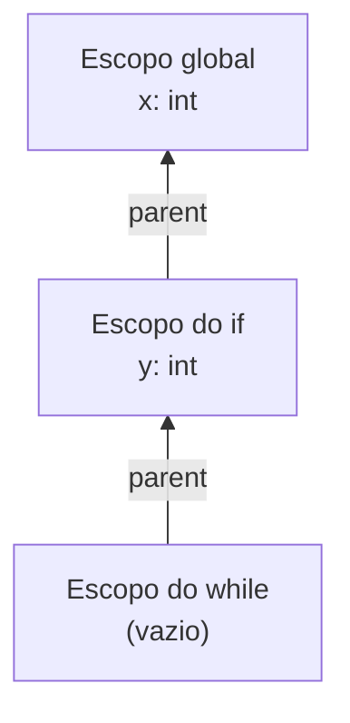

# Tabela de Símbolos e Escopos

A tabela de símbolos (`src/semantic/symbol_table.py`) é a memória do **analisador semântico**: ela registra cada variável declarada no programa, com o seu tipo e a linha em que apareceu, e responde se um nome está visível em determinado ponto do código.

!!! note "Não confundir com a tabela do léxico"
    O módulo `src/lexer/symbol_table.py` apenas registra a primeira ocorrência de cada identificador durante a varredura. A tabela do semântico, descrita aqui, conhece **tipos** e **escopos**.

---

## Componentes

### `Symbol`

Registro imutável de uma variável.

| Atributo | Tipo | Descrição |
| :--- | :--- | :--- |
| `name` | `str` | Nome do identificador. |
| `type` | `str` | Tipo primitivo: `"int"`, `"float"`, `"str"`, `"bool"` ou `"None"`. |
| `line` | `int` | Linha da primeira definição. |
| `column` | `int` | Coluna da primeira definição (opcional, padrão `0`). |

### `SymbolTable`

Cada instância representa **um escopo** e aponta para o escopo que a contém.

| Membro | Descrição |
| :--- | :--- |
| `symbols: dict[str, Symbol]` | Símbolos definidos neste escopo. |
| `parent: SymbolTable \| None` | Escopo pai, ou `None` no escopo global. |
| `define(symbol)` | Registra no escopo atual. Lança `ValueError` se o nome já existir **neste** escopo. |
| `lookup(name)` | Procura no escopo atual e depois nos pais; devolve o `Symbol` ou `None`. |
| `lookup_current_scope(name)` | Procura só no escopo atual. |
| `name in tabela` | Atalho para `lookup(name) is not None`. |
| `depth` | `0` no escopo global, `1` em um bloco dentro dele, e assim por diante. |

---

## Escopos encadeados

Os escopos formam uma cadeia do mais interno até o global. O analisador semântico cria um escopo filho ao entrar em um bloco (`if`, `elif`, `else`, `while`) e volta ao pai ao sair dele.

```python
x = 1              # escopo global (depth 0)
if x > 0:
    y = x + 1      # escopo do if (depth 1): enxerga x
    while y < 5:
        y += 1     # escopo do while (depth 2): enxerga x e y
return x           # de volta ao global: y não é visível aqui
```



### Regras de resolução

1. **Busca de dentro para fora.** `lookup("x")` começa no escopo atual e sobe pelos pais até encontrar o nome ou chegar ao global.
2. **O pai não enxerga o filho.** Uma variável definida dentro do `if` não existe fora dele.
3. **Escopos irmãos são isolados.** O que é definido no `then` não aparece no `else`.
4. **Sombreamento.** Definir no filho um nome que já existe no pai é permitido; dentro do filho, `lookup` devolve o símbolo mais próximo.
5. **Redeclaração.** Definir duas vezes o mesmo nome **no mesmo escopo** lança `ValueError`. Cabe ao analisador semântico decidir se uma nova atribuição é redeclaração ou reatribuição (consultando `lookup` antes de chamar `define`).

---

## Exemplo de uso

```python
from src.semantic import Symbol, SymbolTable

global_scope = SymbolTable()
global_scope.define(Symbol(name="x", type="int", line=1))

if_scope = SymbolTable(parent=global_scope)
if_scope.define(Symbol(name="y", type="int", line=3))

if_scope.lookup("x")                # Symbol(name='x', type='int', line=1, column=0)
if_scope.lookup_current_scope("x")  # None
global_scope.lookup("y")            # None: y só existe dentro do if
```

---

## Validação

```bash
pytest tests/test_symbol_table.py -v
mkdocs build --strict
```
