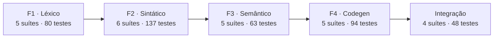

# Suítes de Testes — Cobertura Completa do PyToJava

<div class="phase-banner">
  <span class="phase-banner-title"> Cobertura · 26 suítes · 727 testes automatizados · 2 falhas conhecidas</span>
  <span class="phase-banner-meta">tests/ · pytest · Python 3.10+</span>
</div>

Os testes cobrem as quatro fases do compilador de forma independente e integrada. Cada fase agrupa as suítes relacionadas; dentro de cada suíte há um resumo do que é testado, quantas vezes e exemplos concretos, seguido pela tabela individual de cada teste.



```bash
# Todos os testes
pytest -v

# Uma suíte específica (exemplo)
pytest tests/test_scanner.py -v
```

---

## F1 · Análise Léxica

---

### Scanner

**Arquivo:** `test_scanner.py` · 31 testes

**O que é testado:** O `Scanner` lê o código-fonte caractere a caractere e transforma em tokens. Esta suíte valida que todos os 11 tipos de palavra-chave são reconhecidos corretamente, que identificadores com underscore e dígitos funcionam, que literais inteiros e floats têm seus valores convertidos, que strings com escapes (`\"`, `\n`, `\\`) são processadas, que operadores compostos como `<=` e `+=` não são divididos em dois tokens (*maximal munch*), que comentários são descartados sem deixar rastro, que blocos geram `INDENT`/`DEDENT`, e que erros como `@` ou string não terminada disparam `LexicalError` com linha e coluna exatos.

**Cobertura em números:** 11 palavras-chave testadas individualmente · 4 tipos de identificador com underscore/dígitos · 3 literais inteiros · 3 floats · 2 strings com escape · 6 operadores relacionais · 3 delimitadores · 4 variações de comentário · 3 variações de `NEWLINE`/`CRLF` · 3 variações de bloco com `INDENT`/`DEDENT` · 4 exemplos diretos da especificação léxica.

**Exemplos de casos testados:**

```python
# Keyword não pode ser prefixo de identificador
scan_all("define")[0].type == IDENTIFIER  # não KW_DEF
scan_all("ifx")[0].type   == IDENTIFIER  # não KW_IF

# Maximal munch — operadores compostos não divididos
scan_all("+=")  # → [OP_ADD_ASSIGN, EOF], nunca [OP_PLUS, OP_ASSIGN]
scan_all("<=")  # → [OP_LTE, EOF]

# Escapes processados no literal
scan_all(r'"linha1\nlinha2"')[0].literal == "linha1\nlinha2"

# Erro com posição exata
scan_all("def main():\n    a = 10\n    b = a @ 2\n")
# → LexicalError linha=3, coluna=11, "caractere inválido '@'"
```

| Teste | O que verifica |
| :--- | :--- |
| `test_keywords_all` | 11 palavras-chave reconhecidas com tipo e lexema corretos |
| `test_keyword_not_matched_as_prefix` | `define` e `ifx` reconhecidos como `IDENTIFIER` |
| `test_keywords_case_sensitive` | `DEF`, `Class`, `true` são `IDENTIFIER` (case-sensitive) |
| `test_identifier_with_underscore_and_digits` | `_init`, `total_1`, `valor2`, `__x__` como `IDENTIFIER` |
| `test_int_literal` | `0`, `42`, `1000` com `token.literal` convertido para `int` |
| `test_float_literal` | `0.5`, `3.1415`, `10.0` com `token.literal` convertido para `float` |
| `test_int_followed_by_dot_without_digit_is_not_float` | `3.` lança `LexicalError` — ponto sem dígito não é float |
| `test_string_double_quotes` | `"olá"` gera `STRING_LITERAL` com `literal == "olá"` |
| `test_string_single_quotes` | `'texto'` gera `STRING_LITERAL` com `literal == "texto"` |
| `test_string_with_escape_sequences` | `\"` dentro de string processado corretamente |
| `test_string_with_newline_escape` | `\n` na string vira caractere de nova linha em `token.literal` |
| `test_unterminated_string_raises_lexical_error` | String não fechada antes de `\n` → `LexicalError` linha 1 coluna 1 |
| `test_unterminated_string_at_eof_raises_lexical_error` | String aberta até o EOF → `LexicalError` |
| `test_compound_assignment_operators` | `+=` → `OP_ADD_ASSIGN`; `-=` → `OP_SUB_ASSIGN` (inteiros, não divididos) |
| `test_assign_operator` | `=` simples → `OP_ASSIGN` |
| `test_relational_operators` | `==`, `!=`, `<`, `<=`, `>`, `>=` com lexema correto |
| `test_delimiters` | `:` → `COLON`; `(` → `LPAREN`; `)` → `RPAREN` |
| `test_invalid_character_raises_lexical_error` | `@` → `LexicalError("caractere inválido '@'")` linha 1 coluna 1 |
| `test_inline_comment_is_discarded` | `# comentário` ao final de linha descartado sem `ERROR` |
| `test_comment_does_not_generate_newline` | Linha só de comentário não gera `NEWLINE` |
| `test_newline_token_emitted` | `\n` gera token `NEWLINE` |
| `test_crlf_produces_single_newline` | `\r\n` produz exatamente um `NEWLINE` |
| `test_blank_lines_do_not_produce_newline` | Linhas em branco entre instruções não geram tokens extras |
| `test_indent_and_dedent_single_block` | Bloco simples: exatamente 1 `INDENT` e 1 `DEDENT` |
| `test_nested_blocks_emit_multiple_indent_dedent` | Dois blocos aninhados: exatamente 2 `INDENT`s e 2 `DEDENT`s |
| `test_eof_closes_open_blocks_with_dedents` | EOF fecha bloco aberto emitindo `DEDENT` antes de `EOF` |
| `test_spec_example_comment_discarded` | Spec exemplo 1: `def dobro` com comentários → sequência exata de 15 tokens |
| `test_spec_example_compound_operators` | Spec exemplo 2: `while total <= 100` com `+=` → sequência exata de 13 tokens |
| `test_spec_example_invalid_char_at` | Spec erro: `@` linha 3 coluna 11 → `LexicalError` |
| `test_spec_example_unterminated_string_position` | Spec erro: string não terminada linha 2 coluna 13 → `LexicalError` |
| `test_many_blank_lines_do_not_cause_recursion_error` | 1500 linhas em branco não causam `RecursionError` |

---

### Casos Felizes do Lexer

**Arquivo:** `test_lexer_happy_path.py` · 16 testes

**O que é testado:** Todos os tokens válidos da linguagem verificados via `Scanner.next_token()` com validação de `token.type`, `token.lexeme`, `token.literal`, `token.line` e `token.column`. Esta suíte foca nos caminhos sem erro: cada keyword individualmente com `@pytest.mark.parametrize`, 7 identificadores válidos, 9 variações de string incluindo escapes desescapados no `literal`, 16 operadores e delimitadores com lexema, e coordenadas exatas em programas de uma e múltiplas linhas.

**Cobertura em números:** 11 keywords parametrizadas · 7 identificadores · 11 pseudo-keywords como `define`, `DEF` → `IDENTIFIER` · 4 inteiros · 4 floats · 9 strings com escapes · 16 operadores/delimitadores · 6 operadores compostos com maximal munch · 3 variações de comentário · 2 programas para coordenadas (linha única e multilinhas) · 3 programas completos integrados.

**Exemplos de casos testados:**

```python
# Coordenadas exatas em "x = 42"
tokens[0] → (line=1, column=1, lexeme="x")
tokens[1] → (line=1, column=3, lexeme="=")
tokens[2] → (line=1, column=5, lexeme="42")

# String com escape desescapada no literal
scan_all(r'"com \"escape\""')[0].literal == 'com "escape"'
scan_all(r'"barra \\ invertida"')[0].literal == "barra \\ invertida"

# Programa completo — sequência de tipos validada
get_token_types("def calcular_dobro(numero):\n    return numero * 2\n")
# → [KW_DEF, IDENTIFIER, LPAREN, IDENTIFIER, RPAREN, COLON,
#    NEWLINE, INDENT, KW_RETURN, IDENTIFIER, OP_MULT,
#    INT_LITERAL, NEWLINE, DEDENT, EOF]
```

| Grupo | Teste | O que verifica |
| :--- | :--- | :--- |
| Keywords | `test_keywords_recognition` | 11 keywords → tipo e lexema corretos (parametrizado) |
| Identificadores | `test_valid_identifiers` | 7 identificadores válidos com `literal=None` (parametrizado) |
| Identificadores | `test_keywords_not_matched_on_prefixes_or_casing` | 11 casos como `define`, `DEF`, `TrueValue` → `IDENTIFIER` (parametrizado) |
| Literais | `test_int_literals` | `0`, `42`, `1000`, `999999` com `token.literal` como `int` (parametrizado) |
| Literais | `test_float_literals` | `0.0`, `3.14`, `0.5`, `123.456` com `token.literal` como `float` (parametrizado) |
| Literais | `test_string_literals` | 9 casos — aspas simples, duplas, `\"`, `\'`, `\n`, `\\` (parametrizado) |
| Operadores | `test_operators_and_delimiters` | 16 operadores e delimitadores por tipo e lexema (parametrizado) |
| Operadores | `test_compound_operator_maximal_munch` | `<=`, `>=`, `==`, `!=`, `+=`, `-=` como token único (6 casos) |
| Comentários | `test_full_line_comment_ignored` | Linha de comentário → único token `EOF` |
| Comentários | `test_inline_comment_ignored` | Comentário inline não altera sequência da expressão |
| Comentários | `test_multiple_spaces_and_tabs_ignored` | Múltiplos espaços e tabs entre tokens descartados |
| Coordenadas | `test_token_coordinates_single_line` | `x = 42` → colunas 1, 3, 5 na linha 1 |
| Coordenadas | `test_token_coordinates_multiline` | `a = 10\nb = 20.5` → coordenadas corretas nas linhas 1 e 2 |
| Integração | `test_happy_path_function_definition` | `def calcular_dobro(numero): return numero * 2` → 15 tokens na ordem exata |
| Integração | `test_happy_path_while_loop_with_compound_operator` | `while contador <= 10: contador += 1` → 13 tokens com `INDENT`/`DEDENT` |
| Integração | `test_happy_path_conditional_statement` | `if ativo == True: ... else: ...` → 22 tokens com dois pares `INDENT`/`DEDENT` |

---

### Casos Limite do Lexer

**Arquivo:** `test_lexer_edge_cases.py` · 18 testes

**O que é testado:** Cenários de fronteira onde o lexer precisa lidar com situações fora do caminho feliz: retorno abrupto de múltiplos níveis de indentação de uma vez, recuo para nível que não existe na pilha, fechamento automático de blocos quando o arquivo termina no meio de um bloco, strings sem fechamento (aspas duplas, simples, barra invertida final, EOF), nove caracteres ilegais com posição exata, e entradas completamente vazias ou só com comentários.

**Cobertura em números:** 2 casos de dedent múltiplo/parcial · 2 casos de desalinhamento · 2 casos de fechamento no EOF · 4 variações de string não terminada · 9 caracteres ilegais (parametrizados) + `!` isolado + float com `.` final · 5 variações de entrada vazia.

**Exemplos de casos testados:**

```python
# 3 ifs aninhados → retorno abrupto ao global emite 3 DEDENTs seguidos
source = "if True:\n    if True:\n        if True:\n            x = 1\ny = 2\n"
y_idx = tokens.index("y")
types[y_idx-3:y_idx] == [DEDENT, DEDENT, DEDENT]  # exatamente antes de "y"

# Desalinhamento emite ERROR com mensagem padronizada
source = "if True:\n    if True:\n        x = 1\n      y = 2\n"
# nível 6 não existe em [0, 4, 8] → TokenType.ERROR linha 4

# EOF com 3 blocos abertos
source = "def calcular():\n    if True:\n        while True:\n            x = 1"
types[-4:] == [DEDENT, DEDENT, DEDENT, EOF]
```

| Grupo | Teste | O que verifica |
| :--- | :--- | :--- |
| Dedent múltiplo | `test_multiple_dedents_returning_to_global_scope` | 3 ifs aninhados → 3 `DEDENT`s imediatamente antes de `y` |
| Dedent múltiplo | `test_partial_dedent_to_intermediate_level` | Nível 8→4: exatamente 1 `DEDENT`, sem `DEDENT` adicional |
| Desalinhamento | `test_misaligned_indentation_emits_error_token` | Nível 6 em pilha `[0,4,8]` → `TokenType.ERROR` `"Indentação desalinhada"` linha 4 |
| Desalinhamento | `test_misaligned_indentation_with_two_spaces` | Nível 2 em pilha `[0,4]` → `TokenType.ERROR` linha 3 |
| EOF | `test_eof_with_single_open_block_emits_dedent_and_eof` | Bloco aberto sem `\n` final → `[DEDENT, EOF]` |
| EOF | `test_eof_with_multiple_open_blocks_emits_all_dedents` | 3 blocos abertos → `[DEDENT, DEDENT, DEDENT, EOF]` |
| String | `test_unterminated_string_with_newline_raises_lexical_error` | `"string sem fechar\n` → `LexicalError` linha 1 coluna 5 |
| String | `test_unterminated_single_quote_string_with_newline_raises_lexical_error` | `'abriu e nao fechou\n` → `LexicalError` linha 1 coluna 12 |
| String | `test_unterminated_string_at_eof_raises_lexical_error` | String abre na linha 2 e chega ao EOF → `LexicalError` linha 2 coluna 12 |
| String | `test_unterminated_string_with_trailing_escape` | `"incompleto\` → `LexicalError` |
| Inválidos | `test_unsupported_characters_raise_lexical_error` | `@`, `$`, `?`, `~`, `` ` ``, `^`, `&`, `\|`, `;` → `LexicalError` coluna 8 (parametrizado · 9 casos) |
| Inválidos | `test_isolated_exclamation_mark_raises_lexical_error` | `!` isolado sem `=` → `LexicalError` linha 1 coluna 6 |
| Inválidos | `test_malformed_float_with_trailing_dot_raises_lexical_error` | `3.` sem dígito → `LexicalError` linha 1 coluna 9 |
| Vazio | `test_completely_empty_source` | String vazia `""` → único token `EOF` em `(1, 1)` |
| Vazio | `test_whitespace_and_tabs_only` | Só espaços e tabs → único `EOF` |
| Vazio | `test_blank_lines_only` | Só `\n` e `\r\n` → único `EOF` |
| Vazio | `test_comments_only` | 3 linhas de comentário → único `EOF` |
| Vazio | `test_interleaved_comments_blank_lines_and_spaces` | Mix de comentários, espaços e linhas em branco → único `EOF` |

---

### Gerenciador de Indentação

**Arquivo:** `test_indent_manager.py` · 10 testes

**O que é testado:** O módulo `indent_manager` mantém a pilha `INDENT_STACK` e os tokens pendentes `PENDING_TOKENS`. É ele quem decide, a cada nova linha, se deve emitir `INDENT`, `DEDENT`, um token `ERROR` de desalinhamento ou nada. Esta suíte testa o estado inicial, o reset completo, as quatro transições possíveis (aumentar, reduzir por um, reduzir por vários, desalinhar), o comportamento de nível igual, o fechamento final de todos os blocos abertos, e que a API pública é exportada corretamente pelo pacote `src.lexer`.

**Cobertura em números:** 4 transições de nível testadas · 1 caso de desalinhamento com mensagem exata · 1 caso de nível igual sem emissão · 1 finalização com 2 blocos abertos · 1 finalização no nível base · 4 funções da API pública verificadas.

**Exemplos de casos testados:**

```python
# Aumentar nível emite INDENT e empilha
reset_indent_manager()
process_indentation(4, 1, 1)  # → [INDENT], pilha=[0,4]
process_indentation(8, 2, 1)  # → [INDENT], pilha=[0,4,8]

# Desalinhamento — mensagem padronizada
process_indentation(3, 3, 1)
# → [Token(ERROR, "Erro Léxico [Linha 3, Coluna 1]: Indentação desalinhada")]
# pilha desempilhada para [0]

# Fechar todos os blocos abertos no EOF
finalize_indentation(10, 1)  # pilha=[0,4,8] → [DEDENT, DEDENT], pilha=[0]
```

| Teste | O que verifica |
| :--- | :--- |
| `test_initial_state` | `get_current_indent_level()` retorna `0` ao importar |
| `test_reset_indent_manager` | Esvazia `PENDING_TOKENS` e restaura `INDENT_STACK` para `[0]` |
| `test_process_indentation_increase` | Aumentar o recuo de 0 para 4 espaços e depois de 4 para 8 espaços emite `INDENT` e registra o novo nível na pilha em cada caso |
| `test_process_indentation_single_and_multiple_dedent` | Reduzir de 8 para 4 espaços emite 1 `DEDENT`; reduzir de 8 para 0 espaços emite 2 `DEDENT`s de uma vez |
| `test_process_indentation_misaligned_error` | Tentar recuar para 3 espaços quando a pilha só conhece os níveis `[0, 4, 8]` emite token `ERROR` com a mensagem de desalinhamento e desempilha tudo |
| `test_process_indentation_same_level` | Linha com o mesmo recuo da anterior não emite nenhum token nem altera a pilha |
| `test_finalize_indentation_with_multiple_open_blocks` | Finalizar com 2 blocos ainda abertos emite 2 `DEDENT`s com a linha e coluna do fim do arquivo |
| `test_finalize_indentation_at_root_level` | Finalizar já no nível base (recuo zero) não emite nada e não altera a pilha |
| `test_public_api_exports` | 4 funções exportadas corretamente pelo pacote `src.lexer` |
| `test_process_indentation_rejects_negative_level` | Nível negativo → `ValueError` sem mutar a pilha |

---

### Tabela de Símbolos Léxica e LexicalError

**Arquivo:** `test_symbol_table_and_errors.py` · 5 testes

**O que é testado:** A tabela de símbolos léxica (`src/lexer/symbol_table.py`) armazena os identificadores encontrados durante a varredura com sua primeira ocorrência. Esta suíte verifica a formatação do `LexicalError`, inserção e recuperação de símbolos, que inserções repetidas preservam a primeira ocorrência (não substituem), que nomes inexistentes retornam `None`, e que a ordem de inserção é preservada.

**Cobertura em números:** 1 formatação de erro com linha e coluna · 1 inserção com lookup e contains · 1 preservação de primeira ocorrência · 1 lookup de inexistente · 1 ordem de inserção.

**Exemplos de casos testados:**

```python
# LexicalError formata a posição
str(LexicalError("Caractere inesperado '@'", 3, 11))
# → "Erro Léxico [Linha 3, Coluna 11]: Caractere inesperado '@'"

# Inserção repetida preserva primeira ocorrência
first   = insert_symbol(table, "total", IDENTIFIER, line=2, col=5)
repeated = insert_symbol(table, "total", IDENTIFIER, line=9, col=3)
repeated is first          # True — mesmo objeto
repeated.first_declared_line == 2  # preserva linha original
len(table) == 1            # não duplica
```

| Grupo | Teste | O que verifica |
| :--- | :--- | :--- |
| `LexicalError` | `test_formats_message_with_source_position` | `message`, `line=3`, `column=11` e formato `"Erro Léxico [Linha 3, Coluna 11]: ..."` |
| Tabela | `test_inserts_and_finds_symbol` | `insert_symbol` insere; `lookup_symbol` e `contains_symbol` encontram |
| Tabela | `test_preserves_first_occurrence` | Inserção repetida retorna símbolo original com linha da primeira declaração |
| Tabela | `test_returns_none_for_unknown_symbol` | `lookup_symbol` → `None`; `contains_symbol` → `False` para nomes inexistentes |
| Tabela | `test_lists_symbols_in_insertion_order` | Símbolos listados na ordem de inserção |

---

## F2 · Análise Sintática

---

### Nós da AST

**Arquivo:** `test_ast_nodes.py` · 45 testes

**O que é testado:** Todos os nós da Árvore Sintática Abstrata definidos em `src/parser/nodes.py`. A classe base `Node` usa `kw_only=True` para forçar que `line` e `column` sejam sempre por keyword, impedindo confusão de posição com valores de campo. Esta suíte valida que a herança funciona, que listas padrão não são compartilhadas entre instâncias, que todos os 15 tipos de nó armazenam seus campos corretamente, e que os 6 nós folha aceitam coordenadas mas rejeitam posicionais.

**Cobertura em números:** 2 testes de `Node` base · 6 de `ProgramNode` · 5 de `AssignNode`/`ReturnNode` · 5 de `BinOpNode` com 4 operadores aritméticos + 6 relacionais parametrizados · 3 de `ElifClauseNode` · 3 de `ElseClauseNode` · 6 de `IfNode` · 3 de `WhileNode` · 12 dos 6 nós folha (5 nomes de identif. + 5 inteiros + 5 floats + 7 strings + 2 booleanos + 3 de `NoneLiteralNode`) com 3 testes parametrizados cobrindo todos os 6 de uma vez.

**Exemplos de casos testados:**

```python
# kw_only=True — posicionais rejeitados
Node(10, 4)   # → TypeError

# Listas padrão isoladas entre instâncias
prog_a = ProgramNode()
prog_b = ProgramNode()
prog_a.stmts.append(Node())
len(prog_b.stmts) == 0  # prog_b não foi afetado

# Aninhamento de BinOpNode simula precedência
# 2 + 3 * 4 → raiz.op=="+", raiz.right.op=="*"
root = BinOpNode(two, "+", BinOpNode(three, "*", four))

# NoneLiteralNode não tem campo value
NoneLiteralNode(value=None)  # → TypeError
```

| Grupo | Teste | O que verifica |
| :--- | :--- | :--- |
| `Node` | `test_node_default_instantiation` | `line=0`, `column=0` por padrão |
| `Node` | `test_node_custom_position_keyword_only` | Aceita keyword; rejeita posicional com `TypeError` |
| `ProgramNode` | `test_program_node_default_instantiation` | `stmts=[]`, `line=0`, `column=0` |
| `ProgramNode` | `test_program_node_mutable_default_isolation` | Duas instâncias com listas independentes |
| `ProgramNode` | `test_program_node_with_custom_elements_and_positions` | Armazena elementos e posição |
| `ProgramNode` | `test_program_node_positional_stmts` | `stmts` aceita argumento posicional |
| `ProgramNode` | `test_program_node_inheritance` | `isinstance(ProgramNode(), Node)` verdadeiro |
| `ProgramNode` | `test_kw_only_allows_subclasses_with_positional_and_default_fields` | Subclasse com campos posicionais não conflita com `kw_only` |
| `AssignNode` | `test_assign_node_instantiation` | `target`, `op`, `value`, `line`, `column` armazenados |
| `AssignNode` | `test_assign_node_operators` | `=`, `+=`, `-=` aceitos (parametrizado · 3 casos) |
| `ReturnNode` | `test_return_node_instantiation` | `value` e coordenadas; `value=None` por padrão |
| `ReturnNode` | `test_return_node_variants` | Com e sem `value` (parametrizado · 2 casos) |
| `Assign/Return` | `test_assign_and_return_nodes_inheritance_and_metadata` | Herança de `Node` e `line`/`column` em ambos |
| `BinOpNode` | `test_binop_node_default_instantiation` | `left=None`, `op=""`, `right=None` |
| `BinOpNode` | `test_binop_node_arithmetic_operators` | `+`, `-`, `*`, `/` (parametrizado · 4 casos) |
| `BinOpNode` | `test_binop_node_relational_operators` | `==`, `!=`, `<`, `<=`, `>`, `>=` (parametrizado · 6 casos) |
| `BinOpNode` | `test_binop_node_right_nesting_precedence` | `2 + 3 * 4` → `op="+"`, `right.op="*"` |
| `BinOpNode` | `test_binop_node_left_nesting_and_relational_combination` | `(10 - 2) / 4 <= 5` em aninhamento à esquerda |
| `ElifClauseNode` | `test_elif_clause_node_default_values` | `condition=None`, `body=[]` |
| `ElifClauseNode` | `test_elif_clause_node_with_values` | Armazena `condition` e `body` |
| `ElifClauseNode` | `test_elif_clause_node_inherits_from_node` | `isinstance` e `issubclass` |
| `ElseClauseNode` | `test_else_clause_node_default_values` | `body=[]` por padrão |
| `ElseClauseNode` | `test_else_clause_node_with_body` | Armazena `body` corretamente |
| `ElseClauseNode` | `test_else_clause_node_inherits_from_node` | `isinstance` e `issubclass` |
| `IfNode` | `test_if_node_default_values` | `condition=None`, `then_body=[]`, `elif_clauses=[]`, `else_body=[]` |
| `IfNode` | `test_if_node_without_elif_and_else` | Simples sem cláusulas opcionais |
| `IfNode` | `test_if_node_with_elif_clauses` | Múltiplos `ElifClauseNode` na ordem correta |
| `IfNode` | `test_if_node_with_else_clause` | `else_body` preenchido com `elif_clauses=[]` |
| `IfNode` | `test_if_node_complete_if_elif_else` | Todos os campos preenchidos ao mesmo tempo |
| `IfNode` | `test_if_node_inherits_from_node` | `isinstance` e `issubclass` |
| `WhileNode` | `test_while_node_default_values` | `condition=None`, `body=[]` |
| `WhileNode` | `test_while_node_with_values` | `condition` e `body` armazenados |
| `WhileNode` | `test_while_node_inherits_from_node` | `isinstance` e `issubclass` |
| `IdentifierNode` | `test_identifier_node_stores_valid_names` | 5 nomes com underscore, dígitos, casing (parametrizado) |
| `IdentifierNode` | `test_identifier_node_default_name` | `name=""` por padrão |
| `IntLiteralNode` | `test_int_literal_node_stores_values` | `0`, `1`, `42`, `-7`, `-1024` como `int` (parametrizado · 5 casos) |
| `FloatLiteralNode` | `test_float_literal_node_stores_values` | `0.0`, `3.14`, `-0.5`, `1e-3`, `123.456` como `float` (parametrizado · 5 casos) |
| `StringLiteralNode` | `test_string_literal_node_stores_values` | 7 strings incluindo vazia, aspas e chars especiais (parametrizado) |
| `BoolLiteralNode` | `test_bool_literal_node_stores_value` | `True` e `False` como `bool` (parametrizado · 2 casos) |
| `NoneLiteralNode` | `test_none_literal_node_instantiation_without_value` | Sem campo `value`; apenas coordenadas |
| `NoneLiteralNode` | `test_none_literal_node_default_instantiation` | `line=0`, `column=0` |
| `NoneLiteralNode` | `test_none_literal_node_rejects_value_field` | `NoneLiteralNode(value=None)` → `TypeError` |
| Folha | `test_leaf_nodes_inherit_from_node` | 6 nós folha herdam de `Node` (parametrizado · 6 casos) |
| Folha | `test_leaf_nodes_propagate_position_metadata` | `line=10`, `column=5` em todos os 6 nós (parametrizado) |
| Folha | `test_leaf_nodes_reject_positional_metadata` | `line`/`column` posicionais rejeitados por `kw_only` (parametrizado · 6 casos) |

---

### Expressões do Parser

**Arquivo:** `test_parser_expressions.py` · 20 testes

**O que é testado:** O método `parse_expression()` usando o algoritmo *Precedence Climbing* em `src/parser/parser.py`. Esta suíte verifica os métodos auxiliares de navegação de tokens, o parsing de cada tipo de literal e identificador, agrupamento com parênteses sobrescrevendo precedência, operadores unários `+` e `-` como prefixo com encadeamento, e a hierarquia completa de precedência dos operadores binários com associatividade à esquerda.

**Cobertura em números:** 2 testes de navegação · 3 de inteiro + 3 de float + 3 de string · 4 de identificador · 3 de keyword literal · 3 de parênteses · 3 de unário · 6 de precedência/associatividade (1 mult>add, 1 div>sub, 2 de assoc. esquerda, 1 relacional<aritmético parametrizado com 6 ops) · 1 de erro.

**Exemplos de casos testados:**

```python
# Parênteses sobrescrevem precedência
parse_expr("(2 + 3) * 4")
# → BinOpNode(op="*", left=BinOpNode(op="+", left=2, right=3), right=4)

# Sem parênteses — mult tem precedência
parse_expr("2 + 3 * 4")
# → BinOpNode(op="+", left=2, right=BinOpNode(op="*", left=3, right=4))

# Associatividade à esquerda
parse_expr("10 - 3 - 2")
# → BinOpNode(op="-", left=BinOpNode(op="-", left=10, right=3), right=2)
# não: BinOpNode(op="-", left=10, right=BinOpNode(...))

# Unário representado como BinOpNode(0, "-", expr)
parse_expr("-15")
# → BinOpNode(op="-", left=IntLiteralNode(0), right=IntLiteralNode(15))
```

| Grupo | Teste | O que verifica |
| :--- | :--- | :--- |
| Navegação | `test_parser_navigation_helpers` | `peek()`, `advance()`, `match()`, `expect()` na sequência |
| Navegação | `test_parser_expect_raises_parser_error_on_mismatch` | `expect()` com token errado → `ParserError` linha 1 coluna 1 |
| Primários | `test_parse_primary_int_literal` | `0`, `42`, `1024` → `IntLiteralNode` com valor e posição (parametrizado) |
| Primários | `test_parse_primary_float_literal` | `3.14`, `0.5`, `100.0` → `FloatLiteralNode` (parametrizado) |
| Primários | `test_parse_primary_string_literal` | `"ola mundo"`, `'compiladores'`, `""` → `StringLiteralNode` (parametrizado) |
| Primários | `test_parse_primary_identifier` | `x`, `contador_1`, `_temp`, `totalGeral` → `IdentifierNode` (parametrizado) |
| Primários | `test_parse_primary_keywords_true_false_none` | `True`→`Bool(True)`, `False`→`Bool(False)`, `None`→`NoneLiteralNode` |
| Parênteses | `test_parse_parenthesized_single_literal` | `(99)` → `IntLiteralNode(99)` diretamente |
| Parênteses | `test_parse_nested_parentheses` | `(((variavel)))` → `IdentifierNode("variavel")` |
| Parênteses | `test_parse_parentheses_override_precedence` | `(2 + 3) * 4` → `op="*"`, `left.op="+"` |
| Parênteses | `test_parse_unclosed_parenthesis_raises_parser_error` | `(2 + 3` → `ParserError` |
| Unário | `test_parse_unary_minus_and_plus` | `-15` → `BinOpNode(0, "-", 15)`; `+3.5` → `BinOpNode(0, "+", 3.5)` |
| Unário | `test_parse_chained_unary_operators` | `--x` → dois `BinOpNode` aninhados com `op="-"` |
| Unário | `test_parse_unary_precedence_over_binary` | `-2 * 3` → `op="*"`, `left = BinOpNode(0, "-", 2)` |
| Precedência | `test_multiplicative_precedence_over_additive` | `2 + 3 * 4` → `op="+"`, `right.op="*"` |
| Precedência | `test_division_precedence_over_subtraction` | `10 - 8 / 2` → `op="-"`, `right.op="/"` |
| Precedência | `test_left_associativity_additive_operators` | `10 - 3 - 2` → `(10 - 3) - 2`, não `10 - (3 - 2)` |
| Precedência | `test_left_associativity_multiplicative_operators` | `24 / 4 * 2` → `(24 / 4) * 2` |
| Precedência | `test_relational_operators_lower_precedence_than_arithmetic` | `a + 1 OP b * 2` → relacional na raiz (parametrizado · 6 operadores) |
| Erro | `test_invalid_primary_token_raises_parser_error` | `* 5` sem operando esquerdo → `ParserError` linha 1 coluna 1 |

---

### Instruções Simples do Parser

**Arquivo:** `test_parser_statements.py` · 16 testes

**O que é testado:** O parsing de instruções simples: atribuições com `=`, `+=`, `-=` e a instrução `return` com e sem expressão. Esta suíte verifica que a precedência de expressões é preservada no nó de valor, que os diferentes tipos de literal são aceitos como valor direito, que `line` e `column` são rastreados no nó de atribuição e no seu valor, e que erros como `x =` sem valor ou `x = 1 2` com dois tokens na mesma linha produzem `ParserError` com a mensagem correta.

**Cobertura em números:** 7 testes de atribuição · 4 de `return` · 3 de `parse_statement` · 2 de erro com mensagem e coordenada.

**Exemplos de casos testados:**

```python
# Precedência preservada na árvore
parse_one("total = a + b * 2")
# → AssignNode(target="total", op="=",
#     value=BinOpNode(left=ident("a"), op="+",
#       right=BinOpNode(left=ident("b"), op="*", right=num(2))))

# return sem expressão
parse_one("return")  # → ReturnNode(value=None)
parse_one("return\n")  # → ReturnNode(value=None)

# Identificador sem operador de atribuição vira expressão solta
parse_one("x + 1")  # → BinOpNode (não AssignNode)
```

| Grupo | Teste | O que verifica |
| :--- | :--- | :--- |
| Atribuição | `test_atribuicao_simples` | `x = 10` → `AssignNode(target="x", op="=", value=IntLiteralNode(10))` |
| Atribuição | `test_atribuicoes_acumulativas` | `contador += 1` e `contador -= 1` (parametrizado · 2 casos) |
| Atribuição | `test_atribuicao_com_expressao_respeita_precedencia` | `total = a + b * 2` → `b * 2` na sub-árvore direita |
| Atribuição | `test_atribuicao_de_literais_e_identificadores` | `String`, `True`, `False`, `None`, identificador como valor (parametrizado · 5 casos) |
| Atribuição | `test_atribuicao_guarda_posicao_do_alvo` | Segunda instrução em linha 2 com `column` do valor correto |
| Atribuição | `test_parse_assignment_chamado_diretamente` | `parse_assignment()` retorna nó sem depender de `parse_statement()` |
| Atribuição | `test_parse_assignment_exige_operador_de_atribuicao` | `x + 1` → `ParserError("operador de atribuição")` |
| `return` | `test_return_com_expressao` | `return x + 1` → `ReturnNode(BinOpNode(...))` |
| `return` | `test_return_sem_expressao` | `return` e `return\n` → `ReturnNode(value=None)` (parametrizado) |
| `return` | `test_return_guarda_posicao_da_palavra_chave` | `line=1`, `column=1` |
| `return` | `test_parse_return_statement_chamado_diretamente` | `parse_return_statement()` funciona diretamente |
| `parse_statement` | `test_parse_statement_roteia_cada_tipo_de_instrucao` | Roteia `AssignNode`, `ReturnNode` e expressão solta |
| `parse_statement` | `test_identificador_seguido_de_operador_nao_e_atribuicao` | `x + 1` → `BinOpNode`, não `AssignNode` |
| `parse_statement` | `test_instrucao_consome_o_newline_final` | Após `x = 1\n`, cursor aponta para `y` |
| Erro | `test_instrucoes_invalidas` | `x =`, `x +=`, `x = 1 2`, `return 1 2`, `x = (1 + 2` → mensagens corretas (parametrizado · 5 casos) |
| Erro | `test_erro_informa_linha_e_coluna` | Erro na linha 2 coluna 5 reportado com coordenadas exatas |

---

### Controle de Fluxo do Parser

**Arquivo:** `test_parser_control_flow.py` · 24 testes

**O que é testado:** O parsing de blocos indentados e das estruturas `if`/`elif`/`else` e `while`. Esta suíte verifica que `parse_block()` consome o `DEDENT` corretamente, que a árvore `IfNode` é construída com todos os campos nas posições certas, que múltiplos `elif`s mantêm a ordem, que o `while` com múltiplas instruções no corpo funciona, e que aninhamentos profundos (`if` dentro de `while`, `while` dentro de `if`) produzem a AST correta com contagem exata de `INDENT`/`DEDENT`. Também cobre erros com linha e coluna exatos.

**Cobertura em números:** 2 de bloco · 3 de `if` simples · 2 de `if/else` · 4 de `if/elif/else` · 3 de `while` · 5 de aninhamento · 5 de erro.

**Exemplos de casos testados:**

```python
# if/elif/else completo — AST verificada com strip_positions
parse("if nota >= 9:\n    conceito = 'A'\nelif nota >= 7:\n    conceito = 'B'\nelse:\n    conceito = 'C'\n")
# → IfNode(
#     condition=BinOpNode(ident("nota"), ">=", num(9)),
#     then_body=[assign("conceito", "A")],
#     elif_clauses=[ElifClauseNode(BinOpNode(ident("nota"), ">=", num(7)), [assign("B")])],
#     else_body=[assign("conceito", "C")]
#   )

# Aninhamento: 3 níveis → 3 INDENT e 3 DEDENT
source = "while x < 10:\n    if x > 5:\n        y = 1\n    else:\n        y = 2\n    x += 1\n"
sum(t == INDENT for t in tokens) == 3
sum(t == DEDENT for t in tokens) == 3
```

| Grupo | Teste | O que verifica |
| :--- | :--- | :--- |
| Bloco | `test_parse_block_analisa_multiplas_instrucoes_e_consome_dedent` | Múltiplas instruções no bloco e `DEDENT` consumido |
| Bloco | `test_parse_block_exige_dois_pontos` | Sem `:` → `ParserError("Esperado ':'")` |
| `if` simples | `test_if_simples_gera_if_node_com_condicao_e_then_body` | Condição e `then_body` corretos; `elif_clauses=[]`; `else_body=[]` |
| `if` simples | `test_if_simples_nao_tem_elif_nem_else` | `elif_clauses=[]` e `else_body=[]` confirmados |
| `if` simples | `test_if_guarda_posicao_da_palavra_chave_e_do_corpo` | `IfNode` em `(1,1)`; instrução em `(2,5)` |
| `if/else` | `test_if_else_preenche_then_body_e_else_body` | Ambos preenchidos, `elif_clauses=[]` |
| `if/else` | `test_if_else_sem_elif` | `elif_clauses=[]` confirmado |
| `if/elif/else` | `test_if_elif_else_cria_elif_clause_node` | Um `ElifClauseNode` na posição correta |
| `if/elif/else` | `test_if_com_multiplos_elif_mantem_ordem_das_clausulas` | Dois `elif`s — `ops == ["==", "<"]`, `values == [0, 3]` na ordem |
| `if/elif/else` | `test_elif_sem_else_e_permitido` | `elif` sem `else` → `else_body=[]` |
| `if/elif/else` | `test_elif_guarda_posicao_da_palavra_chave` | `ElifClauseNode` em `(3,1)` |
| `while` | `test_while_simples_gera_while_node` | `while contador <= 10: contador += 1` → `WhileNode` correto |
| `while` | `test_while_com_multiplas_instrucoes_no_corpo` | 3 instruções no corpo na ordem correta |
| `while` | `test_while_guarda_posicao_da_palavra_chave` | `WhileNode` em `(1,1)` |
| Aninhamento | `test_if_aninhado_dentro_de_while` | `while` com `[IfNode, AssignNode]` no corpo |
| Aninhamento | `test_while_aninhado_dentro_de_if` | `if` com `[WhileNode, AssignNode]` no `then_body` |
| Aninhamento | `test_aninhamento_profundo_emparelha_indent_e_dedent` | 3 níveis: 3 `INDENT`s e 3 `DEDENT`s exatos |
| Aninhamento | `test_if_aninhado_com_elif_e_else_no_mesmo_bloco` | `if` interno com `elif` e `else` dentro de `then_body` externo |
| Aninhamento | `test_instrucoes_apos_bloco_voltam_ao_escopo_global` | `if x: y=1` seguido de `z=2` no escopo global |
| Erro | `test_if_sem_dois_pontos_lanca_parser_error` | `if x\n` → `ParserError("Esperado ':'")` |
| Erro | `test_while_sem_dois_pontos_lanca_parser_error` | `while x\n` → `ParserError("Esperado ':'")` |
| Erro | `test_falta_de_indent_apos_dois_pontos_lanca_parser_error` | `if x:\ny = 1` → `ParserError("Esperado bloco indentado")` em `(2,1)` |
| Erro | `test_indentacao_inconsistente_lanca_parser_error` | Inconsistência interna no bloco → `ParserError` linha 3 |
| Erro | `test_bloco_sem_newline_apos_dois_pontos_lanca_parser_error` | `if x: y = 1` → `ParserError("Esperado fim de linha")` |

---

### Casos de Borda do Parser

**Arquivo:** `test_parser_edge_cases.py` · 16 testes

**O que é testado:** Erros sintáticos com coordenadas exatas e comportamentos defensivos do `Parser`. Esta suíte cobre a formatação de `ParserError`, validações internas de `expect()` e `match()`, o tratamento de tokens `ERROR` vindos do lexer, entradas vazias e só com comentários, parênteses malformados, operadores sem operandos, atribuições inválidas, estruturas de controle malformadas (12 casos parametrizados), e `elif`/`else` órfãos sem `if`.

**Cobertura em números:** 2 de `ParserError` · 5 defensivos de `expect`/`match` · 9 de entradas vazias (parametrizado) · 5 de parênteses (parametrizado) · 12 de operadores sem operandos (parametrizado) · 8 de atribuições inválidas (parametrizado) · 12 de controle de fluxo malformado (parametrizado) · 3 de `elif`/`else` órfão · 3 casos especiais.

**Exemplos de casos testados:**

```python
# ParserError com formatação padronizada
str(ParserError("Esperado ':'", line=3, column=12))
# → "Erro Sintático [Linha 3, Coluna 12]: Esperado ':'"

# Token ERROR do lexer relançado como ParserError com mesmas coordenadas
error_token = Token(ERROR, "recuo desalinhado", line=4, column=3)
# → ParserError("recuo desalinhado", line=4, column=3)

# elif/else sem if correspondente
parse("elif x > 0:\n    y = 1\n")
# → ParserError("Cláusula 'elif' sem 'if'", line=1)

# Bloco aberto chegando ao EOF sem DEDENT
# → ParserError("Bloco indentado não finalizado", line=2, column=10)
```

| Grupo | Teste | O que verifica |
| :--- | :--- | :--- |
| `ParserError` | `test_parser_error_attributes_and_str_formatting` | `message`, `line=3`, `column=12` e formato `"Erro Sintático [Linha 3, Coluna 12]: ..."` |
| `ParserError` | `test_parser_error_default_coordinates` | `line=0`, `column=0` por padrão |
| Defensivo | `test_expect_rejects_invalid_token_type_argument` | Arg não-`TokenType` → `TypeError` |
| Defensivo | `test_match_rejects_invalid_token_type_argument` | Arg não-`TokenType` → `TypeError` |
| Defensivo | `test_expect_and_match_raise_parser_error_on_lexical_error_token` | Token `ERROR` relançado como `ParserError` com coordenadas preservadas |
| Defensivo | `test_parser_handles_empty_token_list_gracefully` | Lista vazia → `ProgramNode(stmts=[])` |
| Defensivo | `test_parser_appends_eof_when_missing_from_token_list` | Lista sem `EOF` recebe `EOF` automaticamente |
| Vazio | `test_empty_and_comment_only_sources_return_empty_program` | 9 variações → `ProgramNode(stmts=[])` em `(1,1)` (parametrizado) |
| Parênteses | `test_malformed_parentheses_raise_parser_error_with_position` | `(1 + 2`, `()`, `1 + 2)` etc. → coluna exata (parametrizado · 5 casos) |
| Operadores | `test_operators_without_operands_raise_parser_error` | `* 10`, `10 +`, `10 + * 5` etc. → linha e coluna exatos (parametrizado · 12 casos) |
| Atribuição | `test_malformed_simple_statements_raise_parser_error` | `x =`, `10 = x`, `"texto" = 1`, `x = 1 y = 2` etc. → coluna exata (parametrizado · 8 casos) |
| Controle | `test_malformed_control_flow_and_blocks_raise_parser_error` | Falta de `:`, condição, `NEWLINE` ou `INDENT` em 12 casos → linha e coluna (parametrizado) |
| Controle | `test_orphan_elif_and_else_raise_parser_error` | `elif`/`else` sem `if` → `ParserError("Cláusula 'X' sem 'if'")` (parametrizado · 3 casos) |
| Especial | `test_unexpected_indentation_in_global_scope` | `x = 1\n    y = 2` → `ParserError("Indentação inesperada")` linha 2 |
| Especial | `test_misaligned_dedent_propagates_as_parser_error` | Token `ERROR` de desalinhamento dentro de bloco → `ParserError` linha 3 |
| Especial | `test_unclosed_block_reaching_eof_without_dedent_raises_parser_error` | Bloco aberto sem `DEDENT` → `ParserError("Bloco indentado não finalizado")` linha 2 coluna 10 |

---

### Integração do Parser

**Arquivo:** `test_parser_integration.py` · 16 testes

**O que é testado:** O ponto de entrada `Parser.parse()` com programas completos do código-fonte até a árvore `ProgramNode`. Esta suíte cobre entradas vazias e só com comentários, instruções no escopo global com `NEWLINE` extras entre elas, programas com `while` (fatorial), `if/elif/else` (conceito de nota com dois `elif`), blocos aninhados (`if` dentro de `while` com `else` interno), arquivo sem `\n` final, linhas em branco e comentários dentro de blocos, e rastreabilidade de coordenadas de linha para cada nó da AST. Também cobre dois erros sintáticos com linha correta.

**Cobertura em números:** 5 variações de entrada vazia (parametrizado) · 1 de posição inicial do `ProgramNode` · 1 de aceitação de lista de tokens e código-fonte · 4 de programas completos com AST verificada · 3 de comportamento de arquivo/linhas extras · 2 de erro sintático com linha.

**Exemplos de casos testados:**

```python
# Programa com while — AST verificada integralmente
parse(PROGRAMA_FATORIAL)
# → ProgramNode([assign("n","=",5), assign("resultado","=",1),
#     WhileNode(condition=BinOpNode(ident("n"),">",num(1)),
#       body=[assign("resultado","=",BinOpNode(...)), assign("n","-=",1)]),
#     ReturnNode(value=ident("resultado"))])

# Coordenadas de linha preservadas no if/elif/else
ast = parse(PROGRAMA_CONCEITO)
ast.stmts[1].line == 2                   # IfNode na linha 2
ast.stmts[1].elif_clauses[0].line == 4
ast.stmts[1].elif_clauses[1].line == 6
ast.stmts[1].then_body[0].line == 3
ast.stmts[2].line == 10                  # ReturnNode

# Parser aceita tanto lista de tokens quanto string diretamente
Parser(tokenize(source)).parse() == Parser(source).parse()
```

| Grupo | Teste | O que verifica |
| :--- | :--- | :--- |
| Vazio | `test_programa_vazio` | 5 variações de entrada vazia → `ProgramNode(stmts=[])` (parametrizado) |
| Escopo global | `test_parse_retorna_program_node_na_posicao_inicial` | `ProgramNode` em `(1,1)` |
| Escopo global | `test_parse_aceita_lista_de_tokens_e_codigo_fonte` | Resultado idêntico para tokens e string |
| Escopo global | `test_newlines_extras_no_escopo_global_sao_ignorados` | `\n` extras entre instruções não geram nós |
| Escopo global | `test_arquivo_sem_newline_final` | Arquivo sem `\n` final produz 2 instruções corretas |
| Escopo global | `test_instrucoes_mantem_a_ordem_e_a_linha_do_codigo` | Tipos e linhas de 3 instruções verificados |
| Programas | `test_programa_completo_com_instrucoes_simples` | 7 instruções com expressões e `return` → AST exata |
| Programas | `test_return_vazio_no_fim_do_arquivo` | `x += 1\nreturn` → `[AssignNode, ReturnNode(None)]` |
| Programas | `test_programa_com_while` | Fatorial com `while` → AST integralmente verificada |
| Programas | `test_programa_com_if_elif_else` | Nota com 2 `elif` → AST integralmente verificada |
| Programas | `test_programa_com_if_dentro_de_while_e_blocos_aninhados` | `while > if > else > if` aninhado → AST exata |
| Programas | `test_bloco_no_fim_do_arquivo_sem_newline_final` | Bloco `while` sem `\n` final → AST correta |
| Programas | `test_linhas_em_branco_e_comentarios_dentro_de_blocos` | Linhas em branco e comentários em bloco `if` ignorados |
| Coordenadas | `test_estruturas_mantem_a_linha_do_codigo` | Linhas de `IfNode`, `ElifClauseNode`, `then_body` e `ReturnNode` verificadas |
| Erros | `test_indentacao_inesperada_no_escopo_global` | `x = 1\n    y = 2` → `ParserError("Indentação inesperada")` linha 2 |
| Erros | `test_erro_sintatico_interrompe_o_parse_com_a_linha_correta` | 4 programas malformados → `ParserError` na linha correta (parametrizado) |

---

## F3 · Análise Semântica

---

### Base do Analisador Semântico

**Arquivo:** `test_semantic_analyzer_base.py` · 15 testes

**O que é testado:** A infraestrutura do `SemanticAnalyzer`: a exceção `SemanticError`, o gerenciamento de escopos com `enter_scope()`/`exit_scope()`, e o padrão Visitor que despacha visitas para `visit_<NomeDaClasse>(node)`. Esta suíte usa uma subclasse `RecordingSemanticAnalyzer` que registra cada nó visitado e a profundidade do escopo naquele momento — isso permite verificar não só que os nós certos são visitados, mas que são visitados no escopo certo.

**Cobertura em números:** 2 de `SemanticError` · 3 de escopos · 7 de Visitor (vazio, sequência de 15 nós, tipos de literais, `ReturnNode`, `IdentifierNode`, `infer_type`, nó desconhecido) · 3 de profundidade/isolamento.

**Exemplos de casos testados:**

```python
# Sequência exata de 15 nós em um programa de 6 linhas
analyzer.analyze(program)
analyzer.visited_nodes == [
    "ProgramNode",
    "AssignNode", "IntLiteralNode",           # x = 10
    "AssignNode", "BinOpNode", "IdentifierNode", "FloatLiteralNode",  # y = x + 2.5
    "AssignNode", "BoolLiteralNode",           # ativo = True
    "AssignNode", "StringLiteralNode",         # msg = 'ok'
    "AssignNode", "NoneLiteralNode",           # nulo = None
    "ReturnNode", "IdentifierNode",            # return y
]

# Profundidades em if/elif/while aninhados
assign_depths == [0, 1, 1, 2]
# 1º AssignNode global=0, then=1, elif=1, while dentro de else=2
```

| Grupo | Teste | O que verifica |
| :--- | :--- | :--- |
| `SemanticError` | `test_semantic_error_stores_attributes_and_formats_message` | `message`, `line=4`, `column=10` e formato `"Erro Semântico [Linha 4, Coluna 10]: ..."` |
| `SemanticError` | `test_semantic_error_default_coordinates` | `line=0`, `column=0` por padrão |
| Escopos | `test_analyzer_initializes_with_global_scope` | `current_scope is global_scope`, `parent=None`, `depth=0` |
| Escopos | `test_enter_and_exit_scope_chain` | Encadeamento: `depth` 0→1→2, retorno correto com `exit_scope()` |
| Escopos | `test_exit_global_scope_raises_semantic_error` | `exit_scope()` no global → `SemanticError("Não é possível sair do escopo global")` |
| Visitor | `test_visit_empty_program_node` | Programa vazio visita apenas `ProgramNode`, retorna `global_scope` |
| Visitor | `test_visit_simple_program_visits_all_children` | Sequência exata de 15 nós em um programa de 6 linhas |
| Visitor | `test_visit_literals_returns_primitive_type_names` | `int`, `float`, `String`, `boolean`, `None`; `visit(None)` → `None` |
| Visitor | `test_visit_return_node_with_and_without_value` | `ReturnNode(None)` → `"None"`; `ReturnNode(IntLiteralNode(42))` → `"int"` |
| Visitor | `test_visit_identifier_resolves_symbol_in_current_scope` | Declarado → tipo; não declarado → `SemanticError` com `line=3`, `column=7` |
| Visitor | `test_infer_type_resolves_literals_and_symbols` | `infer_type` correto para todos os literais e identificador declarado |
| Visitor | `test_generic_visit_raises_semantic_error_for_unknown_node` | Nó desconhecido → `SemanticError` com nome da classe em `(7,3)` |
| Profundidade | `test_scope_depth_during_control_flow_traversal` | Profundidades dos `AssignNode`s em `if/elif/while` aninhado: `[0, 1, 1, 2]` |
| Profundidade | `test_scope_isolation_between_blocks_and_parent` | Variáveis de `then` e `else` não vazam para o global nem entre blocos irmãos |
| Profundidade | `test_visit_else_clause_node_directly_creates_isolated_scope` | `ElseClauseNode` visitado diretamente: `ElseClauseNode` em `depth=0`, `AssignNode` em `depth=1` |

---

### Atribuições Semânticas

**Arquivo:** `test_semantic_assignment.py` · 9 testes

**O que é testado:** A verificação de tipos em atribuições pelo `SemanticAnalyzer`. O analisador precisa registrar novos símbolos no escopo ativo, aceitar tipos compatíveis (incluindo promoção `int→float`), rejeitar tipos incompatíveis com a mensagem e posição exatas, e garantir que atribuições a variáveis do escopo pai não criam sombras locais.

**Cobertura em números:** 1 de registro com tipo/posição · 1 de promoção `int→float` · 4 tipos compatíveis (parametrizado) · 6 incompatíveis com mensagem (parametrizado) · 2 de comportamento de escopo · 1 de inferência via `BinOpNode` · 1 de propagação de posição do erro · 1 de `value=None`.

**Exemplos de casos testados:**

```python
# Nova atribuição registra com tipo, linha e coluna
visit_AssignNode(AssignNode("total", "=", IntLiteralNode(10), line=3, column=5))
# → símbolo "total": type="int", line=3, column=5

# Incompatível: mensagem inclui ambos os tipos
visit_AssignNode(AssignNode("valor", "=", StringLiteralNode("x"), line=6, column=11))
# → SemanticError("Tipo incompatível na atribuição: ... 'int' ... 'String'", line=6, column=11)

# Atribuição ao pai não cria cópia local
analyzer.global_scope.define(Symbol("x", "int"))
analyzer.enter_scope()
visit_AssignNode(AssignNode("x", "=", IntLiteralNode(2)))
analyzer.current_scope.lookup_current_scope("x") is None  # True — sem sombra
```

| Teste | O que verifica |
| :--- | :--- |
| `test_assignment_registers_new_symbol` | Novo símbolo com `type="int"`, `line=3`, `column=5` |
| `test_assignment_allows_int_to_float_coercion` | `int` → variável `float` aceita (promoção Java) |
| `test_assignment_accepts_compatible_types` | `int→int`, `float→float`, `String→String`, `boolean→boolean` (parametrizado · 4 casos) |
| `test_assignment_rejects_incompatible_types` | 6 incompatíveis → `SemanticError("Tipo incompatível")` com tipos e linha exatos (parametrizado) |
| `test_assignment_registers_symbol_in_current_scope` | Símbolo no escopo ativo, não no pai |
| `test_assignment_to_outer_symbol_does_not_shadow_it` | Atribuição ao pai não cria cópia local |
| `test_assignment_uses_inferred_binop_type` | `7 / 2` registra variável como `"float"` |
| `test_assignment_propagates_undeclared_identifier_location` | Identificador não declarado no lado direito propaga sua posição `(2,3)` no erro |
| `test_assignment_without_value_raises_semantic_error` | `value=None` → `SemanticError("Atribuição sem expressão")` em `(9,4)` |

---

### Inferência de Tipos em Expressões

**Arquivo:** `test_semantic_binop_inference.py` · 7 testes

**O que é testado:** A função `infer_type()` do `SemanticAnalyzer` para `BinOpNode`. Esta suíte verifica todas as regras de promoção aritmética (`int + float → float`, `/` sempre `→ float`), que comparações entre tipos compatíveis resultam em `boolean`, que operações incompatíveis levantam `SemanticError` com os tipos na mensagem, e que a inferência é recursiva em árvores aninhadas.

**Cobertura em números:** 14 combinações aritméticas (parametrizado) · 6 operadores × 5 pares de tipos em comparações (parametrizado) · 4 incompatíveis (parametrizado) · 1 aninhado · 1 com identificador · 1 operando ausente · 1 operador não suportado.

**Exemplos de casos testados:**

```python
# int / int → float (divisão sempre float)
infer_binop("/", IntLiteralNode(1), IntLiteralNode(2)) == "float"

# int + float → float (promoção)
infer_binop("+", IntLiteralNode(1), FloatLiteralNode(2.0)) == "float"

# Comparação → boolean independente dos operandos
infer_binop("==", IntLiteralNode(1), FloatLiteralNode(2.0)) == "boolean"

# Incompatível com posição exata
BinOpNode(IntLiteralNode(1), "+", StringLiteralNode("x"), line=5, column=9)
# → SemanticError("... 'int' ... 'String'", line=5, column=9)

# Recursivo: (int + float) * int → float
BinOpNode(BinOpNode(int, "+", float), "*", int) → "float"
```

| Teste | O que verifica |
| :--- | :--- |
| `test_arithmetic_type_inference` | 14 combinações de tipos e operadores → tipo resultante correto (parametrizado) |
| `test_comparison_type_inference` | 6 ops × 5 pares compatíveis → `"boolean"` (parametrizado · 30 combinações) |
| `test_incompatible_operations_raise_semantic_error` | `int+String`, `bool*float`, `String-String`, `int<String` → erro com tipos e posição (parametrizado) |
| `test_nested_binop_promotes_types` | `(int + float) * int` → `"float"` por promoção recursiva |
| `test_binop_resolves_identifier_types` | Operando `peso (float)` resolvido na tabela → `peso * 2 → "float"` |
| `test_binop_with_missing_operand_raises_semantic_error` | `right=None` → `SemanticError("operando ausente")` em `(7,2)` |
| `test_binop_with_unsupported_operator_raises_semantic_error` | `**` → `SemanticError("Operador binário não suportado")` |

---

### Controle de Fluxo Semântico 

**Arquivo:** `test_semantic_control_flow.py` · 15 testes

**O que é testado:** A verificação semântica de condições e o isolamento de escopos em `if`/`elif`/`else`/`while`. Em Java, condições de `if` e `while` devem ser estritamente `boolean` — não existe *truthiness* implícita. Esta suíte verifica que condições booleanas válidas passam, que qualquer tipo não booleano (`int`, `float`, `String`, `None`, expressão aritmética) é rejeitado com a mensagem e linha exatas, e que variáveis criadas dentro de blocos não vazam para fora nem para blocos irmãos.

**Cobertura em números:** 6 condições válidas (parametrizado) · 8 condições inválidas em `if` (parametrizado) · 4 em `elif` (parametrizado) · 5 em `while` (parametrizado) · 3 erros adicionais de condição · 4 casos de não-vazamento (then, elif, else, while) · 2 de blocos irmãos · 2 de herança de escopo pai.

**Exemplos de casos testados:**

```python
# int como condição → sempre erro (sem truthiness como Python)
analyze_source("if 1:\n    x = 1\n")
# → SemanticError("Condição inválida em 'if': esperado 'boolean', mas recebeu 'int'", line=1)

# Variável do bloco não vaza para fora
analyze_source("if True:\n    interna = 42\nresultado = interna + 1\n")
# → SemanticError("Variável 'interna' não declarada", line=3)

# Mesmo nome em blocos irmãos — sem conflito (escopos independentes)
analyze_source("x = 10\nif x > 0:\n    temp = 100\nelse:\n    temp = ' cem '\n")
# → OK: global_scope.lookup("temp") is None — temp não vaza
```

| Grupo | Teste | O que verifica |
| :--- | :--- | :--- |
| Válidas | `test_valid_boolean_conditions_in_if_elif_and_while` | 6 programas com booleanos válidos passam sem erro (parametrizado) |
| `if` inválido | `test_if_non_boolean_condition_raises_semantic_error` | `1`, `0`, `42`, `3.14`, `"texto"`, `None`, `10+5`, `10/2` → erro na linha 1 (parametrizado · 8 casos) |
| `elif` inválido | `test_elif_non_boolean_condition_raises_semantic_error` | `100`, `2.5`, `"invalido"`, `None` → erro na linha 4 (parametrizado · 4 casos) |
| `while` inválido | `test_while_non_boolean_condition_raises_semantic_error` | `10`, `0.0`, `"loop"`, `None`, `x+1` → erro na linha 2 (parametrizado · 5 casos) |
| Condição | `test_non_boolean_variable_in_condition_raises_semantic_error` | Variável `int` como condição → erro linha 2 coluna 4 |
| Condição | `test_undeclared_variable_in_condition_raises_semantic_error` | Variável não declarada na condição → `SemanticError` linha 1 |
| Condição | `test_missing_condition_in_ast_nodes_raises_semantic_error` | `IfNode`, `ElifClauseNode`, `WhileNode` sem condição → `SemanticError("Condição ausente")` |
| Isolamento | `test_variable_declared_inside_if_then_is_not_visible_outside` | Var do `then` não acessível fora → erro linha 3 |
| Isolamento | `test_variable_declared_inside_elif_is_not_visible_outside` | Var do `elif` não acessível fora → erro linha 6 |
| Isolamento | `test_variable_declared_inside_else_is_not_visible_outside` | Var do `else` não acessível fora → erro linha 5 |
| Isolamento | `test_variable_declared_inside_while_is_not_visible_outside` | Var do `while` não acessível fora → erro linha 5 |
| Irmãos | `test_sibling_blocks_if_elif_else_do_not_share_local_variables` | Var do `if` não acessível no `elif` nem no `else` |
| Irmãos | `test_sibling_blocks_can_declare_same_variable_name_with_different_types` | Mesmo nome em irmãos com tipos diferentes não conflita |
| Herança | `test_outer_variables_are_visible_and_checked_inside_nested_blocks` | `soma` e `i` do global acessíveis dentro de `while > if` |
| Herança | `test_incompatible_reassignment_of_outer_variable_inside_block_raises_error` | `contador (int)` recebe `String` dentro de `if` → erro linha 3 |

---

### Tabela de Símbolos com Escopos 

**Arquivo:** `test_symbol_table.py` · 17 testes

**O que é testado:** A `SymbolTable` semântica com escopos aninhados. Diferente da tabela léxica, esta suporta hierarquia: um escopo filho enxerga símbolos do pai mas não o contrário, escopos irmãos são completamente isolados, e sombreamento usa sempre o escopo mais próximo. `Symbol` é imutável (`frozen dataclass`) para garantir que nenhum código modifique o tipo de uma variável após a declaração.

**Cobertura em números:** 4 de `Symbol` · 4 de escopo único · 2 de identificador ausente · 7 de escopos aninhados.

**Exemplos de casos testados:**

```python
# Filho enxerga pai; pai não enxerga filho
global_scope.define(Symbol("x", "int"))
block = SymbolTable(parent=global_scope)
block.lookup("x") is x          # True  — herança
global_scope.lookup("local")     # None  — pai não enxerga filho

# Escopos irmãos isolados
then_block.define(Symbol("y", "int"))
else_block.lookup("y")           # None  — irmão não enxerga

# Sombreamento: escopo mais próximo vence
inner_x = block.define(Symbol("x", "String"))
block.lookup("x")        is inner_x    # True  — sombra local
global_scope.lookup("x") is outer_x   # True  — global inalterado
```

| Grupo | Teste | O que verifica |
| :--- | :--- | :--- |
| `Symbol` | `test_symbol_guarda_nome_tipo_e_posicao` | `name`, `type`, `line`, `column` armazenados |
| `Symbol` | `test_symbol_coluna_padrao_e_zero` | `column=0` por padrão |
| `Symbol` | `test_symbol_e_imutavel` | `s.type = "str"` → `FrozenInstanceError` |
| `Symbol` | `test_symbol_aceita_tipos_primitivos` | `int`, `float`, `str`, `bool`, `None` (parametrizado) |
| Escopo único | `test_tabela_nova_esta_vazia_e_e_global` | `symbols={}`, `parent=None`, `depth=0` |
| Escopo único | `test_define_e_lookup_no_mesmo_escopo` | `define` e `lookup`/`lookup_current_scope` retornam o mesmo objeto |
| Escopo único | `test_varios_simbolos_no_mesmo_escopo` | Dois símbolos com tipos diferentes coexistem |
| Escopo único | `test_redeclaracao_no_mesmo_escopo_e_rejeitada` | `ValueError("'x' já declarada neste escopo (linha 1)")` |
| Ausente | `test_lookup_de_nome_inexistente_retorna_none` | `lookup`, `lookup_current_scope` → `None`; `"fantasma" not in table` |
| Ausente | `test_lookup_inexistente_em_escopos_aninhados` | `None` em três níveis de aninhamento |
| Aninhado | `test_filho_enxerga_simbolo_do_pai` | `lookup` encontra; `lookup_current_scope` não; `"x" in block` = `True` |
| Aninhado | `test_resolucao_sobe_varios_niveis` | `level2.lookup("x")` chega ao global (`depth=0`) |
| Aninhado | `test_pai_nao_enxerga_simbolo_do_filho` | `global_scope.lookup("local")` → `None` |
| Aninhado | `test_escopos_irmaos_sao_isolados` | `else_block.lookup("y")` não encontra `y` do `then_block` |
| Aninhado | `test_sombreamento_usa_o_escopo_mais_proximo` | Sombra local vence; global inalterado |
| Aninhado | `test_mesmo_nome_no_pai_nao_e_redeclaracao` | Declarar `x` no filho quando `x` existe no pai não lança erro |
| Aninhado | `test_repr_mostra_simbolos_e_profundidade` | `repr` → `"SymbolTable(symbols=['x'], depth=0)"` |

---

## F4 · Geração de Código

---

### Boilerplate e Auxiliares

**Arquivo:** `test_codegen.py` · 24 testes e `test_codegen_base.py` · 25 testes

**O que é testado:** O `CodeGenerator` base: a estrutura Java que envolve todo o código gerado (`public class Main { public static void main(String[] args) { ... } }`), os métodos auxiliares `emit()`, `indent()`, `dedent()` e `get_code()`, e que o estado é limpo corretamente a cada chamada a `generate()`. Ambos os arquivos cobrem o mesmo conjunto — `test_codegen_base.py` adiciona um teste extra para nós desconhecidos.

**Cobertura em números:** 2 de importação/estado · 7 de boilerplate (string, `class Main`, `main`, chaves, `\n`) · 4 de indentação do boilerplate · 2 de reset de estado · 8 de métodos auxiliares · 1 de nó desconhecido (apenas em `_base`).

**Exemplos de casos testados:**

```python
# Boilerplate exato para programa vazio
generate(ProgramNode()) ==
    "public class Main {\n"
    "    public static void main(String[] args) {\n"
    "    }\n"
    "}\n"

# emit com nível de indentação
gen.indent(); gen.emit("int x = 0;")
gen.code_lines == ["    int x = 0;"]  # 4 espaços

gen.indent(); gen.emit("x++;")
gen.code_lines == ["        x++;"]   # 8 espaços

# dedent em nível 0 proibido
gen.dedent()  # → ValueError

# Nó sem handler → lança ValueError
generate(ProgramNode(stmts=[Node()]))
# → ValueError("Instrução não suportada na geração de código: Node")
```

| Grupo | Teste | O que verifica |
| :--- | :--- | :--- |
| Importação | `test_codegen_importable_from_package` | `CodeGenerator` exportado por `src.codegen` |
| Importação | `test_codegen_initial_state` | `indent_level=0`, `code_lines=[]` |
| Boilerplate | `test_generate_empty_program_returns_string` | Retorna `str` não vazia |
| Boilerplate | `test_generate_empty_program_contains_class_main` | Contém `"public class Main"` |
| Boilerplate | `test_generate_empty_program_contains_main_method` | Contém `"public static void main(String[] args)"` |
| Boilerplate | `test_generate_empty_program_has_opening_braces` | Pelo menos duas `{` |
| Boilerplate | `test_generate_empty_program_has_closing_braces` | Pelo menos duas `}` |
| Boilerplate | `test_generate_empty_program_balanced_braces` | `count("{") == count("}")` |
| Boilerplate | `test_generate_empty_program_ends_with_newline` | Termina com `\n` |
| Indentação | `test_generate_class_declaration_at_zero_indent` | Linha 0: `"public class Main {"` sem espaços |
| Indentação | `test_generate_main_method_at_one_indent` | Linha 1: `"    public static void main(String[] args) {"` |
| Indentação | `test_generate_method_closing_brace_at_one_indent` | Penúltima linha não vazia: `"    }"` |
| Indentação | `test_generate_class_closing_brace_at_zero_indent` | Última linha não vazia: `"}"` |
| Indentação | `test_generate_indent_size_is_four_spaces` | `CodeGenerator.INDENT_SIZE == 4` |
| Reset | `test_generate_resets_state_on_each_call` | Duas chamadas consecutivas → resultado idêntico |
| Reset | `test_generate_indent_level_returns_to_zero_after_generation` | `indent_level == 0` após geração |
| Auxiliares | `test_emit_adds_line_with_current_indent` | `emit` em nível 0 → sem prefixo |
| Auxiliares | `test_emit_with_indent_level_one` | `emit` em nível 1 → 4 espaços |
| Auxiliares | `test_emit_with_indent_level_two` | `emit` em nível 2 → 8 espaços |
| Auxiliares | `test_indent_increments_level` | `indent()` → `indent_level == 1` |
| Auxiliares | `test_dedent_decrements_level` | `dedent()` → `indent_level == 0` |
| Auxiliares | `test_dedent_at_zero_raises_value_error` | `dedent()` em 0 → `ValueError` |
| Auxiliares | `test_get_code_joins_lines_with_newline` | Une linhas com `\n` e adiciona `\n` final |
| Auxiliares | `test_get_code_empty_lines_returns_newline` | Lista vazia → `"\n"` |
| Nó desconhecido | `test_unknown_node_emits_todo_comment` | `Node()` genérico → `ValueError("Instrução não suportada na geração de código: Node")` |

---

### Expressões no Codegen 

**Arquivo:** `test_codegen_expressions.py` · 16 testes

**O que é testado:** O método `gen_expression()` que converte cada nó de expressão da AST para a string Java correspondente. Destaque para: strings com escapes (`\"` → `\\"`, `\n` → `\\n`), booleanos em caixa baixa (`true`/`false`), `null` para `None`, e que toda expressão binária é envolvida em parênteses `(left op right)` para garantir precedência explícita no Java gerado.

**Cobertura em números:** 4 inteiros + 4 floats + 6 strings + 2 booleanos + 1 `None` + 4 identificadores (todos parametrizados) · 5 binários aritméticos + 6 relacionais (parametrizado) · 2 de string · 4 complexas (aninhamento, Parser, unário, misto) · 2 de erro.

**Exemplos de casos testados:**

```python
# Booleanos em caixa baixa
gen_expr(BoolLiteralNode(True))  == "true"
gen_expr(BoolLiteralNode(False)) == "false"

# Strings com escapes Java
gen_expr(StringLiteralNode('texto com "aspas"')) == r'"texto com \"aspas\""'
gen_expr(StringLiteralNode("linha1\nlinha2"))    == r'"linha1\nlinha2"'

# Toda expressão binária com parênteses explícitos
gen_expr(BinOpNode(IntLiteralNode(10), "+", IntLiteralNode(5))) == "(10 + 5)"

# Aninhamento preserva parênteses recursivos
gen_expr(BinOpNode(IntLiteralNode(2), "+", BinOpNode(IntLiteralNode(3), "*", IntLiteralNode(4))))
# → "(2 + (3 * 4))"

# Via Parser: unário representado como (0 - x)
gen_expr(Parser("-x + 5").parse_expression()) == "((0 - x) + 5)"
```

| Grupo | Teste | O que verifica |
| :--- | :--- | :--- |
| Literais | `test_gen_expression_int_literal` | `0`, `1`, `42`, `999999` → strings dos inteiros (parametrizado) |
| Literais | `test_gen_expression_float_literal` | `0.0`, `3.14`, `0.5`, `123.456` → strings dos floats (parametrizado) |
| Literais | `test_gen_expression_string_literal` | 6 casos com `\"`, `\n`, `\\` → escapes Java corretos (parametrizado) |
| Literais | `test_gen_expression_bool_literal` | `True`→`"true"`, `False`→`"false"` (parametrizado) |
| Literais | `test_gen_expression_none_literal` | `NoneLiteralNode()` → `"null"` |
| Literais | `test_gen_expression_identifier` | `x`, `contador_1`, `_temp`, `totalGeral` → nome exato (parametrizado) |
| Binários | `test_gen_expression_simple_arithmetic_binop` | `+`, `-`, `*`, `/`, `%` → `"(10 OP 5)"` (parametrizado · 5 ops) |
| Binários | `test_gen_expression_simple_relational_binop` | `==`, `!=`, `<`, `<=`, `>`, `>=` → `"(a OP 0)"` (parametrizado · 6 ops) |
| Binários | `test_gen_expression_string_concatenation` | `"Hello, " + nome` → com aspas e parênteses |
| Binários | `test_gen_expression_boolean_comparison` | `ativo == True` → `"(ativo == true)"` |
| Complexas | `test_gen_expression_nested_precedence_tree` | `2 + 3 * 4` → `"(2 + (3 * 4))"` |
| Complexas | `test_gen_expression_from_parsed_parenthesized_expression` | `(2 + 3) * 4` via Parser → `"((2 + 3) * 4)"` |
| Complexas | `test_gen_expression_from_parsed_unary_and_binary_expression` | `-x + 5` via Parser → `"((0 - x) + 5)"` |
| Complexas | `test_gen_expression_complex_arithmetic_and_relational` | `(nota1 + nota2) / 2.0 >= 7.0` → `"(((nota1 + nota2) / 2.0) >= 7.0)"` |
| Erros | `test_gen_expression_incomplete_binop_raises_value_error` | `right=None` → `ValueError("ambos os operandos")` |
| Erros | `test_gen_expression_unsupported_node_raises_value_error` | `Node()` genérico → `ValueError("Nó de expressão não suportado")` |

---

### Instruções no Codegen 

**Arquivo:** `test_codegen_statements.py` · 20 testes

**O que é testado:** A geração de atribuições e `return`. A regra principal é: na primeira atribuição de cada variável no escopo, o `CodeGenerator` emite a declaração tipada (`int x = 10;`); em reatribuições subsequentes, emite apenas a atribuição (`x = 20;`). Esta suíte verifica todos os tipos Java mapeados, a inferência de tipo via expressão, o comportamento de `+=`/`-=`, e os erros para situações inválidas.

**Cobertura em números:** 5 tipos de declaração (parametrizado) · 4 de inferência via expressão · 1 de acumulativa (2 ops) · 1 de sequência mista · 1 de `float` recebe `int` · 5 de erro · 3 de `return` · 2 de programa completo.

**Exemplos de casos testados:**

```python
# Declaração tipada na primeira atribuição, sem tipo na segunda
main_body("x = 10\nx = 20\n") == ["int x = 10;", "x = 20;"]

# int * float → double
main_body("a = 2\nb = a * 1.5\n") == ["int a = 2;", "double b = (a * 1.5);"]

# Programa completo indentado exatamente
generate(Parser("x = 10\nx += 5\n").parse()) ==
    "public class Main {\n"
    "    public static void main(String[] args) {\n"
    "        int x = 10;\n"
    "        x += 5;\n"
    "    }\n"
    "}\n"

# Troca de tipo na mesma variável → SemanticError
main_body('x = 1\nx = "texto"\n')  # → SemanticError
```

| Grupo | Teste | O que verifica |
| :--- | :--- | :--- |
| Declaração | `test_primeira_atribuicao_declara_tipo_java` | `int`, `double`, `String`, `boolean`, `Object` (parametrizado · 5 tipos) |
| Declaração | `test_declaracao_com_expressao_infere_tipo` | `int * float` → `double b = (a * 1.5);` |
| Declaração | `test_declaracao_de_comparacao_gera_boolean` | `aprovado = n >= 5` → `boolean aprovado = (n >= 5);` |
| Declaração | `test_declaracao_de_concatenacao_gera_string` | `b = a + "y"` → `String b = (a + "y");` |
| Declaração | `test_variavel_e_registrada_em_declared_vars` | Após declaração, nome em `declared_vars` |
| Reatribuição | `test_reatribuicao_nao_repete_declaracao` | Segunda atribuição sem tipo |
| Reatribuição | `test_atribuicao_acumulativa` | `x += 5` e `x -= 5` emitidos literalmente (parametrizado · 2 ops) |
| Reatribuição | `test_sequencia_de_atribuicoes` | Mix de declarações e reatribuições na ordem correta |
| Reatribuição | `test_float_aceita_reatribuicao_com_int` | `double media` recebe `int` sem erro |
| Erros | `test_acumulativa_em_variavel_nao_declarada_falha` | `x += 1` sem declaração → `ValueError("não declarada")` |
| Erros | `test_reatribuicao_com_tipo_incompativel_falha` | `x = 1` depois `x = "texto"` → `SemanticError` |
| Erros | `test_uso_de_variavel_indefinida_falha` | `x = y + 1` com `y` não declarado → `SemanticError` |
| Erros | `test_assign_invalido_levanta_erro` | Alvo vazio, `value=None`, op `*=` → `ValueError` (parametrizado · 3 casos) |
| Erros | `test_generate_reinicia_variaveis_declaradas` | Duas chamadas a `generate()` → mesmo resultado com declaração correta |
| `return` | `test_return_com_expressao` | `ReturnNode(BinOpNode(1, "+", 2))` → `"return (1 + 2);"` |
| `return` | `test_return_sem_expressao` | `ReturnNode()` → `"return;"` |
| `return` | `test_return_de_variavel_do_programa` | `x = 3\nreturn x` → `["int x = 3;", "return x;"]` |
| Completo | `test_programa_completo_indentado` | `x = 10\nx += 5` → Java exato com 8 espaços de indentação |
| Completo | `test_programa_vazio_continua_igual` | `ProgramNode()` → boilerplate sem alterações |
| Completo | `test_instrucao_nao_suportada_levanta_erro` | `IntLiteralNode` como instrução → `ValueError("não suportada")` |

---

### Controle de Fluxo no Codegen 

**Arquivo:** `test_codegen_control_flow.py` · 9 testes

**O que é testado:** A tradução de `if`/`elif`/`else` e `while` para Java, incluindo o alinhamento das chaves `{` e `}`, a indentação de múltiplos níveis, e o comportamento de variáveis em blocos irmãos. Um detalhe importante: variáveis declaradas pela primeira vez em blocos irmãos recebem declaração tipada independente em cada bloco — porque em Java cada bloco tem seu próprio escopo.

**Cobertura em números:** 4 de condicionais (`if`, `if/else`, cadeia `elif`, `ElseClauseNode` direto) · 1 de `while` · 2 de aninhamento/escopos · 2 de erro.

**Exemplos de casos testados:**

```python
# if/else com chaves alinhadas
main_body_lines("ativo = True\nresultado = 0\nif ativo:\n    resultado = 1\nelse:\n    resultado = 2\n")
# == ["boolean ativo = true;", "int resultado = 0;",
#     "if (ativo) {", "    resultado = 1;",
#     "} else {",    "    resultado = 2;", "}"]

# Blocos irmãos declaram a mesma variável com tipo independente
main_body_lines("x = 10\nif x > 0:\n    temp = 1\nelse:\n    temp = 2\n")
# == ["int x = 10;", "if ((x > 0)) {",
#     "    int temp = 1;",   # declaração no then
#     "} else {",
#     "    int temp = 2;",   # declaração independente no else
#     "}"]

# Aninhamento profundo verificado caractere a caractere
compile_to_java("i = 0\nmenores = 0\nwhile i < 10:\n    if i < 5:\n        menores += 1\n    ...")
# == "public class Main {\n    public static void main...\n        int i = 0;\n..."
```

| Grupo | Teste | O que verifica |
| :--- | :--- | :--- |
| `if` | `test_simple_if_statement_generates_java_if_block` | `if x > 5:` → `"if ((x > 5)) {"` com `}` alinhado |
| `if/else` | `test_if_else_statement_generates_java_if_else` | `if/else` → `"} else {"` alinhado exatamente |
| `elif` | `test_if_elif_else_chain_generates_else_if_blocks` | `if/elif/elif/else` → `"} else if ((cond)) {"` em cadeia |
| `ElseClauseNode` | `test_if_node_with_explicit_else_clause_node` | `ElseClauseNode` instanciado diretamente na AST é suportado |
| `while` | `test_while_loop_with_internal_statements` | `while n > 1:` com `fatorial = fatorial * n` e `n -= 1` → Java correto |
| Aninhamento | `test_nested_while_and_if_else_indentation_and_braces` | `while > if > else > if` → Java exato caractere a caractere com `{` balanceados |
| Escopos | `test_sibling_blocks_declare_independent_local_variables_in_java` | Mesmo nome em `then` e `else` → declaração tipada independente em cada bloco |
| Erros | `test_non_boolean_condition_in_if_or_while_raises_semantic_error` | Condição `int` em `if` e `while` → `SemanticError("Condição inválida em 'X'")` |
| Erros | `test_missing_condition_in_control_flow_nodes_raises_value_error` | `IfNode`, `ElifClauseNode`, `WhileNode` sem condição → `ValueError("X requer uma condição")` |

---

## Integração e E2E

---

### Pipeline Completo e CLI 

**Arquivo:** `test_compiler_pipeline.py` · 13 testes

**O que é testado:** O pipeline de ponta a ponta via `compile_source()` e a interface de linha de comando via `main()`. Esta suíte verifica programas completos com resultado Java exato, que qualquer erro em qualquer fase interrompe o pipeline imediatamente com a posição certa, e que a CLI lê arquivos, escreve `.java`, imprime mensagens de sucesso/erro formatadas e retorna os códigos de saída corretos.

**Cobertura em números:** 4 caminhos felizes (vazio, declarações, controle de fluxo completo) · 3 de erro léxico (parametrizado) · 4 de erro sintático (parametrizado) · 4 de erro semântico (parametrizado) · 6 de CLI · 1 de `on_stage` callback.

**Exemplos de casos testados:**

```python
# Pipeline completo com todos os tipos
compile_source("a = 10\nb = 20\nsoma = a + b * 2\ntaxa = 1.5\nmensagem = 'ok'\nativo = True\nreturn\n")
# == "public class Main {\n    public static void main(String[] args) {\n"
#    "        int a = 10;\n        int b = 20;\n        int soma = (a + (b * 2));\n"
#    "        double taxa = 1.5;\n        String mensagem = \"ok\";\n"
#    "        boolean ativo = true;\n        return;\n    }\n}\n"

# on_stage callback na ordem exata
events == [("lexer","running"), ("lexer","done"), ("parser","running"), ("parser","done"),
           ("semantic","running"), ("semantic","done"), ("codegen","running"), ("codegen","done")]

# CLI com erro léxico → código 1 e prefixo no stderr
main(["invalido.py", "-o", "Main.java"])  # source: "x = 10 @ 2\n"
# → exit_code=1, stderr contém "Erro Léxico [Linha 1, Coluna 8]"
# → Main.java não criado
```

| Grupo | Teste | O que verifica |
| :--- | :--- | :--- |
| Feliz | `test_scanner_scan_returns_full_token_list_ending_with_eof` | `Scanner.scan()` retorna lista completa terminando em `EOF` |
| Feliz | `test_compile_source_empty_program_generates_java_boilerplate` | Código vazio → boilerplate exato |
| Feliz | `test_compile_source_declarations_and_arithmetic_expressions` | Todos os tipos, `+=`, `String`, `boolean`, `return` → Java exato |
| Feliz | `test_compile_source_control_flow_if_elif_else_and_while` | `while` com `if/elif/else` aninhados → Java exato com 12 espaços |
| Léxico | `test_pipeline_stops_on_lexical_error` | `@`, string não terminada, `$` → `LexicalError` com linha e coluna (parametrizado · 3 casos) |
| Sintático | `test_pipeline_stops_on_parser_error` | 4 programas malformados → `ParserError` na linha correta (parametrizado) |
| Semântico | `test_pipeline_stops_on_semantic_error` | Var não declarada, tipo incompatível, condição inválida, var de bloco → `SemanticError` (parametrizado · 4 casos) |
| CLI | `test_build_arg_parser_parses_input_and_output_flags` | `input_file`, `-o`, `--output` e default `None` |
| CLI | `test_cli_main_compiles_file_with_explicit_output` | Cria `.java` correto, imprime sucesso, retorna 0 |
| CLI | `test_compile_file_uses_default_output_directory_when_omitted` | Sem `-o` → `output/<nome>.java` |
| CLI | `test_cli_main_returns_1_on_missing_input_file` | Arquivo inexistente → código 1 e `"Erro de Arquivo"` no `stderr` |
| CLI | `test_cli_main_reports_formatted_compilation_errors_to_stderr` | Erros léxico/sintático/semântico → código 1, prefixo formatado, sem arquivo de saída (parametrizado · 3 casos) |
| Callback | `test_compile_source_on_stage_callback_reports_ordered_lifecycle` | `on_stage` recebe 8 eventos em ordem exata |

---

### End-to-End com javac 

**Arquivo:** `test_e2e_javac.py` · 9 testes

**O que é testado:** Compilação real com `javac` e execução na JVM. Os testes desta suíte são pulados automaticamente se `javac` não estiver no `PATH`. Esta é a validação mais forte do compilador: o Java gerado precisa ser sintaticamente e semanticamente correto o suficiente para o `javac` aceitar sem erros, e em alguns casos o `java Main` precisa executar com código de retorno 0.

**Cobertura em números:** 1 programa complexo compilado e executado na JVM · 5 scripts de `examples/` via CLI com `Main.class` gerado (parametrizado) · 2 casos de borda no `javac` · 1 programa só de comentários · 1 de programas inválidos com 9 variações (parametrizado) · 2 de integridade da documentação.

**Exemplos de casos testados:**

```python
# Script complexo: 8 iterações de while, if/elif/else, todos os tipos
compile_source(source)  # → Java
compile_with_javac(java_code, tmp_path, javac_bin)  # → returncode=0
subprocess.run(["java", "-cp", tmp_path, "Main"]).returncode == 0

# Todos os exemplos do projeto passam no javac
for example in ["hello.py", "factorial.py", "calculator.py", "basic_math.py", "control_flow.py"]:
    main([str(example_path), "-o", str(java_output)])  # → exit_code=0
    subprocess.run([javac_bin, str(java_output)]).returncode == 0
    (target_dir / "Main.class").is_file()  # True

# Docs: todos os 17 arquivos do nav existem no sistema
nav_paths = re.findall(r":\s*([a-zA-Z0-9_./-]+\.md)", nav_section)
all(DOCS_DIR / path).is_file() for path in nav_paths)  # True
```

| Grupo | Teste | O que verifica |
| :--- | :--- | :--- |
| JVM | `test_e2e_javac_complex_procedural_program` | Programa complexo compilado com `javac` e executado com `java Main` retornando 0 |
| JVM | `test_e2e_javac_compiles_all_example_scripts` | 5 scripts de `examples/` → `Main.class` válido (parametrizado) |
| JVM | `test_e2e_javac_edge_cases_escapes_and_scoping` | Escapes em strings, coerção `int→double`, blocos irmãos com tipos diferentes → `javac` aceita |
| JVM | `test_e2e_javac_empty_and_comment_only_program` | Só comentários → classe `Main` compilável |
| Exemplos | `test_examples_directory_scripts_compile_and_have_balanced_structure` | 5 scripts → Java com `public class Main`, `main`, `{` balanceados (parametrizado) |
| Exemplos | `test_e2e_deeply_nested_control_flow_and_precedence` | `while > if > elif > else` com precedência complexa → Java com strings esperadas |
| Inválidos | `test_e2e_pipeline_rejects_invalid_programs_with_exact_line` | 9 programas inválidos → exceção correta na linha exata (parametrizado) |
| Docs | `test_mkdocs_nav_files_exist_and_cover_all_compiler_phases` | 17 arquivos `.md` do `nav` existem no sistema de arquivos |
| Docs | `test_documentation_has_no_emojis` | Nenhum `.md` em `docs/`, `README.md`, `CONTRIBUTING.md` contém emojis — **falha atualmente**: `docs/index.md` contém `✓` (U+2713) |

---

### Interface Web 

**Arquivo:** `test_web.py` · 10 testes

**O que é testado:** A integração HTTP da interface web local em `src/web.py`. Um servidor real é levantado em porta efêmera por fixture e encerrado após cada teste. Esta suíte verifica que os assets são servidos com `Content-Type` correto, que os cabeçalhos de segurança estão presentes, que a API de compilação retorna NDJSON na ordem correta, que falhas identificam a fase correta sem vazar código Java, e que validações de entrada rejeitam uploads inválidos com os status HTTP corretos.

**Cobertura em números:** 5 assets (parametrizado) · 1 de cabeçalhos de segurança · 1 de `/api/examples` · 1 de upload com verificação de 10 eventos NDJSON · 3 de falha por fase (parametrizado) · 3 de entrada inválida (parametrizado) · 3 casos especiais (JSON malformado, `Origin` externo, path traversal) + 1 de arquivo vazio.

**Exemplos de casos testados:**

```python
# Upload → 10 eventos NDJSON na ordem exata
events[0] == {"stage": "upload", "status": "done"}
events[1:-1] == [{"stage": s, "status": st}
                 for s in ("lexer","parser","semantic","codegen")
                 for st in ("running","done")]
events[-1] == {"status": "complete", "filename": "Main.java", "java": compile_source(source)}

# Falha léxica → stage correto, sem java, sem codegen
compile_request(server, "x = @\n")
events[-1]["stage"] == "lexer"
events[-1]["status"] == "error"
"Linha 1" in events[-1]["message"]
not any("java" in e for e in events)
not any(e["stage"] == "codegen" for e in events)

# Origin externo bloqueado
request(server, "POST", "/api/compile", "{}", {"Origin": "https://example.com"})
# → 403
```

| Grupo | Teste | O que verifica |
| :--- | :--- | :--- |
| Assets | `test_serves_interface_assets` | `/`, `/app.js`, `/app.css`, `/favicon.svg`, `/?theme=dark` → 200 com `Content-Type` correto (parametrizado · 5 casos) |
| Segurança | `test_head_request_returns_security_headers_without_body` | `HEAD /` → 200 sem corpo com `X-Content-Type-Options`, `X-Frame-Options`, `Referrer-Policy` |
| API | `test_examples_endpoint_lists_compilable_project_scripts` | `/api/examples` lista scripts `.py` que geram Java válido |
| API | `test_upload_generates_download_content_and_ordered_stage_events` | 10 eventos NDJSON na ordem exata com Java correto no final |
| Falhas | `test_failure_identifies_stage_and_never_returns_java` | Erros léxico/sintático/semântico → `stage` correto, `"Linha 1"` na mensagem, sem `java` (parametrizado · 3 casos) |
| Entrada | `test_invalid_upload_returns_friendly_error` | `.txt`, `source=None`, tamanho acima do limite → 400 (parametrizado · 3 casos) |
| Entrada | `test_malformed_json_is_rejected` | JSON `"{"` incompleto → 400 |
| Entrada | `test_external_origin_is_rejected` | `Origin: https://example.com` → 403 |
| Entrada | `test_only_public_assets_can_be_read` | `GET /../cli.py` → 404 |
| Entrada | `test_empty_python_file_can_be_converted` | Arquivo Python vazio → `status:complete` com `public class Main` |
