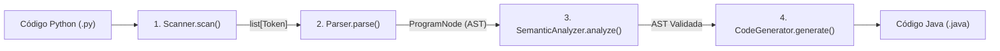

# Guia de Uso: CLI, API Python e Interface Web Local

O módulo `src/cli.py` (também acessível via `src/main.py`) atua como o **Driver** principal do compilador **PyToJava**, orquestrando a execução sequencial de todas as fases da compilação a partir da linha de comando, via API programática em Python ou por meio da interface web local (`src/web.py`).

---

## Fluxo do Pipeline de Compilação

Quando um arquivo `.py` é submetido ao driver, a função `compile_source(source_code, on_stage=None)` executa as quatro etapas clássicas do compilador em cadeia:



1. **Análise Léxica (`Scanner(source_code).scan()`)**: converte o código-fonte em tokens e processa recuos `INDENT`/`DEDENT`.
2. **Análise Sintática (`Parser(tokens).parse()`)**: constrói a Árvore Sintática Abstrata (`ProgramNode`).
3. **Análise Semântica (`SemanticAnalyzer().analyze(ast)`)**: verifica declaração de variáveis, escopos de bloco e compatibilidade estática de tipos.
4. **Geração de Código (`CodeGenerator().generate(ast)`)**: emite a classe Java formatada (`public class Main`).

Caso qualquer fase detecte uma violação (`LexicalError`, `ParserError` ou `SemanticError`), o pipeline é imediatamente interrompido e o erro é reportado com a **linha e coluna exatas**.

---

## Uso via Linha de Comando (CLI)

### Sintaxe Geral

```bash
python -m src.cli <input_file> [-o OUTPUT]
```

*(Também é possível executar `python -m src.main <input_file> [-o OUTPUT]` ou `python src/cli.py <input_file>`).*

### Argumentos Suportados

| Argumento | Obrigatório | Descrição |
| :--- | :---: | :--- |
| `input_file` | Sim | Caminho para o arquivo-fonte Python (`.py`) que será compilado. |
| `-o`, `--output` | Não | Caminho para o arquivo Java (`.java`) de saída. Quando omitido, o arquivo é salvo automaticamente em `output/<nome_do_arquivo>.java`. |
| `-h`, `--help` | Não | Exibe o resumo de ajuda e opções da interface de linha de comando. |

### Exemplos de Execução no Terminal

**1. Compilando um script com saída padrão (`output/`):**

```bash
python -m src.cli examples/basic_math.py
# Saída: Arquivo Java gerado com sucesso em: output/basic_math.java
```

**2. Especificando o caminho do arquivo `.java` de destino com `-o` / `--output`:**

```bash
python -m src.cli examples/basic_math.py -o output/Main.java
# Saída: Arquivo Java gerado com sucesso em: output/Main.java
```

---

## Uso Programático (API Python)

Além do terminal, a função `compile_source()` pode ser importada diretamente em scripts ou suítes de teste. Ela aceita opcionalmente o callback `on_stage(stage_name, status)` para monitorar o início (`"running"`) e a conclusão (`"done"`) de cada fase (`"lexer"`, `"parser"`, `"semantic"` e `"codegen"`):

```python
from src.cli import compile_source

codigo_python = """
a = 10
b = 20
if a < b:
    maior = b
else:
    maior = a
"""

eventos = []
codigo_java = compile_source(
    codigo_python,
    on_stage=lambda etapa, estado: eventos.append((etapa, estado)),
)
print(codigo_java)
```

Saída gerada:

```java
public class Main {
    public static void main(String[] args) {
        int a = 10;
        int b = 20;
        if ((a < b)) {
            int maior = b;
        } else {
            int maior = a;
        }
    }
}
```

---

## Interface Web Local (`src/web.py`)

O módulo `src/web.py` disponibiliza um servidor HTTP local (implementado exclusivamente com a biblioteca padrão `http.server.ThreadingHTTPServer`) que reutiliza `compile_source()` e transmite o progresso de cada fase do compilador em tempo real no formato **NDJSON** (`application/x-ndjson`).

### Como Iniciar o Servidor Web

```bash
python -m src.web
```

Por padrão, o servidor escuta em `http://localhost:8000` (`127.0.0.1:8000`). Caso a porta esteja ocupada, utilize `--port`:

```bash
python -m src.web --port 8001
```

### Argumentos do Servidor Web

| Argumento | Padrão | Descrição |
| :--- | :---: | :--- |
| `--port` | `8000` | Porta TCP local onde o servidor HTTP será iniciado. |
| `--host` | `127.0.0.1` | Endereço de interface local para escuta do servidor. |

### Recursos e Endpoints da Interface Web

- **Modos de Entrada (Arquivo `.py` e Editor Integrado)**: permite enviar arquivos `.py` em UTF-8 (até 1 MB) via *drag-and-drop* ou seletor de arquivos, carregar com um clique qualquer script oficial da pasta `examples/` (`GET /api/examples`) ou editar o código Python diretamente no navegador (atalho `Ctrl+Enter` para compilar).
- **Streaming de Etapas em Tempo Real (`POST /api/compile`)**: emite eventos NDJSON ordenados para `upload`, `lexer`, `parser`, `semantic` e `codegen`, atualizando a barra de progresso e o checklist visual. Em caso de erro, destaca a etapa exata que falhou com a linha e a coluna reportadas pelo compilador.
- **Visualizador de Código Java**: apresenta o `Main.java` gerado com numeração de linhas, realce de sintaxe Java, tempo de compilação, botão para cópia imediata e download de `Main.java`, além de alternância entre temas claro e escuro.
- **Segurança Local**: valida mesma origem (`Origin`), restringe leituras apenas aos assets públicos estáticos (`/`, `/app.css`, `/app.js`, `/favicon.svg`) e aplica cabeçalhos `X-Content-Type-Options: nosniff`, `X-Frame-Options: DENY` e `Referrer-Policy: no-referrer`.

---

## Tratamento Centralizado de Erros

O driver captura e formata automaticamente diagnósticos das três fases de validação, retornando código de saída `1` na CLI (ou evento `{"status": "error"}` na interface web):

| Fase | Exceção Capturada | Exemplo de Saída (`stderr` / Interface Web) |
| :--- | :--- | :--- |
| **Léxica** | `LexicalError` | `Erro Léxico [Linha 1, Coluna 8]: caractere inválido '@'` |
| **Sintática** | `ParserError` | `Erro Sintático [Linha 1, Coluna 8]: Esperado ':' ao iniciar o bloco` |
| **Semântica** | `SemanticError` | `Erro Semântico [Linha 1, Coluna 5]: Variável 'y' não declarada` |
| **Arquivo / E/S** | `FileNotFoundError` | `Erro de Arquivo: arquivo de entrada não encontrado: 'inexistente.py'` |

---

## Validação e Testes

Para executar as suítes de testes de integração do pipeline, da CLI, da interface web e a validação E2E com `javac`:

```bash
python -m pytest tests/test_compiler_pipeline.py tests/test_web.py tests/test_e2e_javac.py -v
mkdocs build --strict
```
