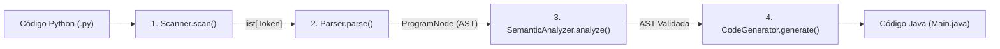
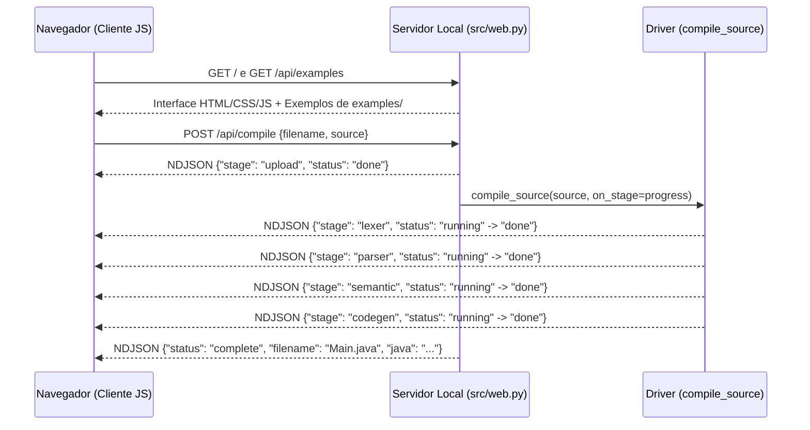

# Guia de Uso: CLI, API Python e Interface Web Local

<div class="phase-banner">
  <span class="phase-banner-title">Orquestração e Interfaces · Driver do Compilador</span>
  <span class="phase-banner-meta">src/cli.py · src/main.py · src/web.py</span>
</div>

O módulo `src/cli.py` (também acessível via `src/main.py`) atua como o **Driver** principal do compilador **PyToJava**, orquestrando a execução sequencial de todas as fases da compilação a partir da **linha de comando (CLI)**, via **API programática em Python** ou através da **Interface Web Local** (`src/web.py`).

---

## Fluxo do Pipeline de Compilação

Quando um código Python é submetido ao driver, a função `compile_source(source_code, on_stage=None)` executa as quatro etapas do compilador em cadeia e notifica o estado de cada fase:



| Ordem | Fase Acionada | Chamada Interna | Exceção em Caso de Falha |
| :---: | :--- | :--- | :--- |
| **1** | Análise Léxica (`"lexer"`) | `Scanner(source_code).scan()` | `LexicalError` |
| **2** | Análise Sintática (`"parser"`) | `Parser(tokens).parse()` | `ParserError` |
| **3** | Análise Semântica (`"semantic"`) | `SemanticAnalyzer().analyze(ast)` | `SemanticError` |
| **4** | Geração de Código (`"codegen"`) | `CodeGenerator().generate(ast)` | `ValueError` / `SemanticError` |

!!! warning "Interrupção Imediata em Caso de Erro (*Fail-Fast*)"
    Caso qualquer fase detecte uma violação (`LexicalError`, `ParserError` ou `SemanticError`), o pipeline é imediatamente interrompido, as fases seguintes **não** são executadas e nenhum arquivo `.java` parcial é gerado.

---

## 1. Uso via Linha de Comando (CLI)

### Sintaxe Geral

```bash
python -m src.cli <input_file> [-o OUTPUT]
```

*(Também é possível executar `python -m src.main <input_file> [-o OUTPUT]` ou `python src/cli.py <input_file>`).*

### Argumentos Suportados

| Argumento | Obrigatório | Descrição |
| :--- | :---: | :--- |
| `input_file` | Sim | Caminho para o arquivo-fonte Python (`.py`) que será compilado. |
| `-o`, `--output` | Não | Caminho para o arquivo Java (`.java`) de saída. Quando omitido, o arquivo é salvo automaticamente em `output/<nome_do_arquivo>.java`. |
| `-h`, `--help` | Não | Exibe o resumo de ajuda e opções da interface de linha de comando. |

### Exemplos Passo a Passo no Terminal

=== "Saída Padrão (`output/`)"

    ```bash
    python -m src.cli examples/basic_math.py
    # Saída: Arquivo Java gerado com sucesso em: output/basic_math.java
    ```

=== "Saída Customizada (`-o`) + Execução no `javac`"

    ```bash
    # 1. Transpila o script Python para Main.java
    python -m src.cli examples/calculator.py -o output/Main.java

    # 2. Compila o código Java gerado para bytecode (.class)
    javac output/Main.java

    # 3. Executa na JVM
    java -cp output Main
    ```

---

## 2. Interface Web Local (`src/web.py`)

O módulo `src/web.py` disponibiliza uma aplicação web local completa — construída apenas com a biblioteca padrão do Python (`ThreadingHTTPServer`) e HTML/CSS/JS puros — para experimentar o compilador visualmente no navegador.



### Como Iniciar o Servidor Web

```bash
# Porta padrão (http://localhost:8000)
python -m src.web

# Especificando outra porta local
python -m src.web --port 8001
```

| Argumento | Padrão | Descrição |
| :--- | :---: | :--- |
| `--port` | `8000` | Porta TCP local onde o servidor HTTP será iniciado. |
| `--host` | `127.0.0.1` | Endereço de interface local para escuta do servidor. |

### Recursos da Interface Web

- **Duplo Modo de Entrada (Arquivo `.py` e Editor Integrado)**: envie arquivos `.py` em UTF-8 (até 1 MB) via *drag-and-drop* ou seletor de arquivos, carregue qualquer script oficial de `examples/` com um clique ou edite o código diretamente no editor integrado (`Ctrl+Enter` para compilar).
- **Checklist e Barra de Progresso em Tempo Real**: acompanha os eventos NDJSON de `upload`, `lexer`, `parser`, `semantic` e `codegen`, exibindo o tempo de compilação em milissegundos ou destacando em vermelho a etapa exata que reportou erro.
- **Visualizador de Código Estilo IDE**: exibe o `Main.java` com numeração de linhas, realce de sintaxe Java, alternância entre **tema claro e escuro**, botão **Copiar código** e download direto de `Main.java`.
- **Segurança Local**: validação de mesma origem (`Origin`), cache em memória dos assets estáticos (`functools.lru_cache`) e cabeçalhos `X-Content-Type-Options: nosniff`, `X-Frame-Options: DENY` e `Referrer-Policy: no-referrer`.

---

## 3. Uso Programático (API Python)

A função `compile_source()` pode ser importada diretamente em scripts ou testes automatizados, aceitando opcionalmente o callback `on_stage(stage, status)`:

```python
from src.cli import compile_source

codigo_python = """
a = 10
b = 20
if a < b:
    maior = b
else:
    maior = a
"""

etapas: list[tuple[str, str]] = []
codigo_java = compile_source(
    codigo_python,
    on_stage=lambda etapa, estado: etapas.append((etapa, estado)),
)
print(codigo_java)
```

Saída gerada:

```java
public class Main {
    public static void main(String[] args) {
        int a = 10;
        int b = 20;
        if ((a < b)) {
            int maior = b;
        } else {
            int maior = a;
        }
    }
}
```

---

## Tratamento Centralizado de Erros

| Fase | Exceção Capturada | Exemplo de Diagnóstico (`stderr` / Interface Web) |
| :--- | :--- | :--- |
| **Léxica** | `LexicalError` | `Erro Léxico [Linha 1, Coluna 8]: caractere inválido '@'` |
| **Sintática** | `ParserError` | `Erro Sintático [Linha 1, Coluna 8]: Esperado ':' ao iniciar o bloco` |
| **Semântica** | `SemanticError` | `Erro Semântico [Linha 1, Coluna 5]: Variável 'y' não declarada` |
| **Arquivo / E/S** | `FileNotFoundError` | `Erro de Arquivo: arquivo de entrada não encontrado: 'inexistente.py'` |

---

## Validação e Testes

```bash
python -m pytest tests/test_compiler_pipeline.py tests/test_web.py tests/test_e2e_javac.py -v
mkdocs build --strict
```
