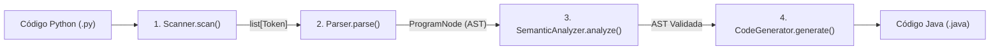

# Guia de Uso e CLI do Compilador (Driver)

O módulo `src/cli.py` (também acessível via `src/main.py`) atua como o **Driver** principal do compilador **PyToJava**, orquestrando a execução sequencial de todas as fases da compilação a partir da linha de comando ou via API programática em Python.

---

## Fluxo do Pipeline de Compilação

Quando um arquivo `.py` é submetido ao driver, a função `compile_source(source_code)` executa as quatro etapas clássicas do compilador em cadeia:



1. **Análise Léxica (`Scanner(source_code).scan()`)**: converte o código-fonte em tokens e processa recuos `INDENT`/`DEDENT`.
2. **Análise Sintática (`Parser(tokens).parse()`)**: constrói a Árvore Sintática Abstrata (`ProgramNode`).
3. **Análise Semântica (`SemanticAnalyzer().analyze(ast)`)**: verifica declaração de variáveis, escopos de bloco e compatibilidade estática de tipos.
4. **Geração de Código (`CodeGenerator().generate(ast)`)**: emite a classe Java formatada (`public class Main`).

Caso qualquer fase detecte uma violação (`LexicalError`, `ParserError` ou `SemanticError`), o pipeline é imediatamente interrompido e o erro é reportado no `stderr` com a **linha e coluna exatas**.

---

## Uso via Linha de Comando (CLI)

### Sintaxe Geral

```bash
python -m src.cli <input_file> [-o OUTPUT]
```

*(Também é possível executar `python -m src.main <input_file> [-o OUTPUT]` ou `python src/cli.py <input_file>`).*

### Argumentos Suportados

| Argumento | Obrigatório | Descrição |
| :--- | :---: | :--- |
| `input_file` | Sim | Caminho para o arquivo-fonte Python (`.py`) que será compilado. |
| `-o`, `--output` | Não | Caminho para o arquivo Java (`.java`) de saída. Quando omitido, o arquivo é salvo automaticamente em `output/<nome_do_arquivo>.java`. |
| `-h`, `--help` | Não | Exibe o resumo de ajuda e opções da interface de linha de comando. |

### Exemplos de Execução no Terminal

**1. Compilando um script com saída padrão (`output/`):**

```bash
python -m src.cli examples/basic_math.py
# Saída: Arquivo Java gerado com sucesso em: output/basic_math.java
```

**2. Especificando o caminho do arquivo `.java` de destino com `-o` / `--output`:**

```bash
python -m src.cli examples/basic_math.py -o output/Main.java
# Saída: Arquivo Java gerado com sucesso em: output/Main.java
```

---

## Uso Programático (API Python)

Além do terminal, a função `compile_source()` pode ser importada diretamente em scripts ou suítes de teste:

```python
from src.cli import compile_source

codigo_python = """
a = 10
b = 20
if a < b:
    maior = b
else:
    maior = a
"""

codigo_java = compile_source(codigo_python)
print(codigo_java)
```

Saída gerada:

```java
public class Main {
    public static void main(String[] args) {
        int a = 10;
        int b = 20;
        if ((a < b)) {
            int maior = b;
        } else {
            int maior = a;
        }
    }
}
```

---

## Tratamento Centralizado de Erros

A CLI captura e formata automaticamente diagnósticos das três fases de validação, retornando código de saída `1`:

| Fase | Exceção Capturada | Exemplo de Saída no Terminal (`stderr`) |
| :--- | :--- | :--- |
| **Léxica** | `LexicalError` | `Erro Léxico [Linha 1, Coluna 8]: caractere inválido '@'` |
| **Sintática** | `ParserError` | `Erro Sintático [Linha 1, Coluna 8]: Esperado ':' ao iniciar o bloco` |
| **Semântica** | `SemanticError` | `Erro Semântico [Linha 1, Coluna 5]: Variável 'y' não declarada` |
| **Arquivo / E/S** | `FileNotFoundError` | `Erro de Arquivo: arquivo de entrada não encontrado: 'inexistente.py'` |

---

## Validação e Testes

Para executar a suíte de testes de integração do pipeline e da CLI:

```bash
pytest tests/test_compiler_pipeline.py -v
mkdocs build --strict
```
